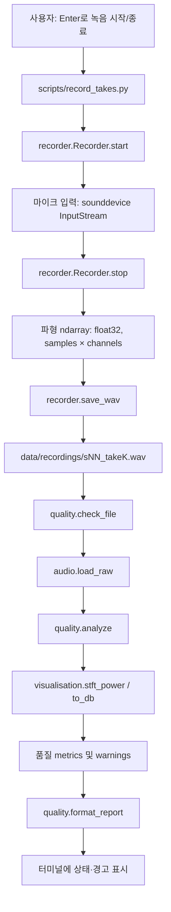
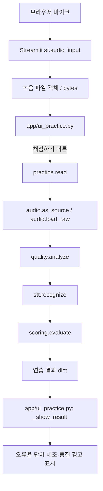
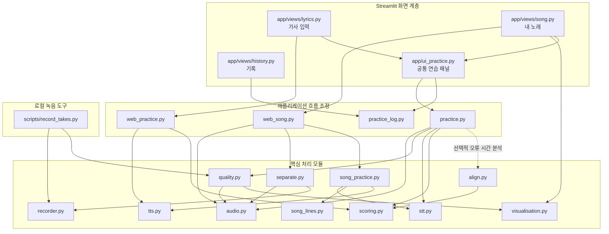
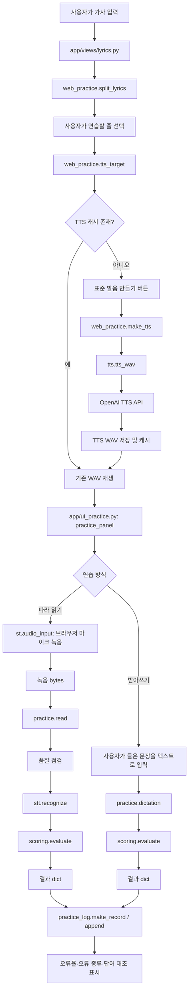
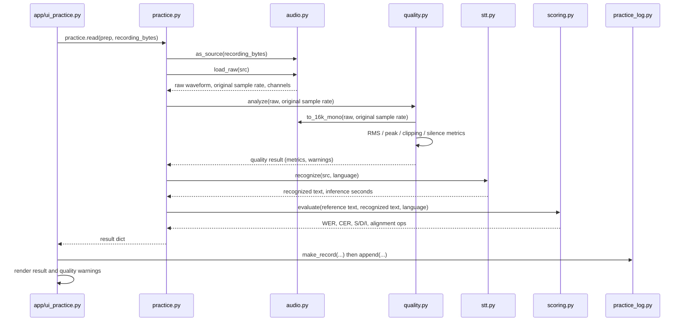
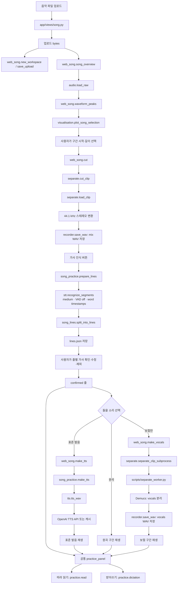
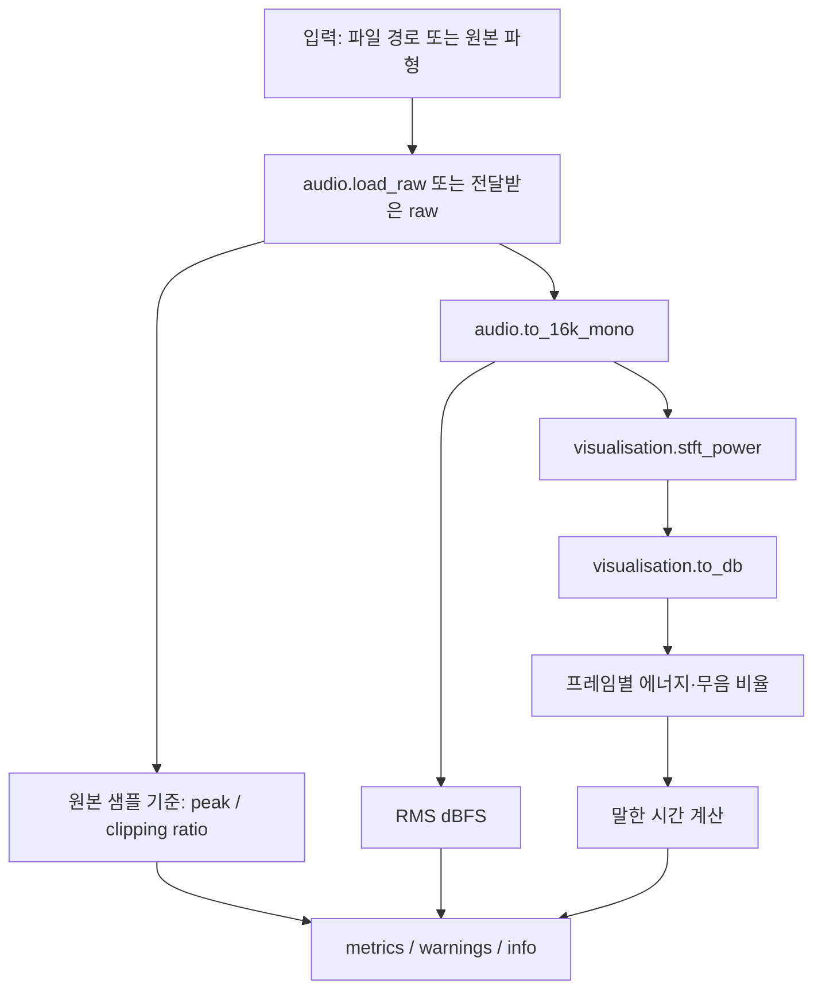
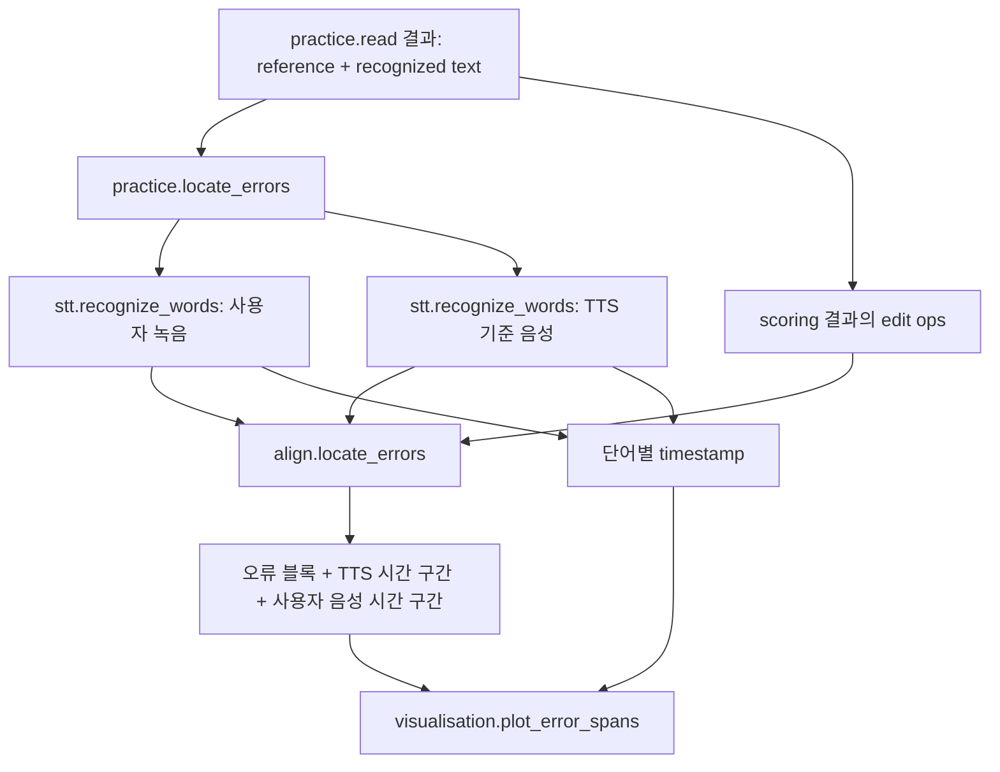

# SongLingo — 모듈 호출 관계와 데이터 흐름

> **목적**: 새 모듈이 추가되거나 기존 호출 순서가 바뀌어도 구조를 쉽게 갱신할 수 있도록, 기능별 호출 관계·데이터 전달 형태·모듈 책임을 한곳에 기록한다.
>
> **기준 소스**: `greenkey20/song-lingo` 저장소 `main` 브랜치, 2026-11-05 확인. 실행 흐름은 현재 코드 기준이며, 계획서에만 있는 기능은 별도로 표시한다.
>
> **갱신 방법**: Mermaid 코드 블록의 노드·화살표를 수정하면 된다. GitHub Markdown에서는 Mermaid 다이어그램이 렌더링된다. VS Code에서는 Mermaid 미리보기를 지원하는 Markdown 확장으로 확인할 수 있다.

---

## 0. 먼저 바로잡을 점: `recorder.py` 다음에 항상 `quality.py`가 호출되는가?

**아니야. 호출 주체와 실행 환경에 따라 달라.** `recorder.py`가 `quality.py`를 직접 import하거나 호출하는 구조가 아니다. 두 모듈을 순서대로 부르는 것은 로컬 녹음 스크립트인 `scripts/record_takes.py`다.

### A. 로컬 터미널에서 녹음하는 경우

`record_takes.py`가 마이크 녹음과 품질 점검을 순서대로 조정한다.

이 경로에서는 네가 예상한 동작이 맞아. **녹음 파일 저장 직후 품질 점검이 실행되고, 점검 결과가 콘솔에 표시돼.** 다만 그 순서를 정하는 코드는 `recorder.py`가 아니라 `scripts/record_takes.py`의 `record_one()`이야.

### B. Streamlit 웹 앱에서 따라 읽는 경우

웹 앱은 `recorder.py`의 `Recorder`를 호출하지 않는다. 브라우저 마이크를 Streamlit의 `st.audio_input()`이 수집한다.

웹 경로의 실행 순서는 **`practice.read()` 안에서 품질 점검 → STT → 채점**이야. 품질 경고는 결과 표시를 위한 안내이며, `quality.py`의 경고만으로 STT를 중단하지 않아.

### C. `recorder.py`가 다른 곳에서 사용되는 경우

`recorder.py`는 마이크 녹음기 역할만 하는 게 아니야. `save_wav()`는 파형을 WAV 파일로 저장하는 공용 함수이기도 해. 현재 `separate.py`가 잘라낸 원곡 구간과 Demucs 보컬 결과를 저장할 때도 `recorder.save_wav()`를 사용해.

따라서 코드에서 `recorder.py`가 호출됐다고 해서 반드시 마이크 녹음이 일어났다고 볼 수는 없어. **`Recorder.start()/stop()` 호출인지, `save_wav()` 호출인지 구분해야 해.**

---

## 1. 전체 시스템 지도

이 다이어그램은 애플리케이션의 큰 기능 경로를 보여 준다. 세부 순서는 아래 2~4절을 기준으로 확인한다.

**화살표 해석**
- 실선: 현재 코드에서 실제 호출 관계가 확인되는 경로
- 점선: 모듈과 함수는 구현되어 있지만 현재 Streamlit 연습 UI의 기본 채점 경로에는 연결되지 않은 선택 기능
- `UI`는 화면·사용자 이벤트를 담당하고, `FLOW`는 여러 처리 모듈을 순서대로 호출하며, `CORE`는 구체적인 계산·파일·모델 작업을 담당한다.

---

## 2. 가사 입력 모드 — 따라 읽기

사용자가 직접 입력하거나 붙여 넣은 가사를 한 줄씩 연습하는 경로다.

### 따라 읽기 버튼을 눌렀을 때의 실제 내부 순서

**중요한 세부사항**
1. 웹 녹음 입력은 bytes로 전달된다. `practice.read()`가 `audio.load_raw()`로 품질 점검용 파형을 준비한다.
2. `quality.analyze()`는 `audio.to_16k_mono()`와 `visualisation.stft_power()` 등을 이용해 측정한다.
3. STT에는 품질 점검을 위해 만든 16 kHz 배열이 아니라 원본 `src`(bytes/파일 객체)를 넘긴다. 저장소 주석에 따르면 노래 입력에서 직접 변환한 배열과 faster-whisper가 파일에서 디코딩한 결과가 달라질 수 있기 때문이야.
4. 품질 경고가 있어도 현재 코드는 STT와 채점을 계속한다.
5. 채점 이후 `app/ui_practice.py`가 결과를 표시하고, 성공한 결과는 `practice_log.py`로 저장한다.

### 받아쓰기 모드의 차이

받아쓰기는 마이크 녹음이 아니므로 `recorder.py`, `audio.py`, `quality.py`, `stt.py`를 거치지 않아.

`사용자 입력 문자열 → practice.dictation() → scoring.evaluate() → 결과 표시 및 practice_log 저장`

---

## 3. 내 노래 모드 — 업로드부터 연습까지

사용자가 음악 파일을 올리고 구간을 골라 가사를 인식·수정한 뒤, 해당 줄을 연습하는 경로다.

**내 노래 경로에서 기억할 점**
- 업로드한 음악 파일은 가사 추출을 위해 `audio.py`와 `stt.py`를 거치지만, 현재 `quality.py`의 녹음 품질 점검 흐름은 거치지 않아. `quality.py`는 공통 연습 패널에서 사용자가 따라 읽은 발화를 점검하는 용도야.
- 가사 추출에는 `stt.recognize_segments()`가 호출되고, 모델 크기는 `song_practice.SONG_MODEL = "medium"`으로 지정돼 있다.
- 인식된 STT segment를 `song_lines.py`가 줄 단위로 쪼개거나 합친다. 이 단계는 AI 모델 추론이 아니라 시간·단어 수·쉼 길이에 기반한 규칙 기반 처리야.
- 가사 후보는 사용자가 확인·수정해야 연습 대상으로 확정된다.
- 보컬 분리는 선택 기능이다. 가사 인식은 현재 설계상 원곡에 대해 실행하며, 보컬 분리는 듣기 보조용으로 별도 실행한다.
- `recorder.save_wav()`가 mix/vocals 파일 저장에 재사용되지만, 이 경로에서 `Recorder.start()/stop()`으로 마이크 녹음을 하는 것은 아니다.

---

## 4. 품질 점검·오류 위치 분석·시각화의 호출 범위

### `quality.py`의 내부 처리

`quality.py`는 **잡음 분류기나 발음 평가기가 아니야.** 현재 계산하는 것은 길이, RMS, 최대 진폭, 클리핑 비율, 무음 비율, 추정 말한 시간 등 녹음 입력의 상태 지표야. 기준을 벗어나면 경고를 반환하지만 현재 `practice.read()`는 이 경고만으로 인식 실행을 차단하지 않아.

### `align.py`와 오류 구간 시각화

**현재 연결 상태**: `practice.locate_errors()`, `align.py`, `visualisation.plot_error_spans()`는 구현돼 있어. 하지만 확인한 현재 Streamlit의 `app/ui_practice.py` 결과 화면은 WER/CER·단어 대조·녹음 재생을 보여 주며, `practice.locate_errors()`를 호출해 오류 시간 구간 그림을 렌더링하지는 않아. 즉, **모듈 구현 완료와 웹 UI 연결 완료는 다른 상태**야.

### `visualisation.py`의 현재 사용처 요약

| 함수·기능                  | 현재 호출하는 곳                                     | 목적                                                                 |
| -------------------------- | ---------------------------------------------------- | -------------------------------------------------------------------- |
| `stft_power()` / `to_db()` | `quality.py`                                         | 무음 프레임 에너지 산출                                              |
| `plot_song_selection()`    | `app/views/song.py`                                  | 업로드한 곡에서 구간 선택을 위한 파형 개요                           |
| `plot_sound_pair()`        | 실험·노트북 경로                                     | TTS와 사용자 음성의 파형·STFT·Log-Mel 비교                           |
| `plot_error_spans()`       | `practice.locate_errors()` 결과와 결합하는 분석 경로 | 오류 블록이 표시된 음성 비교 그림; 현재 기본 웹 결과 화면에는 미연결 |

---

## 5. 핵심 모듈의 호출 관계 요약

| 상위 호출자                         | 호출되는 모듈·함수                                         | 입력 → 출력                            | 현재 제품 경로        |
| ----------------------------------- | ---------------------------------------------------------- | -------------------------------------- | --------------------- |
| `scripts/record_takes.py`           | `recorder.Recorder.start/stop`, `recorder.save_wav`        | 마이크 입력 → WAV 경로                 | 로컬 녹음 데이터 생성 |
| `scripts/record_takes.py`           | `quality.check_file`, `quality.format_report`              | WAV 경로 → 품질 결과·문자열            | 로컬 녹음 직후 점검   |
| `practice.read()`                   | `audio.as_source`, `audio.load_raw`                        | bytes/파일 → 원본 파형                 | 따라 읽기             |
| `practice.read()`                   | `quality.analyze` 또는 `quality.check_file`                | 원본 파형/파일 → 상태 지표             | 따라 읽기             |
| `practice.read()`                   | `stt.recognize`                                            | 원본 음성 → 인식 텍스트                | 따라 읽기             |
| `practice.read()` / `dictation()`   | `scoring.evaluate`                                         | 정답·인식/입력 문장 → WER/CER·edit ops | 두 연습 방식          |
| `practice.locate_errors()`          | `stt.recognize_words`, `align.locate_errors`               | 단어별 시간·채점 결과 → 오류 시간 블록 | 선택적 분석 기능      |
| `app/views/song.py` → `web_song.py` | `audio.load_raw`, `waveform_peaks`                         | 업로드 음성 → 파형 개요                | 내 노래               |
| `web_song.cut()`                    | `separate.cut_clip`, `audio.load_raw`, `recorder.save_wav` | 원곡·시작·길이 → mix WAV               | 내 노래               |
| `song_practice.prepare_lines()`     | `stt.recognize_segments`, `song_lines.split_into_lines`    | mix WAV → segment → 가사 줄 후보       | 내 노래               |
| `web_song.make_vocals()`            | `separate.separate_clip_subprocess`, Demucs                | mix WAV → vocals WAV                   | 선택적 보컬 듣기      |
| `web_song.make_tts()`               | `song_practice.make_tts`, `tts.tts_wav`                    | 확정 가사 → 표준 발음 WAV              | 내 노래               |
| `app/ui_practice.py`                | `practice_log.make_record`, `append`                       | 채점 결과 → CSV 한 행                  | 연습 기록             |
| `app/views/history.py`              | `practice_log.read_all`, Pandas                            | CSV → 기록 표·WER 추이                 | 기록                  |

---

## 6. 핵심 라이브러리 — 모듈과 연결해서 보기

| 라이브러리        | 사용 영역        | 대표 파일                                                   | 실제 역할                                                             |
| ----------------- | ---------------- | ----------------------------------------------------------- | --------------------------------------------------------------------- |
| NumPy             | 배열·수치 연산   | `audio.py`, `quality.py`, `visualisation.py`, `separate.py` | 파형, 행렬, 수치 계산                                                 |
| SciPy             | 신호 처리        | `audio.py`, `visualisation.py`, `separate.py`               | WAV 읽기, Polyphase Resampling, STFT                                  |
| PyAV (`av`)       | 미디어 디코딩    | `audio.py`                                                  | MP3/M4A/WebM 등 오디오 디코딩                                         |
| faster-whisper    | 음성 인식        | `stt.py`                                                    | Whisper 모델 추론                                                     |
| CTranslate2       | 추론 엔진        | faster-whisper 내부                                         | 효율적인 Whisper 추론 실행                                            |
| PyTorch           | 딥러닝 실행      | Demucs 실행 환경                                            | Demucs 모델 실행                                                      |
| Demucs            | 음원 분리 모델   | `separate.py`                                               | 보컬·드럼·베이스·기타/기타 소리 분리                                  |
| OpenAI Python SDK | 외부 AI API      | `tts.py`                                                    | TTS 음성 생성                                                         |
| Matplotlib        | 시각화           | `visualisation.py`                                          | 파형·스펙트로그램·Log-Mel 그림                                        |
| Streamlit         | 웹 UI            | `app/`                                                      | 파일 업로드, 브라우저 녹음, 버튼, 세션 상태, 결과 표시                |
| Pandas            | 표·기록          | `app/views/history.py`, `clip_compare.py`                   | CSV/실험 결과 분석                                                    |
| sounddevice       | 로컬 마이크 입력 | `recorder.py`                                               | 로컬 마이크 스트림 수집; Streamlit 브라우저 녹음 경로는 사용하지 않음 |
| python-dotenv     | 환경 설정        | `app/streamlit_app.py`                                      | `.env`에서 환경변수 로드                                              |

---

## 7. 아직 구현되지 않았거나 제품 경로에 연결되지 않은 로직

상태는 현재 저장소 코드와 개발 계획서 기준이다.

| 기능                                         | 현재 상태                      | 구현 예정 위치·관련 기술                                 | 비고                                                           |
| -------------------------------------------- | ------------------------------ | -------------------------------------------------------- | -------------------------------------------------------------- |
| 문장 뜻·연관 단어·표현 설명                  | 미구현                         | 신규 `explain.py`, OpenAI Chat API                       | 결과 직접 검수 필요                                            |
| 전용 플레이어 제어                           | 미구현/축소                    | 계획상 `player.py`, HTML Audio                           | 현재는 Streamlit 기본 오디오 플레이어 사용                     |
| 일본어 등 다국어 end-to-end 지원             | 부분 구현                      | `stt.py`, `tts.py`, `scoring.py`                         | 정규화 일부 분기는 있으나 앱 전 흐름이 다국어 완성 상태는 아님 |
| Whisper confidence와 실제 오류율의 관계 분석 | 미구현                         | `stt.py`, `clip_compare.py`, 실험 분석 코드              | 기존 `low_confidence`는 휴리스틱 표시이지 통계 검증이 아님     |
| Log-Mel 기반 녹음 품질 분류기                | 미구현·선택 과제               | 신규 DNN/CNN, TensorFlow/Keras                           | 현재 `quality.py`의 규칙 기반 점검과 별개                      |
| SNR별 잡음 견고성 실험                       | 미구현·선택 과제               | 오디오 잡음 합성, STT, WER/CER                           | 합성 잡음 조건에서의 실험                                      |
| 오류 위치 그림의 Streamlit 통합              | 알고리즘 구현, UI 미연결       | `practice.locate_errors`, `align.py`, `visualisation.py` | 현재 기본 UI는 오류 단어 대조까지                              |
| TTS·사용자 녹음의 스펙트로그램 비교 UI       | 계산·그림 함수 구현, UI 미연결 | `visualisation.plot_sound_pair()`                        | History 화면에 연결되지 않음                                   |
| 줄 단위 보컬 파일 생성                       | 미구현                         | `song_practice.py`, `separate.py` 확장                   | 현재는 전체 구간 보컬 WAV를 시간 범위로 재생                   |
| Sound-to-Visual / 의미 기반 애니메이션       | 공식 계획서상 확정 기능 아님   | 향후 별도 실험 설계                                      | 아이디어 단계로만 취급                                         |

---

## 8. 새 모듈이 생길 때 이 문서를 갱신하는 규칙

새 파일을 만들거나 기존 모듈의 역할이 바뀌면 아래 순서로 반영한다.

1. **책임을 한 문장으로 기록**: 이 모듈이 무엇을 입력받아 무엇을 반환하는가?
2. **호출자를 기록**: 어느 파일의 어느 함수가 이 모듈을 호출하는가?
3. **호출 대상을 기록**: 이 모듈이 다시 어떤 모듈·라이브러리를 호출하는가?
4. **데이터 타입을 표시**: 파일 경로, bytes, NumPy 배열, 문자열, dict, DataFrame 중 무엇이 이동하는가?
5. **다이어그램 갱신**: 해당 기능별 다이어그램과 5절 호출 관계 표를 함께 수정한다.
6. **상태를 구분**: 구현됨 / 구현됐지만 UI 미연결 / 실험용 / 계획만 있음 중 하나로 표시한다.
7. **테스트 연결**: 새 알고리즘은 대응하는 `tests/test_*.py`를 함께 기록한다.

### 모듈 추가 기록 템플릿

| 항목                   | 기록                                        |
| ---------------------- | ------------------------------------------- |
| 파일·함수              | `예: explain.py / explain_line()`           |
| 책임                   | 입력을 받아 수행하는 일                     |
| 호출자                 | `예: app/views/lyrics.py → web_practice.py` |
| 피호출 모듈·라이브러리 | 내부에서 호출하는 모듈/API                  |
| 입력 데이터            | 경로 / bytes / ndarray / 문자열 / dict 등   |
| 출력 데이터            | 반환 타입과 주요 필드                       |
| 상태                   | 구현됨 / UI 미연결 / 실험용 / 계획          |
| 테스트                 | `tests/test_*.py`                           |

---

## 9. 우선 읽기 순서

1. `recorder.py`와 `scripts/record_takes.py` — 녹음이 어디서 시작되고 품질 검사가 누가 호출하는지
2. `audio.py`와 `quality.py` — 파일·파형 변환과 입력 상태 계산
3. `stt.py` — Whisper 호출과 인식 결과 구조
4. `scoring.py` — 정규화, 편집 거리 DP, WER/CER
5. `practice.py` — 위 모듈들이 어떤 순서로 결합되는지
6. `app/ui_practice.py`와 `app/views/lyrics.py` — 실제 웹 버튼과 핵심 함수가 연결되는 위치
7. `song_lines.py`와 `song_practice.py` — 노래 STT 결과가 연습용 줄이 되는 과정
8. `separate.py`와 `scripts/separate_worker.py` — Demucs 실행과 subprocess 구조
9. `align.py`와 `visualisation.py` — 오류 위치 추정 및 신호 시각화
10. `web_song.py`, `practice_log.py`, `app/views/history.py` — 파일 생명주기와 기록

---

## 10. 관련 소스 파일 바로가기

- [README.md](https://github.com/greenkey20/song-lingo/blob/main/README.md)
- [CLAUDE.md](https://github.com/greenkey20/song-lingo/blob/main/CLAUDE.md)
- [프로젝트 개발 계획서](https://github.com/greenkey20/song-lingo/blob/main/docs/%ED%94%84%EB%A1%9C%EC%A0%9D%ED%8A%B8%20%EA%B0%9C%EB%B0%9C%20%EA%B3%84%ED%9A%8D%EC%84%9C_20261030.md)
- [recorder.py](https://github.com/greenkey20/song-lingo/blob/main/recorder.py)
- [scripts/record_takes.py](https://github.com/greenkey20/song-lingo/blob/main/scripts/record_takes.py)
- [audio.py](https://github.com/greenkey20/song-lingo/blob/main/audio.py)
- [quality.py](https://github.com/greenkey20/song-lingo/blob/main/quality.py)
- [stt.py](https://github.com/greenkey20/song-lingo/blob/main/stt.py)
- [scoring.py](https://github.com/greenkey20/song-lingo/blob/main/scoring.py)
- [align.py](https://github.com/greenkey20/song-lingo/blob/main/align.py)
- [practice.py](https://github.com/greenkey20/song-lingo/blob/main/practice.py)
- [song_lines.py](https://github.com/greenkey20/song-lingo/blob/main/song_lines.py)
- [song_practice.py](https://github.com/greenkey20/song-lingo/blob/main/song_practice.py)
- [separate.py](https://github.com/greenkey20/song-lingo/blob/main/separate.py)
- [visualisation.py](https://github.com/greenkey20/song-lingo/blob/main/visualisation.py)
- [web_song.py](https://github.com/greenkey20/song-lingo/blob/main/web_song.py)
- [web_practice.py](https://github.com/greenkey20/song-lingo/blob/main/web_practice.py)
- [app/ui_practice.py](https://github.com/greenkey20/song-lingo/blob/main/app/ui_practice.py)
- [app/views/song.py](https://github.com/greenkey20/song-lingo/blob/main/app/views/song.py)
- [app/views/lyrics.py](https://github.com/greenkey20/song-lingo/blob/main/app/views/lyrics.py)
- [app/views/history.py](https://github.com/greenkey20/song-lingo/blob/main/app/views/history.py)
