# SongLingo — 모듈 호출 관계와 데이터 흐름

> **목적**: 새 모듈이 추가되거나 기존 호출 순서가 바뀌어도 구조를 쉽게 갱신할 수 있도록, 기능별 호출 관계·데이터 전달 형태·모듈 책임을 한곳에 기록한다.
>
> **기준 소스**: `greenkey20/song-lingo` 저장소 `main` 브랜치. 2026-11-05 판을 **2026-11-09에 갱신**했다(서버 로그인·저장, 내 문장 묶음, 저장된 곡, 줄 합치기, 언어 확인, 한글 뜻·표현 설명, 일본어 읽기, Azure 발음 평가 반영). 실행 흐름은 현재 코드 기준이며, 계획서에만 있는 기능은 별도로 표시한다.
>
> **갱신 이력**: 11-05 최초(ChatGPT 검토본) → 11-09 서버 저장·화면 연결·새 모듈 반영(Claude Code) → **11-10 F0(목소리 높낮이) 분석과 따라읽기 결과 화면 개편 반영**(이슈 #82). 새 절은 **4-2(로그인·저장)**, **4-3(한글 뜻·표현 설명)**, **4-4(F0 억양 비교)**. → **11-11 점검**: 7절 끝에 남아 있던 **옛 표 조각**("미구현"·"UI 미연결"로 적혀 7-1과 모순이던 행들)을 지우고, 7절에 구조 탐구 노트북·발표 장표 그림 항목을 보강했다. 코드는 11-10 이후 바뀐 모듈이 없다.
>
> **갱신 방법**: Mermaid 코드 블록의 노드·화살표를 수정하면 된다. GitHub Markdown에서는 Mermaid 다이어그램이 렌더링된다. VS Code에서는 Mermaid 미리보기를 지원하는 Markdown 확장으로 확인할 수 있다.

---

## 0. 먼저 바로잡을 점: `recorder.py` 다음에 항상 `quality.py`가 호출되는가?

**아니야. 호출 주체와 실행 환경에 따라 달라.** `recorder.py`가 `quality.py`를 직접 import하거나 호출하는 구조가 아니다. 두 모듈을 순서대로 부르는 것은 로컬 녹음 스크립트인 `scripts/record_takes.py`다.

### A. 로컬 터미널에서 녹음하는 경우

`record_takes.py`가 마이크 녹음과 품질 점검을 순서대로 조정한다.

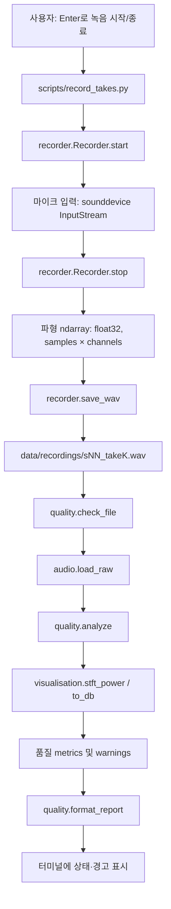

이 경로에서는 네가 예상한 동작이 맞아. **녹음 파일 저장 직후 품질 점검이 실행되고, 점검 결과가 콘솔에 표시돼.** 다만 그 순서를 정하는 코드는 `recorder.py`가 아니라 `scripts/record_takes.py`의 `record_one()`이야.

### B. Streamlit 웹 앱에서 따라읽는 경우

웹 앱은 `recorder.py`의 `Recorder`를 호출하지 않는다. 브라우저 마이크를 Streamlit의 `st.audio_input()`이 수집한다.

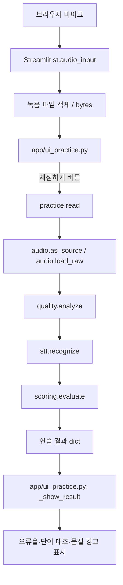

웹 경로의 실행 순서는 **`practice.read()` 안에서 품질 점검 → STT → 채점**이야. 품질 경고는 결과 표시를 위한 안내이며, `quality.py`의 경고만으로 STT를 중단하지 않아.

### C. `recorder.py`가 다른 곳에서 사용되는 경우

`recorder.py`는 마이크 녹음기 역할만 하는 게 아니야. `save_wav()`는 파형을 WAV 파일로 저장하는 공용 함수이기도 해. 현재 `separate.py`가 잘라낸 원곡 구간과 Demucs 보컬 결과를 저장할 때도 `recorder.save_wav()`를 사용해.

따라서 코드에서 `recorder.py`가 호출됐다고 해서 반드시 마이크 녹음이 일어났다고 볼 수는 없어. **`Recorder.start()/stop()` 호출인지, `save_wav()` 호출인지 구분해야 해.**

---

## 1. 전체 시스템 지도

이 다이어그램은 애플리케이션의 큰 기능 경로를 보여 준다. 세부 순서는 아래 2~4절을 기준으로 확인한다.

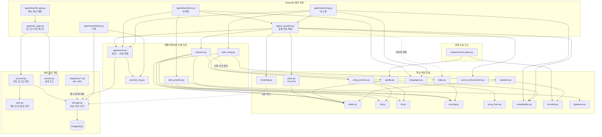

**화살표 해석**
- 실선: 현재 코드에서 실제 호출 관계가 확인되는 경로
- 점선: 조건부·보조 경로(오류 구간 분석은 따라읽기 결과 아래에 표시되고, 마이그레이션은 앱이 시작할 때 한 번 적용되며, 한글 뜻 캐시는 DB가 켜져 있을 때만 DB를 쓴다)
- `UI`는 화면·사용자 이벤트를 담당하고, `FLOW`는 여러 처리 모듈을 순서대로 호출하며, `CORE`는 구체적인 계산·파일·모델 작업을, `STORE`는 **사용자별 서버 저장**(계정·로그인 유지·구간·문장 묶음·줄·연습 기록)을 담당한다.
- **화면 계층은 위젯 배치만 한다.** 계산은 루트 모듈, 저장은 `persist.py`(화면 ↔ 저장 연결) → `storage.py`(SQL)가 한다. 자세한 흐름은 4-2절.

---

## 2. 내 문장 모드 (옛 이름: 가사 입력) — 언어 확인부터 연습·저장까지

사용자가 직접 입력하거나 붙여 넣은 문장·가사를 **줄마다 언어를 확인한 뒤** 한 줄씩 연습하는 경로다(11-05에 메뉴 이름을 "가사 입력"에서 "내 문장"으로 바꿨다, 파일은 `app/views/lyrics.py` 그대로). 입력창 하나의 내용 전체가 **문장 묶음 하나**로 서버에 저장된다(4-2절).

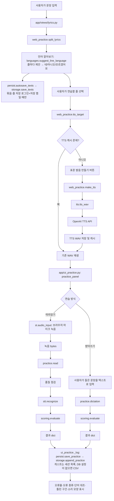

### 따라읽기 버튼을 눌렀을 때의 실제 내부 순서

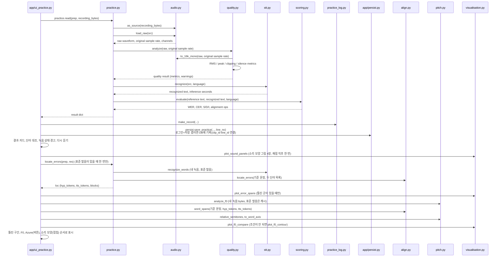

**중요한 세부사항**
1. 웹 녹음 입력은 bytes로 전달된다. `practice.read()`가 `audio.load_raw()`로 품질 점검용 파형을 준비한다.
2. `quality.analyze()`는 `audio.to_16k_mono()`와 `visualisation.stft_power()` 등을 이용해 측정한다.
3. STT에는 품질 점검을 위해 만든 16 kHz 배열이 아니라 원본 `src`(bytes/파일 객체)를 넘긴다. 저장소 주석에 따르면 노래 입력에서 직접 변환한 배열과 faster-whisper가 파일에서 디코딩한 결과가 달라질 수 있기 때문이야.
4. 품질 경고가 있어도 현재 코드는 STT와 채점을 계속한다.
5. 채점 이후 `app/ui_practice.py`가 결과를 표시하고, 성공한 결과는 `practice_log.make_record`로 기록 한 줄을 만든 뒤 **`persist.save_practice`가 서버 DB에 저장**한다(문장 글·인식문·점수 포함). 게스트는 이번 세션의 목록에만, DB 설정이 없는 개발 환경은 CSV에 남긴다.
6. 채점 직후 `app/ui_practice.py`는 **단어별 시간을 `practice.locate_errors`로 한 번만** 구해(표준 발음이 있을 때, 틀린 곳이 없어도) 틀린 구간 그림과 **F0 비교가 함께 쓴다**(인식 2회를 두 번 돌리지 않으려고). 결과는 위에서 아래로 **문장 인식 일치도 → 단어 대조 → 다시 듣기 → 틀린 구간 표시 → 목소리 높낮이 F0 → Azure 발음 평가 → 소리 모양 자세히 보기(접힘)** 순서다. F0 분석은 채점과 별개의 참고 분석이라 실패해도 나머지 결과는 그대로 보인다. **Azure 발음 평가**는 사용자가 버튼을 눌렀을 때만 `azure_pronunciation.assess`로 녹음을 보내고(자동 전송 없음), 결과는 `persist.save_azure`가 저장한다. 결과 아래 "인식에 N초 걸림"은 `stt.recognize`가 잰 인식 계산 시간(녹음 길이가 아님)이다.

### 받아쓰기 모드의 차이

받아쓰기는 마이크 녹음이 아니므로 `recorder.py`, `audio.py`, `quality.py`, `stt.py`를 거치지 않아.

`사용자 입력 문자열 → practice.dictation() → scoring.evaluate() → 결과 표시 및 persist.save_practice 저장`

**언어 알아보기는 입력에 따라 방식이 다르다**(11-12 정리, 검토 문서 16.14-보충): 텍스트(내 문장)는 `languages.suggest_line_language`의 **파이썬 규칙**(글자 종류 세기 + 라틴 문자는 낱말·특징 글자 점수, 모델 호출 없음, 한자만 있으면 제안 불가), 소리(내 노래)는 `stt.detect_language`의 **Whisper 언어 감지**(앞 30초, **STT보다 먼저**, 지원 11개 안에서 재순위). 둘 다 제안일 뿐이고 사용자 확인이 `languages.stt_options`·TTS·채점·Azure 로캘을 정한다.

**일본어·중국어**는 공백이 없어 단어(WER) 대신 글자(CER)를 주 지표로 보고, 일본어는 `japanese.py`(pykakasi)가 한자·가타카나를 히라가나 읽기와 로마자로 바꿔 기준·인식을 읽기로 채점한다(`web_practice.apply_japanese_reading`).

---

## 3. 내 노래 모드 — 업로드부터 연습까지

사용자가 음악 파일을 올리고 구간을 골라 가사를 인식·수정한 뒤, 해당 줄을 연습하는 경로다.

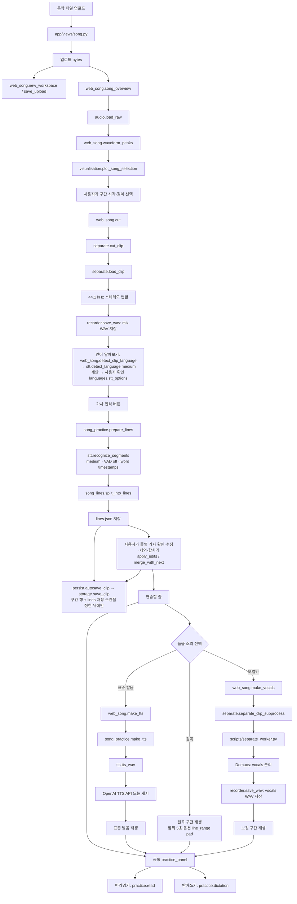

**내 노래 경로에서 기억할 점**
- **언어를 먼저 확인한다**: 구간을 정한 뒤 `stt.detect_language`가 앱이 지원하는 언어 안에서 확률 순위를 매겨 **제안**하고, 사용자가 네/아니오(+선택)/모르겠어요로 확인한다. 그 답이 가사 인식의 `language`·`multilingual` 옵션을 정한다(`languages.stt_options`).
- **줄 확인·수정**: 가사 글 수정(`apply_edits`, 처음 인식한 글 `stt_text`는 보존), 연습에서 빼기, **다음 줄과 합치기**(`song_practice.merge_with_next`: 글·시간·segment를 합치고 줄 번호는 다시 매기지 않음). **줄 나누기 UI는 없다**(자동 나누기는 인식 때 `song_lines`가 한다).
- **저장**: 구간을 정하면 구간 행(`clips`)과 줄(`lines`)이 서버에 저장되고(로그인+저장 켬일 때만), **음원·잘라 낸 wav·보컬은 저장하지 않는다.** 같은 곡의 다른 구간은 따로 저장된다(4-2절). 같은 파일을 다시 올리면 "저장된 구간·가사 불러오기", 소리 없이 이어 쓰려면 입력 방식 "저장된 곡".
- 업로드한 음악 파일은 가사 추출을 위해 `audio.py`와 `stt.py`를 거치지만, 현재 `quality.py`의 녹음 품질 점검 흐름은 거치지 않아. `quality.py`는 공통 연습 패널에서 사용자가 따라읽은 발화를 점검하는 용도야.
- 가사 추출에는 `stt.recognize_segments()`가 호출되고, 모델 크기는 `song_practice.SONG_MODEL = "medium"`으로 지정돼 있다.
- 인식된 STT segment를 `song_lines.py`가 줄 단위로 쪼개거나 합친다. 이 단계는 AI 모델 추론이 아니라 시간·단어 수·쉼 길이에 기반한 규칙 기반 처리야.
- 가사 후보는 사용자가 확인·수정해야 연습 대상으로 확정된다.
- 보컬 분리는 선택 기능이다. 가사 인식은 현재 설계상 원곡에 대해 실행하며, 보컬 분리는 듣기 보조용으로 별도 실행한다.
- 줄 듣기에서 "앞뒤 5초도 함께 듣기"를 켜면 `web_song.line_range(pad=5)`로 재생 구간(`st.audio`의 `start_time`·`end_time`)이 넓어진다(구간의 처음·끝을 넘지 않음). 재생 속도는 브라우저 플레이어 메뉴 기능이다.
- `recorder.save_wav()`가 mix/vocals 파일 저장에 재사용되지만, 이 경로에서 `Recorder.start()/stop()`으로 마이크 녹음을 하는 것은 아니다.

---

## 4. 품질 점검·오류 위치 분석·시각화의 호출 범위

### `quality.py`의 내부 처리

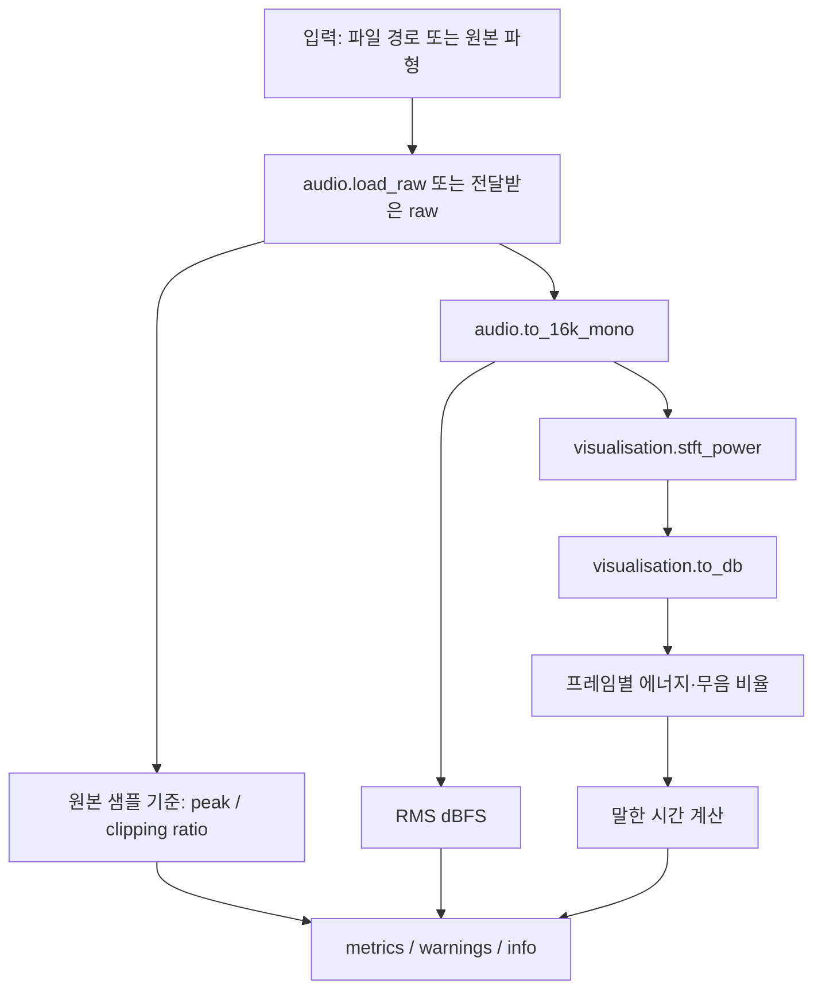

`quality.py`는 **잡음 분류기나 발음 평가기가 아니야.** 현재 계산하는 것은 길이, RMS, 최대 진폭, 클리핑 비율, 무음 비율, 추정 말한 시간 등 녹음 입력의 상태 지표야. 기준을 벗어나면 경고를 반환하지만 현재 `practice.read()`는 이 경고만으로 인식 실행을 차단하지 않아.

### `align.py`와 오류 구간 시각화

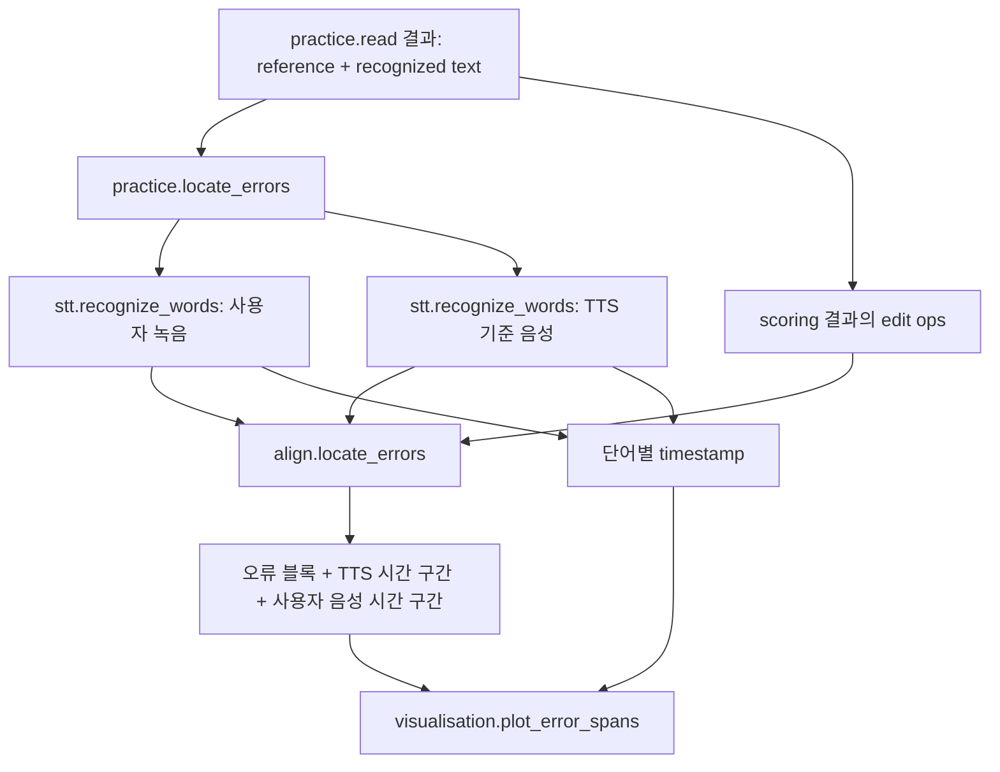

**현재 연결 상태(11-10)**: 따라읽기 결과 아래에 `web_practice.error_spans`가 틀린 구간을 소리 그림 위에 표시하고(`visualisation.plot_error_spans`), 표준 발음과 내 녹음의 소리 모양 비교(`visualisation.plot_sound_panels`: 파형·FFT·STFT·Log-Mel 2×2)는 맨 아래 접힌 상자에 있다. **`practice.locate_errors`의 결과(`loc`)는 `ui_practice._locate_words`가 채점 직후 한 번만 구해 틀린 구간 그림과 F0 비교가 공유한다**(11-09까지는 틀렸을 때만 계산). 틀린 구간이 없으면 "틀린 구간 없음"으로 안내한다. `align.word_spans`는 같은 `loc`의 `hyp_tokens`·`tts_tokens`로 기준 단어마다 TTS·내 녹음의 시간 구간을 돌려준다(4-4절).

### `visualisation.py`의 현재 사용처 요약

| 함수·기능                  | 현재 호출하는 곳                                     | 목적                                                                 |
| -------------------------- | ---------------------------------------------------- | -------------------------------------------------------------------- |
| `stft_power()` / `to_db()` | `quality.py`                                         | 무음 프레임 에너지 산출                                              |
| `plot_song_selection()`    | `app/views/song.py`                                  | 업로드한 곡에서 구간 선택을 위한 파형 개요                           |
| `plot_sound_pair()`        | 실험·노트북 경로                                     | TTS와 사용자 음성의 파형·STFT·Log-Mel 비교                           |
| `plot_sound_panels()`      | `app/ui_practice.py` (따라읽기 결과, 접힌 상자)     | TTS와 내 녹음의 파형·FFT·STFT·Log-Mel 2×2 비교(발음 평가가 아닌 참고) |
| `plot_f0_contour()`        | `app/ui_practice.py` (`_f0_view`)                    | 내 F0 윤곽(실제 시간축, 무성음은 끊김, 중앙 점선·P10~P90 띠)         |
| `plot_f0_compare()`        | `app/ui_practice.py` (`_compare_view`)               | 참고 TTS와 내 녹음의 상대 음높이를 기준 단어 칸에 겹친 그래프        |
| `plot_error_spans()`       | `app/ui_practice.py` ← `web_practice.error_spans`    | 틀린 구간을 표시한 음성 비교 그림(따라읽기 결과 아래)               |

---

## 4-4. F0(목소리 높낮이) 억양 비교 (이슈 #82, 검토 문서 16.18)

따라읽기 결과의 "목소리 높낮이 · F0" 칸이다. **점수·등급이 없는 참고용 관찰**이고 DB에 저장하지 않는다(WER/CER은 인식 일치도, Azure는 외부 발음 평가, F0는 음높이 변화로 서로 다른 질문에 답한다).

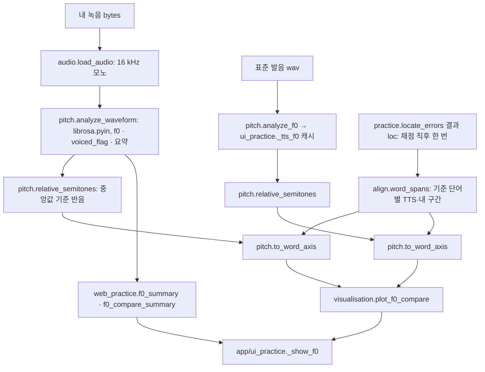

| 모듈·함수 | 책임 | 입력 → 출력 |
|---|---|---|
| `pitch.analyze_f0` / `analyze_waveform` | pYIN으로 20 ms 간격 F0 추정, 중앙값·P10·P90·폭·앞뒤 변화 요약 | 경로·bytes·파형 → dict(`status`, `times`, `f0`(무성음 **NaN**), `valid`, 요약). 실패는 예외가 아니라 `status` |
| `pitch.relative_semitones` | 각 목소리의 중앙값을 0으로 한 `12·log2(F0/중앙값)` | f0, valid → 같은 길이 배열 |
| `pitch.to_word_axis` | 단어 구간 안의 진행률로 x를 바꿈 `x = i + (t−s)/(e−s)`, 단어 사이에 NaN | times, 값, 단어 구간 → x, y |
| `pitch.warm_up` | numba 첫 호출(12~20초)을 앱이 시작 때 백그라운드로 미리 해소 | — |
| `align.word_spans` | 기준 단어마다 TTS·내 구간(대응 없으면 `None`)과 같은 글자인지. `we'll → we·will`은 구간을 균등 분할 | 기준 문장, `hyp_tokens`, `tts_tokens` → 목록 |

**내 윤곽만 보여 주는 경우**: 표준 발음이 없을 때, 공백 없는 언어(일본어·중국어), 단어 시간을 구하지 못했을 때, 표준 발음의 F0 분석이 실패했을 때, 단어에 맞춰 비교할 구간이 부족할 때. **상태**: 구현됨(UI 연결됨). **테스트**: `tests/test_pitch.py`, `test_align.py`(`word_spans`), `test_visualisation.py`, `test_web_practice.py`. 한계는 검토 문서 16.18의 9~11절과 README에 있다.

---

## 4-2. 로그인·저장·불러오기 흐름 (서버 저장, 이슈 #63~#75)

브라우저를 닫아도(특히 아이폰) 연습 기록과 곡·문장 작업이 남도록 **사용자별로 서버(PostgreSQL)에 저장**한다. 판단·설계는 검토 문서 16.16·16.17, 개념은 아래 표를 본다.

### 4-2-1. 누가 어떤 모듈을 맡나

| 모듈 | 책임 | 하지 않는 것 |
|---|---|---|
| `app/streamlit_app.py` | 메뉴(내 문장·내 노래·기록)와 **맨 앞의 접근 제한**: 모든 페이지 앞에서 `auth_gate.run()`을 부르고 통과하지 못하면 `st.stop()` | 계산·저장 |
| `app/auth_gate.py` | 로그인·가입·게스트 화면, 로그인 유지 쿠키(JS로 쓰고 `st.context.cookies`로 읽음), 사이드바(저장 켜기/끄기·로그아웃·계정 삭제) | 비밀번호 검사·SQL |
| `account.py` | 가입·로그인·로그인 유지·로그아웃의 **판단**(주입한 `store`로 시험 가능). 아이디가 있는지 알려 주지 않는 같은 오류 문구 | 화면·SQL |
| `auth.py` | **순수 규칙**: scrypt 해시, 아이디·비밀번호 규칙, 로그인 유지 토큰(DB에는 sha256 해시만), 5회 실패 5분 잠금 | DB·화면 |
| `access.py` | 가입·게스트 입장에 필요한 **초대 코드**(`SONGLINGO_PASSWORD`)와 세션 실패 잠금. 환경변수가 없으면 개발용으로 열림 | 사용자 계정 |
| `storage.py` | **SQL 읽기·쓰기 전부**: 연결(호출마다 열고 닫음, 제한 3초), 마이그레이션 적용, 사용자·토큰·구간·문장 묶음·줄·연습 기록·한글 뜻 캐시. 모든 사용자별 질의는 `user_id` 조건 | 화면·세션 |
| `migrations/001~005_*.sql` | 스키마(이미 적용된 파일은 고치지 않고 새 번호를 추가). 001 초기 → 002 이름·id·구간 여러 개 → 003 `meanings` → 004 `lines` → 005 문장 묶음 여러 개 | — |
| `app/persist.py` | **화면 ↔ 저장 연결**: 스크립트가 다시 실행될 때마다 `autosave_*`를 불러 내용이 바뀐 경우에만 저장하고, 저장한 행·줄의 id를 세션에 보관해 연습 기록에 연결 | 계산·SQL |

### 4-2-2. 로그인과 로그인 유지

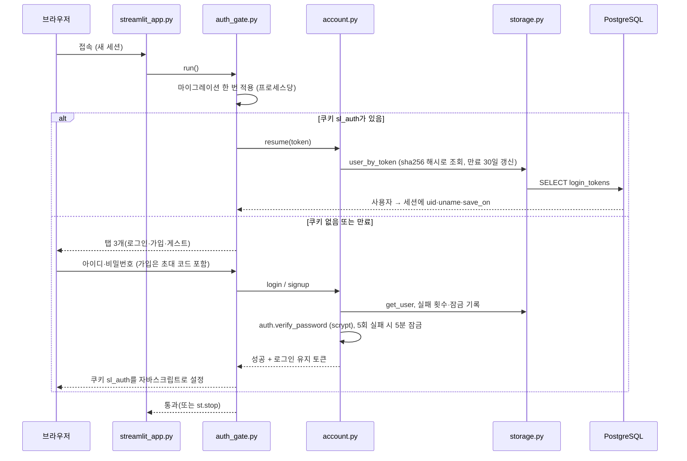

- **게스트**는 초대 코드만 맞으면 들어오지만 **아무것도 저장하지 않는다**(기록은 이번 세션의 목록에만).
- DB 설정(`DB_NAME`·`DB_USER`)이 없으면 저장 기능이 꺼지고 예전처럼 비밀번호 한 칸만 묻는 게스트 동작이다(개발 환경). DB가 죽어 있으면 게스트만 들어올 수 있다.

### 4-2-3. 저장 데이터 모델

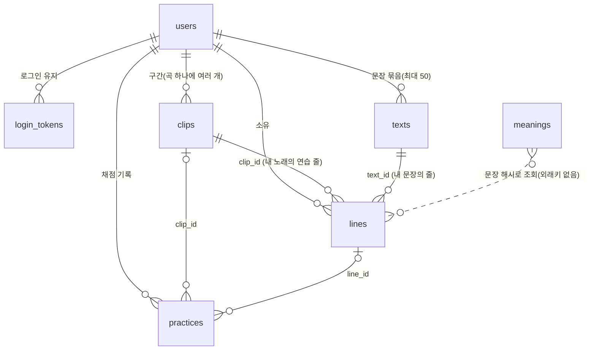

| 테이블 | 한 행 = | 중요한 점 |
|---|---|---|
| `users` | 계정 | 비밀번호는 scrypt 해시, 저장 켜기/끄기 `save_on`, 실패 횟수·잠금 |
| `login_tokens` | 로그인 유지 토큰 | 토큰 원문은 저장하지 않고 해시만 |
| `clips` | 곡의 **구간 하나**(`UNIQUE (user_id, audio_sha1, 시작, 길이)`) | 같은 곡의 다른 구간은 다른 행. 음원은 저장하지 않고 지문 `audio_sha1`만. STT 설정·원본 segments는 `recognition` |
| `texts` | 내 문장 **묶음 하나**(입력창 하나의 내용 전체) | 사용자당 최대 50개, 제목은 입력했을 때만(없으면 화면이 첫 줄로 자동 제목), 삭제 허용 |
| `lines` | 연습 **줄 하나**(`clip_id` 또는 `text_id` 중 하나만) | 처음 인식한 글 `stt_text`와 연습에 쓰는 글 `text`가 따로 있음. 표준 발음 경로는 저장하지 않고 글로 TTS 캐시를 찾음 |
| `practices` | 채점 **한 번**(따라읽기·받아쓰기·Azure) | 기준 글·인식문·점수(`scoring`)·Azure 결과·STT 설정, `clip_id`·`line_id`로 연결(줄이 지워져도 기록은 남음) |
| `meanings` | 한글 뜻·표현 설명 1건 | **모든 사용자가 공유하는 캐시**, 문장 글 대신 해시(`cache_key`)만 |

**저장하지 않는 것**: 업로드한 음원, 잘라 낸 구간 wav, 보컬 분리 결과, 내 녹음, TTS 소리(서버 디스크 `data/tts_cache/`의 파일, 줄의 글 해시로 찾음), 비밀번호·토큰 원문, API 키.

### 4-2-4. 자동 저장과 불러오기

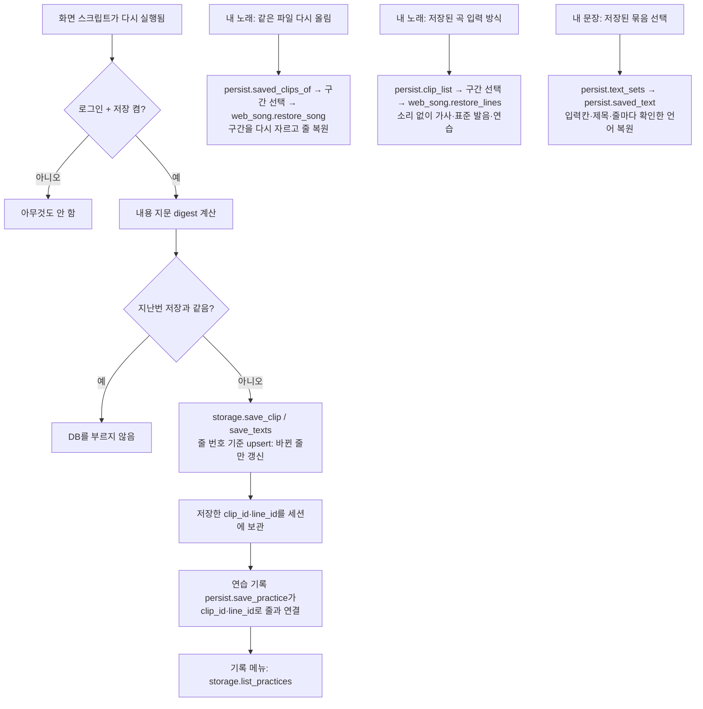

- **덮어쓰기 보호**(`persist.autosave_clip`): 같은 구간의 저장본에 가사가 있는데 이 세션은 아직 가사를 불러오지도 새로 인식하지도 않았다면 저장하지 않는다(같은 곡을 다시 올리고 구간만 고르다가 빈 기록으로 덮는 사고를 막는다).
- **묶음 상한**: 사용자당 50개. 넘으면 새 묶음은 저장되지 않고 경고, 오래된 묶음을 삭제하면 다시 저장된다. **내 노래 구간은 삭제 기능이 없다**(계정 삭제 때만 함께 지워짐).
- 표준 발음 파일은 DB가 아니라 **서버 디스크 캐시**에 있고, 불러온 줄은 글의 해시로 파일을 찾는다(있으면 과금 없이 바로 재생, 없으면 버튼으로 만들기).

---

## 4-3. 한글 뜻·표현 설명 조회 (`meaning.py`)

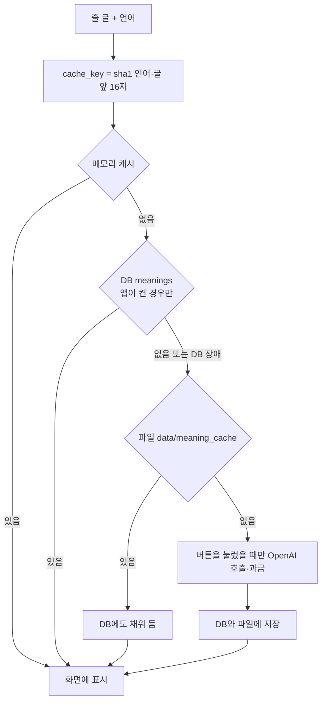

- 예시 문장의 한글 뜻은 **직접 쓴 뜻**을 그대로 보여 준다(호출 없음). 그 밖은 버튼으로 AI가 번역(`translate_ko`)하고, 표현 설명(`explain_sentence`: 단어·IPA·표현·문법·예문 2개, JSON)도 같은 방식이다. 항상 "AI 번역·설명 · 참고용"으로 표시한다.
- DB가 안 되면 번역·설명은 멈추지 않고 파일 캐시만 쓴다(60초 동안 DB를 건너뜀). 문장 글은 저장하지 않고 해시만 저장한다.

---

## 5. 핵심 모듈의 호출 관계 요약

| 상위 호출자                         | 호출되는 모듈·함수                                         | 입력 → 출력                            | 현재 제품 경로        |
| ----------------------------------- | ---------------------------------------------------------- | -------------------------------------- | --------------------- |
| `scripts/record_takes.py`           | `recorder.Recorder.start/stop`, `recorder.save_wav`        | 마이크 입력 → WAV 경로                 | 로컬 녹음 데이터 생성 |
| `scripts/record_takes.py`           | `quality.check_file`, `quality.format_report`              | WAV 경로 → 품질 결과·문자열            | 로컬 녹음 직후 점검   |
| `practice.read()`                   | `audio.as_source`, `audio.load_raw`                        | bytes/파일 → 원본 파형                 | 따라읽기             |
| `practice.read()`                   | `quality.analyze` 또는 `quality.check_file`                | 원본 파형/파일 → 상태 지표             | 따라읽기             |
| `practice.read()`                   | `stt.recognize`                                            | 원본 음성 → 인식 텍스트                | 따라읽기             |
| `practice.read()` / `dictation()`   | `scoring.evaluate`                                         | 정답·인식/입력 문장 → WER/CER·edit ops | 두 연습 방식          |
| `practice.locate_errors()`          | `stt.recognize_words`, `align.locate_errors`               | 단어별 시간·채점 결과 → 오류 시간 블록 | 채점 직후 한 번(틀린 구간·F0가 공유) |
| `app/views/song.py` → `web_song.py` | `audio.load_raw`, `waveform_peaks`                         | 업로드 음성 → 파형 개요                | 내 노래               |
| `web_song.cut()`                    | `separate.cut_clip`, `audio.load_raw`, `recorder.save_wav` | 원곡·시작·길이 → mix WAV               | 내 노래               |
| `song_practice.prepare_lines()`     | `stt.recognize_segments`, `song_lines.split_into_lines`    | mix WAV → segment → 가사 줄 후보       | 내 노래               |
| `web_song.make_vocals()`            | `separate.separate_clip_subprocess`, Demucs                | mix WAV → vocals WAV                   | 선택적 보컬 듣기      |
| `web_song.make_tts()`               | `song_practice.make_tts`, `tts.tts_wav`                    | 확정 가사 → 표준 발음 WAV              | 내 노래               |
| `app/ui_practice.py`                | `practice_log.make_record`, `persist.save_practice`        | 채점 결과 → 기록 dict → DB 한 행       | 연습 기록(서버 DB)    |
| `app/ui_practice.py`                | `azure_pronunciation.assess` (버튼), `persist.save_azure`  | 녹음 bytes·기준 글·로캘 → 발음 평가 결과 | Azure 발음 평가(선택) |
| `app/ui_practice.py`                | `web_practice.error_spans`, `visualisation.plot_error_spans`, `plot_sound_panels` | 결과·녹음 → 틀린 구간·소리 모양 그림 | 따라읽기 결과        |
| `app/ui_practice.py`                | `pitch.analyze_f0`, `align.word_spans`, `pitch.relative_semitones`, `pitch.to_word_axis`, `visualisation.plot_f0_compare`·`plot_f0_contour`, `web_practice.f0_summary`·`f0_compare_summary` | 녹음 bytes·표준 발음·`loc` → F0 그래프·요약 표 | F0 억양 비교(4-4절)  |
| `app/views/history.py`              | `storage.list_practices`, `practice_log.row_from_practice`, Pandas | DB 행 → 기록 표·WER 추이        | 기록(게스트는 세션 목록, DB 없으면 CSV) |
| `app/streamlit_app.py`              | `auth_gate.run`, `meaning.enable_db`                       | 접속 → 로그인·게스트 통과              | 모든 페이지 앞        |
| `auth_gate.py`                      | `account.login/signup/resume`, `access.check`              | 폼 입력 → 세션(uid·save_on)            | 로그인·로그인 유지    |
| `account.py`                        | `auth.hash_password/verify_password`, `storage.*`          | 아이디·비밀번호 → 사용자·토큰          | 계정                  |
| `app/views/lyrics.py`               | `languages.suggest_line_language`, `persist.autosave_texts` | 줄 → 언어 제안, 줄 목록 → 문장 묶음 저장 | 내 문장            |
| `app/views/song.py`                 | `web_song.detect_clip_language`, `persist.autosave_clip`, `web_song.merge_next` | 구간 → 언어 제안, 구간·줄 저장, 줄 합치기 | 내 노래          |
| `persist.autosave_clip`             | `storage.save_clip`, `storage.clip_line_ids`               | doc → `clips`·`lines` 행, 줄 번호 → id | 내 노래 저장          |
| `persist.autosave_texts`            | `storage.save_texts`, `storage.text_line_ids`              | 줄 목록 → `texts`·`lines` 행           | 내 문장 저장          |
| `meaning.cached/translate_ko/explain_sentence` | `storage.get_meaning/put_meaning`, OpenAI Chat   | 문장·언어 → 뜻·설명 JSON               | 한글 뜻·표현 설명     |

---

## 6. 핵심 라이브러리 — 모듈과 연결해서 보기

| 라이브러리        | 사용 영역        | 대표 파일                                                   | 실제 역할                                                             |
| ----------------- | ---------------- | ----------------------------------------------------------- | --------------------------------------------------------------------- |
| NumPy             | 배열·수치 연산   | `audio.py`, `quality.py`, `visualisation.py`, `separate.py` | 파형, 행렬, 수치 계산                                                 |
| SciPy             | 신호 처리        | `audio.py`, `visualisation.py`, `separate.py`               | WAV 읽기, Polyphase Resampling, STFT                                  |
| PyAV (`av`)       | 미디어 디코딩    | `audio.py`                                                  | MP3/M4A/WebM 등 오디오 디코딩                                         |
| faster-whisper    | 음성 인식        | `stt.py`                                                    | Whisper 모델 추론                                                     |
| CTranslate2       | 추론 엔진        | faster-whisper 내부                                         | 효율적인 Whisper 추론 실행                                            |
| PyTorch           | 딥러닝 실행      | Demucs 실행 환경                                            | Demucs 모델 실행                                                      |
| Demucs            | 음원 분리 모델   | `separate.py`                                               | 보컬·드럼·베이스·기타/기타 소리 분리                                  |
| OpenAI Python SDK | 외부 AI API      | `tts.py`, `meaning.py`                                      | TTS 음성 생성, 한글 뜻·표현 설명(채팅 모델)                           |
| Matplotlib        | 시각화           | `visualisation.py`                                          | 파형·스펙트로그램·Log-Mel 그림                                        |
| Streamlit         | 웹 UI            | `app/`                                                      | 파일 업로드, 브라우저 녹음, 버튼, 세션 상태, 결과 표시                |
| Pandas            | 표·기록          | `app/views/history.py`, `clip_compare.py`                   | CSV/실험 결과 분석                                                    |
| sounddevice       | 로컬 마이크 입력 | `recorder.py`                                               | 로컬 마이크 스트림 수집; Streamlit 브라우저 녹음 경로는 사용하지 않음 |
| python-dotenv     | 환경 설정        | `app/streamlit_app.py`, `storage.py`                        | `.env`에서 환경변수 로드                                              |
| PostgreSQL · psycopg 3 | 서버 저장    | `storage.py`, `migrations/`                                 | 사용자별 데이터 저장(JSONB, 외래키·연쇄 삭제, 마이그레이션)           |
| `hashlib.scrypt` · `hmac` · `secrets` | 계정 보안 | `auth.py`                                           | 비밀번호 해시, 시간 일정 비교, 로그인 유지 토큰(표준 라이브러리)      |
| librosa · numba   | F0 추정          | `pitch.py`                                                  | `librosa.pyin`(pYIN)으로 F0·유성음 판정. numba는 librosa 의존(첫 호출 컴파일 지연), `librosa==0.11.0`·`numba==0.62.1`·`llvmlite==0.45.1` 고정 |
| pykakasi          | 일본어 읽기      | `japanese.py`                                               | 한자·가타카나 → 히라가나 읽기·로마자                                  |
| Azure Speech SDK  | 발음 평가        | `azure_pronunciation.py`                                    | 정확도·유창성·완성도·운율(버튼을 눌렀을 때만, 앱 환경에만 설치)       |
| `unittest` · Streamlit `AppTest` | 시험  | `tests/`                                                    | 단위 테스트, 로그인·저장 화면 흐름 시험(가짜 저장소 `tests/fake_store.py`) |

---

## 7. 구현 상태와 아직 없는 것 (2026-11-11 점검)

상태는 현재 저장소 코드와 개발 계획서 기준이다. 11-05 판에서 "미구현·UI 미연결"이던 항목 중 **구현·연결된 것**을 먼저 적는다.

### 7-1. 11-05 이후 구현·연결된 것

| 기능 | 현재 상태 | 위치 |
|---|---|---|
| **F0(목소리 높낮이) 분석·억양 비교** | **구현됨**(11-10, #82): 내 윤곽, 참고 TTS와 상대 음높이를 단어축에 겹침, 요약 표. 점수 없음·저장 안 함 | `pitch.py`, `align.word_spans`, `visualisation.plot_f0_*`, 4-4절 |
| 따라읽기 결과 화면 순서 정리 | **구현됨**: 카드 → 단어 대조 → 다시 듣기 → 틀린 구간 → F0 → Azure → 소리 모양(접힘). 인식 시간 문구는 "인식에 N초 걸림" | `app/ui_practice.py` |
| "어떻게 동작하나요?" 설명 상자 현행화 | **구현됨**: 한글 뜻·표현 설명(`meaning`), 기록(`history`), 저장 스위치(`save`) 상자 추가 | `app/explain.py` |
| 문장 뜻·연관 단어·표현 설명 | **구현됨**(버튼, AI 참고용 표시, DB 공유 캐시). 계획의 `explain.py`는 만들지 않고 `meaning.py`에 구현(화면 설명 글은 `app/explain.py`). 직접 검수표는 남음(이슈 #15) | `meaning.py`, `app/ui_practice.py` |
| 일본어 등 다국어 | **구현됨**: 줄마다 언어 제안·확인, 일본어 히라가나 읽기·로마자, 일본어·중국어 CER 중심, Azure 로캘 | `languages.py`, `japanese.py`, `web_practice.py` |
| 오류 위치 그림의 Streamlit 통합 | **구현됨**(따라읽기 결과 아래) | `web_practice.error_spans`, `visualisation.plot_error_spans` |
| TTS·사용자 녹음의 소리 모양 비교 UI | **구현됨**(파형·FFT·STFT·Log-Mel 2×2) | `visualisation.plot_sound_panels` |
| 발음 평가(Azure) | **구현됨**(선택, 버튼을 눌렀을 때만, 자동 전송 없음) | `azure_pronunciation.py` |
| 주변 음악 녹음 입력(내 노래) | **구현됨**: 파일 업로드와 같은 흐름 | `app/views/song.py` |
| 서버 배포·접근 제한 | **구현됨**: Oracle VM + Cloudflare 터널, HTTPS, 비밀번호(초대 코드) | 검토 문서 16.15·16.15.1 |
| 사용자별 서버 저장 | **구현됨**: 로그인·로그인 유지·게스트, 구간·문장 묶음·줄·연습 기록, 저장된 곡·묶음 불러오기 | 4-2절, 검토 문서 16.16·16.17 |
| 줄 합치기, 앞뒤 5초 듣기 | **구현됨** | `song_practice.merge_with_next`, `web_song.line_range` |
| 발표 장표 그림 | **코드로 생성**: Whisper·HTDemucs·두 모델 비교·프로그램 전체 구조(손그림을 옮김) 4장. 노트북에서 확인한 숫자만 사용 | `scripts/make_slide_figures.py` → `docs/slides/*.png`, `scripts/make_slides_pptx.js` |
| 재생 제어 | **기본 플레이어로 대체**: 속도는 브라우저 메뉴, 앞뒤 5초는 스위치. 계획의 `player.py`(HTML 플레이어)는 만들지 않음 | 이슈 #12 |

### 7-2. 아직 없거나 연결되지 않은 것

| 기능 | 현재 상태 | 비고 |
|---|---|---|
| 기록 화면의 인식문(`practices.hyp_text`) 보기 | 미구현 | DB에는 저장되어 있고 화면 표에는 점수만 나옴(개선 후보) |
| 줄 **나누기** UI | 미구현 | 자동 나누기는 `song_lines`가 인식 때 함, 합치기만 UI 있음 |
| 줄 단위 보컬 파일 생성 | 미구현 | 현재는 전체 구간 보컬 WAV를 시간 범위로 재생 |
| 내 노래 구간 삭제 | 만들지 않음(의도) | 계정 삭제 때만 함께 지워짐 |
| 옛 `clips.doc`·`texts.doc` 열 삭제 | 예정(발표 이후) | 004에서 줄 테이블로 옮기고 열은 남겨 둠(되돌리기 대비) |
| `songlingo/` 패키지로 모듈 정리 | 미착수(발표 이후, 이슈 #24) | 지금은 루트에 flat 구조 |
| TTS 목소리·억양 선택 | 미착수(이슈 #54) | 기본 voice `alloy` 고정 |
| Whisper confidence와 실제 오류율의 관계 분석 | 미구현 | 기존 `low_confidence`는 휴리스틱 표시이지 통계 검증이 아님 |
| Log-Mel 기반 녹음 품질 분류기 | 미구현·선택 과제 | 현재 `quality.py`의 규칙 기반 점검과 별개 |
| SNR별 잡음 견고성 실험 | 미구현·선택 과제 | 합성 잡음 조건에서의 실험 |
| Demucs·Whisper 원리 탐구(이슈 #35·#79) | **노트북 작성됨**(합성 입력·모양·설정까지, 가중치·어텐션은 못 봄). 11-11에 수식 유도·내 질문 답변을 해당 절에 통합 | `experiments/model anatomy/` (원본 대화·초안은 `drafts/`) |
| F0의 언어별 평가(중국어 성조·일본어 악센트), 단어·음절 정렬 | 미착수(범위 밖) | 일본어·중국어는 내 윤곽만 표시 |

> **사용자의 노래를 채점하는 기능은 없다**(이 앱은 노래방이 아니다). 노래는 가사를 얻고 듣기 위한 입력이다.

---

## 8. 새 모듈이 생길 때 이 문서를 갱신하는 규칙

새 파일을 만들거나 기존 모듈의 역할이 바뀌면 아래 순서로 반영한다.

1. **책임을 한 문장으로 기록**: 이 모듈이 무엇을 입력받아 무엇을 반환하는가?
2. **호출자를 기록**: 어느 파일의 어느 함수가 이 모듈을 호출하는가?
3. **호출 대상을 기록**: 이 모듈이 다시 어떤 모듈·라이브러리를 호출하는가?
4. **데이터 타입을 표시**: 파일 경로, bytes, NumPy 배열, 문자열, dict, DataFrame 중 무엇이 이동하는가?
5. **다이어그램 갱신**: 해당 기능별 다이어그램과 5절 호출 관계 표를 함께 수정한다.
6. **상태를 구분**: 구현됨 / 구현됐지만 UI 미연결 / 실험용 / 계획만 있음 중 하나로 표시한다.
7. **테스트 연결**: 새 알고리즘은 대응하는 `tests/test_*.py`를 함께 기록한다.

### 모듈 추가 기록 템플릿

| 항목                   | 기록                                        |
| ---------------------- | ------------------------------------------- |
| 파일·함수              | `예: explain.py / explain_line()`           |
| 책임                   | 입력을 받아 수행하는 일                     |
| 호출자                 | `예: app/views/lyrics.py → web_practice.py` |
| 피호출 모듈·라이브러리 | 내부에서 호출하는 모듈/API                  |
| 입력 데이터            | 경로 / bytes / ndarray / 문자열 / dict 등   |
| 출력 데이터            | 반환 타입과 주요 필드                       |
| 상태                   | 구현됨 / UI 미연결 / 실험용 / 계획          |
| 테스트                 | `tests/test_*.py`                           |

---

## 9. 우선 읽기 순서

1. `recorder.py`와 `scripts/record_takes.py` — 녹음이 어디서 시작되고 품질 검사가 누가 호출하는지
2. `audio.py`와 `quality.py` — 파일·파형 변환과 입력 상태 계산
3. `stt.py` — Whisper 호출과 인식 결과 구조
4. `scoring.py` — 정규화, 편집 거리 DP, WER/CER
5. `practice.py` — 위 모듈들이 어떤 순서로 결합되는지
6. `app/ui_practice.py`와 `app/views/lyrics.py` — 실제 웹 버튼과 핵심 함수가 연결되는 위치
7. `song_lines.py`와 `song_practice.py` — 노래 STT 결과가 연습용 줄이 되는 과정
8. `separate.py`와 `scripts/separate_worker.py` — Demucs 실행과 subprocess 구조
9. `align.py`와 `visualisation.py` — 오류 위치 추정 및 신호 시각화
10. `web_song.py`, `practice_log.py`, `app/views/history.py` — 파일 생명주기와 기록
11. `languages.py`, `japanese.py`, `meaning.py` — 언어 제안, 일본어 읽기, 한글 뜻·표현 설명(캐시 순서)
12. `migrations/001~005`, `storage.py`(`connect`·`migrate`·`save_clip`·`_sync_lines`) — 저장 구조와 줄 단위 upsert
13. `auth.py` → `account.py` → `app/auth_gate.py` → `app/persist.py` — 로그인 규칙, 화면, 화면↔저장 연결
14. `pitch.py` → `align.word_spans` → `visualisation.plot_f0_compare` → `app/ui_practice._show_f0` — F0 억양 비교(4-4절)

상세한 읽는 포인트와 어려운 곳은 `docs/작업_일지.md` 2-3절에 있다.

---

## 10. 관련 소스 파일 바로가기

- [README.md](https://github.com/greenkey20/song-lingo/blob/main/README.md)
- [CLAUDE.md](https://github.com/greenkey20/song-lingo/blob/main/CLAUDE.md)
- [프로젝트 개발 계획서](https://github.com/greenkey20/song-lingo/blob/main/docs/%ED%94%84%EB%A1%9C%EC%A0%9D%ED%8A%B8%20%EA%B0%9C%EB%B0%9C%20%EA%B3%84%ED%9A%8D%EC%84%9C_20261030.md)
- [recorder.py](https://github.com/greenkey20/song-lingo/blob/main/recorder.py)
- [scripts/record_takes.py](https://github.com/greenkey20/song-lingo/blob/main/scripts/record_takes.py)
- [audio.py](https://github.com/greenkey20/song-lingo/blob/main/audio.py)
- [quality.py](https://github.com/greenkey20/song-lingo/blob/main/quality.py)
- [stt.py](https://github.com/greenkey20/song-lingo/blob/main/stt.py)
- [scoring.py](https://github.com/greenkey20/song-lingo/blob/main/scoring.py)
- [align.py](https://github.com/greenkey20/song-lingo/blob/main/align.py), [pitch.py](https://github.com/greenkey20/song-lingo/blob/main/pitch.py)
- [practice.py](https://github.com/greenkey20/song-lingo/blob/main/practice.py)
- [song_lines.py](https://github.com/greenkey20/song-lingo/blob/main/song_lines.py)
- [song_practice.py](https://github.com/greenkey20/song-lingo/blob/main/song_practice.py)
- [separate.py](https://github.com/greenkey20/song-lingo/blob/main/separate.py)
- [visualisation.py](https://github.com/greenkey20/song-lingo/blob/main/visualisation.py)
- [web_song.py](https://github.com/greenkey20/song-lingo/blob/main/web_song.py)
- [web_practice.py](https://github.com/greenkey20/song-lingo/blob/main/web_practice.py)
- [app/ui_practice.py](https://github.com/greenkey20/song-lingo/blob/main/app/ui_practice.py)
- [app/views/song.py](https://github.com/greenkey20/song-lingo/blob/main/app/views/song.py)
- [app/views/lyrics.py](https://github.com/greenkey20/song-lingo/blob/main/app/views/lyrics.py)
- [app/views/history.py](https://github.com/greenkey20/song-lingo/blob/main/app/views/history.py)
- [storage.py](https://github.com/greenkey20/song-lingo/blob/main/storage.py), [migrations/](https://github.com/greenkey20/song-lingo/tree/main/migrations)
- [auth.py](https://github.com/greenkey20/song-lingo/blob/main/auth.py), [account.py](https://github.com/greenkey20/song-lingo/blob/main/account.py), [app/auth_gate.py](https://github.com/greenkey20/song-lingo/blob/main/app/auth_gate.py), [app/persist.py](https://github.com/greenkey20/song-lingo/blob/main/app/persist.py)
- [meaning.py](https://github.com/greenkey20/song-lingo/blob/main/meaning.py), [languages.py](https://github.com/greenkey20/song-lingo/blob/main/languages.py), [japanese.py](https://github.com/greenkey20/song-lingo/blob/main/japanese.py), [azure_pronunciation.py](https://github.com/greenkey20/song-lingo/blob/main/azure_pronunciation.py)
