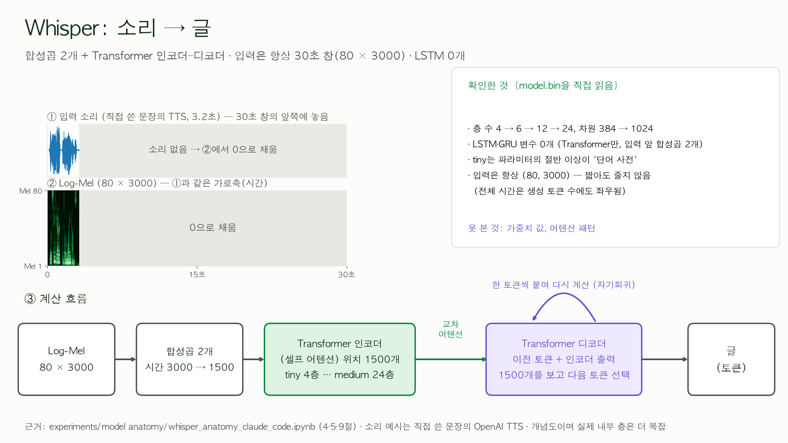
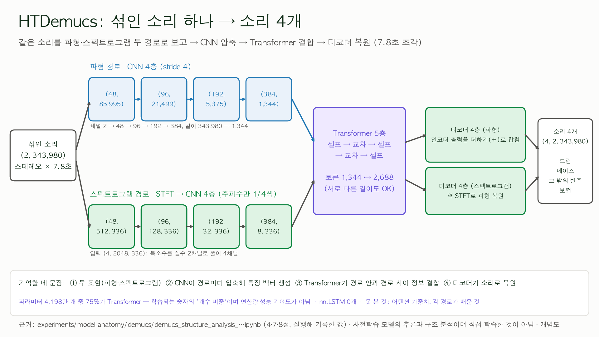
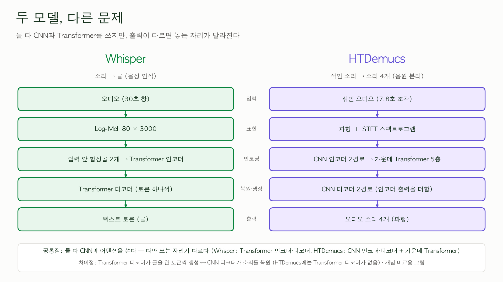

# 1. 🎵 song lingo

**화면**
- 외국어 노래 속 문장을 **듣고 → 따라읽거나 받아적고 → 평가를 확인**하는 학습 도우미 (https://songlingo.kr/clip)

강은영 (https://github.com/greenkey20/song-lingo)

**대본**
안녕하세요. 
제가 금번 프로젝트 기간 중 작업한 song lingo는 외국어 노래 속 문장을 듣고, 따라읽거나 받아적고, 그에 대한 평가를 받을 수 있는 학습 도우미 웹앱입니다. 
오늘은 먼저, 프로그램 개요 및 구조를 설명 드리고, 서버에서 돌아가는 프로그램을 보여드리겠습니다. 그 다음에는 song lingo 구현에 사용한 음성 처리 AI 모델의 구조, 실험 이야기를 공유하고자 합니다.

---

# 2. ❓ 목적 및 목표

**화면**
- 문제: 외국어 노래를 듣다가 **무슨 언어인지, 무슨 뜻인지 + 어떻게 발음하고 표기하는지** 궁금하다!
- **내가 이 프로젝트로 얻고 싶은 것 (한 문장)**
  > 실제로 쓸 수 있는 외국어 학습 도구를 만들면서, **음성 데이터가 수집되고 처리되고 분석되어 사용자에게 전달되는 전체 과정을 이해하고 직접 다룰 수 있는 개발자**로 성장한다
- 여섯 가지 목표 (12장에서 다시 점검)
  | 01 쓰는 도구           | 02 음성·음향 처리 내재화  | 03 AI 실험 능력      |
  | ---------------------- | ------------------------- | -------------------- |
  | **04 소프트웨어 설계** | **05 기술 → 사용자 경험** | **06 과학적 호기심** |

**대본**
외국어 노래를 듣다 보면 이 노래가 무슨 언어인지, 무슨 뜻인지, 어떻게 발음하고 표기하는지 알기 어렵습니다. 그래서 음성 데이터 처리를 통해 실제로 듣는 노래를 학습 자료로 바꾸는 도구를 만들고 싶었습니다. 
이 프로젝트에서 제가 목표한 것은, 수업에서 배운 음성 데이터 처리, 인공지능 원리를 적용한 프로그래밍 경험을 하는 동시에, 제가 실제로 쓸 수 있는 학습 도구를 만드는 것이었습니다. 

---

# 3. 🗺️ 프로그램 구조

**화면**
/Users/greenpianorabbit/Documents/Development/song-lingo/docs/slides/slide_3_overview.png

**대본**
프로그램의 전체 구조를 도식화한 것입니다. 

외국어 노래 문장이 소리 또는 텍스트 형태의 데이터로 들어올 수 있습니다.
소리 데이터는 STT 모델인 Whisper를 거치고, 텍스트 데이터는 프로그램 내에 정의된 일련의 규칙에 따라, 언어 종류를 확인하여 사용자에게 확인 받습니다.
인식된 텍스트에 대해서는 OpenAI API 호출을 통해 한국어 뜻, 관련 표현 등의 설명을 제공하며, TTS 모델에 입력되어 기준 음성을 생성합니다.

사용자는 기준 음성을 듣고 따라읽기, 또는 받아쓰기 연습을 합니다.
따라읽기 연습의 경우, 사용자가 외국어 문장을 읽는 목소리를 녹음하면 먼저 음량과 무음, 클리핑 등 음성 데이터 상태를 점검합니다.
사용자가 따라읽기 녹음을 완료하면, 따라읽기 연습에 대해서 현재 4가지의 피드백을 제공합니다. 녹음 데이터에 대해 STT 모델이 생성한 텍스트를 정답 문장과 비교해 계산한 오류율, 틀린 구간 표시를 포함한 파형 분석, 목소리 높낮이 분석, Azure API를 활용한 발음 평가를 확인할 수 있습니다.

로그인한 사용자가 원하는 경우 연습 및 평가 기록을 서버 데이터베이스에 저장할 수 있습니다. 사용자가 업로드한 음원과 녹음은 데이터베이스에 저장하지 않습니다.

---

# 4. 입력의 '언어 알아보기' 기능

**화면** 
/Users/greenpianorabbit/Documents/Development/song-lingo/docs/slides/slide_5.png

**대본**
TTS 모델에 데이터를 입력하기 전, 사용자가 제공한 외국어 노래 문장에 대해 '언어 알아보기' 절차를 거치는데, 입력에 따라 방식이 다릅니다. 
가사가 텍스트로 입력된 경우, 언어 판별 시 문자 체계와 언어별 특징을 활용합니다. 예를 들어 일본어는 가나, 한국어는 한글, 러시아어는 키릴 문자로 구분할 수 있고, 라틴 문자를 사용하는 언어는 자주 쓰는 단어와 특징적인 문자를 활용합니다. 중국어와 일본어는 한자를 공유하고 간체자와 일본어 신자체도 일부 같은 유니코드 코드를 사용하기 때문에, 한자만 있는 짧은 문장에서는 언어를 확정하기 어렵습니다. 따라서 이 경우에는 자동으로 판단하기보다 사용자가 직접 선택하도록 했습니다.
반면, 소리로 입력된 경우에는 Whisper 모델의 언어 감지 기능을 씁니다. 입력된 소리를 한 번 듣고 언어별 확률을 계산해서 순위를 매깁니다.

'언어 알아보기' 기능에서 선택할 수 있는 언어는 한국어를 포함해 총 11개입니다.
Whisper가 감지한 언어별 확률 중 이 11개 언어만 추려서 다시 순위를 매깁니다.

---

# 5. 🔬 '따라읽기' 음성 분석 방법

**화면**
/Users/greenpianorabbit/Documents/Development/song-lingo/docs/slides/slide_5_error rate.png 이미지 첨부

| 분석                                              | 답하는 질문                                                                                        | 점수인가?                                 | 한계                                                                                                                                                |
| ------------------------------------------------- | -------------------------------------------------------------------------------------------------- | ----------------------------------------- | --------------------------------------------------------------------------------------------------------------------------------------------------- |
| **문장 인식 오류율** (Whisper → WER/CER)          | 인식된 문장이 기준 문장과 **얼마나 다른가**                                                        | 오류율(낮을수록 좋음), **발음 점수 아님** | 문맥으로 **틀린 발음도 정답에 가깝게 적을 수 있고**, 쉼·속도·억양은 못 잡는다                                                                       |
| **파형 분석** (틀린 구간 표시, 스펙트로그램 포함) | **어느 단어 덩어리**가 다르게 인식됐고, 내 소리의 **파형·주파수 모양**이 기준 음성과 어떻게 다른가 | **점수 없음**, 눈으로 보는 관찰           | 단어 구간은 Whisper의 **단어별 시간(모델 내부 정보로 추정한 대략의 구간)** 이라 정확한 정렬이 아니다. 그림만으로 발음이 맞고 틀림을 판정하지 않는다 |
| **F0 (목소리 높낮이)**                            | 내 목소리의 **음높이가 시간에 따라 어떻게 변하나**                                                 | **점수 없음**, 관찰용                     | TTS의 억양이 **유일한 정답이 아니다**. 무성음·쉼에서는 값이 없고, 잡음에서는 옥타브 오류가 생기며, 상대 음높이만 비교한다                           |
| **Azure 발음 평가** (7장)                         | 기준 문장에 비추어 **발음·유창성·운율**을 어떻게 평가하나                                          | 외부 서비스의 점수(선택)                  | 내 시험은 **한 사람·한 문장·1회씩**. 운율·음절·음소는 영어 중심(일본어·프랑스어도 기본 점수는 나옴). 버튼을 누를 때만 녹음이 외부로 나간다          |

- 핵심: **"발음 점수를 하나 더 만든 것"이 아니라, 하나의 소리를 서로 다른 층위로 분석하고 각각의 한계를 밝힌 것**
- 파형 분석의 "스펙트로그램"은 결과 아래 **"소리 모양 자세히 보기"**(파형·FFT·STFT·Log-Mel)에 있고, 수업 3·4강에서 배운 그림과 같은 것입니다 [확인: 4장 시연 순서 ⑦]
- Whisper는 문맥을 보고 **틀린 발음도 정답에 가깝게 적을 수 있어서** 오류율이 낮아도 발음이 완벽하다는 뜻이 아니다
- F0는 TTS의 억양이 **유일한 정답이 아니고**, 문장 끝을 항상 올려야 하는 것도 아니다
  
**대본**
따라읽기 녹음 음성에 대해서는 네 가지 종류의 평가가 제공됩니다. 
첫째, 음성에서 인식한 텍스트가 정답 문장과 얼마나 다른지 계산한 오류율,
둘째, 파형 분석 - 이 때 어느 단어 구간이 달랐는지를 표시하고, 파형과 스펙트로그램으로 소리 모양을 보여 줍니다. 
셋째, 목소리의 높낮이가 시간에 따라 어떻게 변했는지 기본 주파수 F0 분석,
넷째, 발음과 유창성을 평가하는 Azure API 평가 점수입니다. 

---

# 6. 🧪 Azure API를 활용한 발음 평가 및 피드백 구현 (1:30)

**화면**
/Users/greenpianorabbit/Documents/Development/song-lingo/docs/slides/slide_6_azure.png 이미지 첨부

| 칸            | 장표에 쓸 내용                                                                                                                                                                                                                                                             |
| ------------- | -------------------------------------------------------------------------------------------------------------------------------------------------------------------------------------------------------------------------------------------------------------------------- |
| ① 도입 배경   | 처음 기획한 오류율(WER/CER)은 **인식된 글의 일치도**라서 한계가 있다. ⓐ 문맥으로 고쳐 적혀 **오류율 0인데 Azure는 `explore`를 68점**으로 봤다(내 녹음 1건) ⓑ 끊어 읽어도 오류율은 0.250으로 낮다 → 언어 학습에는 "**어디를 어떻게 고칠지**" 피드백이 필요 **[추정: 동기]** |
| ② 서비스 개요 | **Azure AI Speech 발음 평가**. 항목: **정확도 · 유창성 · 완성도 · 운율 · 종합**, 단어별 점수와 오류 종류(**발음 · 빠짐 · 더해짐**), 음소 펼침. **평가 기준은 TTS가 아니라 Azure의 원어민 발음 모델**                                                                       |
| ③ 사용 방법   | 따라읽기 채점 후 **"Azure로 평가하기" 버튼**(누를 때만) → **녹음·기준 문장 글·언어**만 전송(TTS 소리는 보내지 않음, 녹음은 서버에 저장 안 함) → 점수 카드 + 단어별 점수. 로그인·저장을 켜면 **점수와 단어별 결과**가 기록에 저장(녹음 제외)                                |
| ④ 결과 예시   | 같은 문장을 네 가지로 읽은 비교표(아래)                                                                                                                                                                                                                                    |
| ⑤ 한계        | 한 사람·한 문장·**1회**. 정상 읽기도 `we'll` 51·`together` 43으로 이미 낮아 **완벽한 기준선이 아님**. "틀린 발음" 시험은 기준선이 낮은 단어를 골라 깔끔하지 않았음. 운율·음절·음소는 영어 중심이고, 일본어·프랑스어는 기본 점수가 나오는 것까지만 확인                     |

**④ 결과 예시 표** (문장: `We'll sing together until the morning comes.`, 직접 쓴 문장) [확인: 11-05 화면 캡처 4장]

| 읽기 조건   | 정확도 | 유창성 | 완성도 | 운율 | **종합** | Azure가 표시한 단어                                          | 오류율(WER) |
| ----------- | ------ | ------ | ------ | ---- | -------- | ------------------------------------------------------------ | ----------- |
| ① 정상      | 81     | 90     | 71     | 81   | **79**   | `we'll` 51 · `together` 43(발음), 나머지 91~97               | (캡처 없음) |
| ② 단어 생략 | 32     | 77     | **14** | 69   | **41**   | `together`·`the`·`comes` **빠짐**                            | 0.750       |
| ③ 끊어 읽기 | 45     | **49** | 14     | 66   | **38**   | `We'll` **빠짐**, `the` **더해짐**                           | **0.250**   |
| ④ 틀린 발음 | 56     | 88     | 43     | 74   | **61**   | `We'll` **빠짐**, `sing` 47 · `together` 44 · `the` 55(발음) | 0.375       |

- 읽은 것 [확인 + 추정]: ⓐ 정상보다 **세 경우 모두 종합이 내려갔다**(79 → 41·38·61): 강사님 질문의 답은 "**차이가 평가에 반영된다**" ⓑ **끊어 읽기에서 유창성이 90 → 49로 가장 크게** 내려갔는데 **오류율은 0.250**으로 낮았다(Whisper는 끊어 읽어도 단어를 알아듣는다) → **쉼·속도는 오류율이 못 잡고 Azure(유창성)가 잡는다** ⓒ 단어 생략은 **`빠짐` 표시와 완성도 71 → 14**로 반응했다
- 완성도·정확도 등의 정의는 Microsoft 문서를 읽고 정리한 것이고 [일반 지식], **완성도의 계산식은 문서에 없어 이 표본으로 확인하지 못했다** **[미확인]**

**대본**
사용자의 따라읽기 발음 자체를 평가하는 방법으로써 Azure의 발음 평가 API를 사용하였습니다. 처음 기획한 오류율은 Whisper가 글로 바꾼 결과를 정답과 비교하기 때문에, 문맥으로 고쳐 적힌 단어나 쉼과 속도는 잡지 못합니다. 
녹음과 기준 문장, 언어만 Azure로 전송되고, 정확도·유창성·완성도·운율과 종합 점수, 그리고 단어별 점수와 빠짐·더해짐 같은 오류 종류가 돌아옵니다. 평가 기준은 Azure의 원어민 발음 모델입니다.
예를 들어, 같은 문장을 정상으로, 단어를 빼고, 끊어서, 틀리게 읽어 봤습니다. 정상 읽기의 종합 79가 단어를 빼면 41, 끊어 읽으면 38, 틀리게 읽으면 61로 내려가는 등 차이가 점수에 반영됐습니다. 특히 끊어 읽기는 유창성이 90에서 49로 가장 크게 떨어졌는데, 단어 기준 오류율은 0.25로 낮았습니다.

---

# 7. 🧮 오류율 채점 알고리즘 - 편집 거리

**화면**
- **제목**: 채점의 핵심: 편집 거리를 표로 한 칸씩 채운다 (동적 계획법)
- **표** (정답 `we sing together until` × 인식 `we seeing together`, **굵은 칸 = 되짚은 길**)

  | 정답 \ 인식 | ∅     | we    | seeing | together |
  | ----------- | ----- | ----- | ------ | -------- |
  | ∅           | **0** | 1     | 2      | 3        |
  | we          | 1     | **0** | 1      | 2        |
  | sing        | 2     | 1     | **1**  | 2        |
  | together    | 3     | 2     | 2      | **1**    |
  | until       | 4     | 3     | 3      | **2**    |

- **되짚은 길**: `we = we` 일치 → `sing → seeing` **바뀜(S)** → `together = together` 일치 → `until → (없음)` **빠짐(D)**
- **점화식**: `d[i][j]` = 아래 세 값 중 가장 작은 것 — 위 칸 + 1(**삭제**: 정답 단어를 지움) · 왼쪽 칸 + 1(**삽입**: 인식에만 있는 단어) · 대각선 칸 + (같으면 0, 다르면 1)(**일치·바뀜**)
- **결과**: 오른쪽 아래 칸 = 최소 수정 횟수 = 2 → **WER = (S + D + I) ÷ N = (1 + 1 + 0) ÷ 4 = 0.50**
- **코드 발췌** (`scoring.edit_matrix`, 내 코드):
  ```python
  cost = 0 if ref[i-1] == hyp[j-1] else 1     # 같으면 0, 다르면 1
  d[i][j] = min(d[i-1][j] + 1,                # 삭제
                d[i][j-1] + 1,                # 삽입
                d[i-1][j-1] + cost)           # 일치 또는 바뀜
  ```
- **이해한 방법**: 점화식 → 표를 한 칸씩 넘기는 도구(`experiments/WER, CER/DP_편집거리_이해하기.html`) [확인: 검토 문서 13장]. **동률일 때 비슷한 단어끼리 짝짓는 규칙**은 이 프로젝트에서 덧붙인 부분(수업에 없음)

**대본**
단어 기준 오류율이 어떻게 나오는지 한 장으로 보겠습니다. 정답 문장과 STT 인식 텍스트를 표로 놓고, 한 칸을 채울 때 삭제, 삽입, 일치나 바뀜 중 가장 적게 드는 값을 고릅니다. 이렇게 앞부분의 답을 이용해 뒷부분을 채우는 방법이 동적 계획법입니다. 오른쪽 아래 칸이 최소 수정 횟수이고, 이 값을 정답 단어 수로 나눈 것이 오류율입니다.

---

# 8. 📺 프로그램 시연

**화면** 
/Users/greenpianorabbit/Documents/Development/song-lingo/docs/slides/slide_8.png 이미지 첨부

**대본**
(live)

---

## 9. 🧠 모델1 — Whisper

**화면**


**대본**
한편, 프로그램 구현에 사용한 두 가지 음성 처리 AI 모델의 구조를 살펴본 결과를 공유합니다.
첫 번째 모델은 Whisper입니다. 
입력은 소리의 길이와 상관없이 30초 창에 맞춘 80 곱하기 3000 크기의 Log-Mel입니다. 짧은 소리는 모자란 부분을 0으로 채우기 때문에, 인코더의 입력 크기는 소리가 짧아도 줄어들지 않습니다.
계산은 두 단계입니다. 인코더가 합성곱 두 개와 Transformer 층으로 소리를 읽어 위치 1500개의 표현으로 만듭니다. 디코더는 지금까지 쓴 글과 인코더가 출력한 표현을 교차 어텐션으로 보고, 다음 토큰의 확률을 계산하여 하나를 고릅니다. 그리고 그것을 붙여서 다시 계산합니다. 이렇게 글을 한 토큰씩 씁니다. 

---

## 10. 🧠 모델2 — Demucs(Deep Extractor for Music Sources)

**화면** 


**대본**
두 번째 모델은 Demucs(디먹스)입니다. Meta AI 연구팀이 공개한 오픈소스 음원 분리 모델로, 노래 하나를 넣으면 보컬, 드럼, 베이스, 그리고 기타 나머지 소리, 이렇게 네 개의 소리로 나눠 줍니다. song lingo에서는 노래에서 보컬만 따로 듣게 하고, 분리한 보컬이 가사 인식에 도움이 되는지 비교하는 선택 기능으로 썼습니다. 

첨부 구조는 최신 계열인 Hybrid Transformer Demucs의 구성입니다.
스테레오 7.8초짜리, 샘플링레이트 44,100Hz로 343,980개의 샘플을 가진 2채널 음원이 입력으로 들어온다고 예를 들어보겠습니다. Demucs는 같은 소리를 두 가지 모양으로 나란히 봅니다. 파형 그대로 한 경로, STFT를 거친 스펙트로그램으로 한 경로입니다. 각 경로는 합성곱 4개 층으로 길이를 4분의 1씩 줄이고 채널을 늘리며 압축합니다. 압축하며 특성을 뽑아내고, 압축하지 않으면 토큰이 약 34만 개라 어텐션 계산에 부하가 크기 때문에 합성곱이 먼저 압축을 합니다. 파형은 343,980이 1,344개 구간으로 줄고, 스펙트로그램은 토큰 2,688개가 됩니다.
모델의 인코더와 디코더 사이에 위치한 Transformer가 같은 경로 안에서, 그리고 두 경로 사이에서 서로를 참조해 정보를 결합합니다. 마지막으로 디코더가 인코더의 중간 결과를 더해 가며 원래 크기로 복원해 소리 네 개를 출력합니다.

---

## 11. 🔁 Whisper vs Demucs 한 눈에 보기

**화면**


**대본**
두 모델을 나란히 놓아 보겠습니다. 둘 다 딥러닝 모델이지만 푸는 문제가 다릅니다. Whisper는 소리를 텍스트 토큰으로 바꾸고, Demucs는 하나의 소리를 악기별 소리 네 개로 나눕니다. 둘 다 CNN과 어텐션을 쓰지만 자리가 다릅니다. Whisper는 입력 앞에 합성곱 두 개를 두고 Transformer 인코더와 디코더가 위치합니다. 반면, Demucs는 CNN 인코더와 디코더가 주요 데이터 처리를 하며 그 가운데에 Transformer가 들어가 있습니다.

---

# 12. 시행착오/실험 예시 1 - 노래와 가사를 어떻게 확보할까?

# 12-A

**화면**
### 초기 구상
노래 검색 → 곡 정보 확인 → 가사 확보 → 학습 문장 선택

### 검토한 세 가지 접근

| 접근 방식                   | 처리 흐름                                                    | 고려한 문제                                     |
| --------------------------- | ------------------------------------------------------------ | ----------------------------------------------- |
| **① 곡 식별 후 가사 검색**  | 주변 소리 → Shazam류 음원 식별 API → 곡 정보 → 가사 제공 API | API 키·비용·이용 조건, 가사 제공 범위 및 저작권 |
| **② 음원 직접 입력 후 STT** | 파일 업로드 / 주변 음악 녹음 → Whisper STT → 인식 결과 수정  | 반주·발성·음질에 따른 인식 정확도               |
| **③ 가사 텍스트 직접 입력** | 사용자가 문장·가사 입력 → 표준 발음·채점                     | 자동 곡 검색은 없지만 가장 단순한 대안          |

### 검토 결과 및 선택

- 가사 사이트 스크래핑은 이용약관·저작권·유지보수 위험이 있어 제외
- 음원 식별 API와 가사 제공 서비스는 키·약관·요금·언어 지원이 불확실해 MVP에서 보류
- 주변 음악 녹음은 곡 식별이 아닌 **오디오 입력 방식**으로 정의
- 파일 업로드와 마이크 녹음을 같은 STT 파이프라인으로 통합

**현재 선택한 흐름**

`음원 업로드 / 주변 음악 녹음 → 로컬 Whisper STT → 사용자 수정 → 따라읽기·받아쓰기`

*곡 식별 API와 가사 검색 서비스는 비교·검증한 기능이 아니라, 초기 설계 단계에서 검토 후 보류한 대안이다.*

**대본**
이제는 구현 과정 중 실험하며 시행착오한 사례를 소개하겠습니다.
첫번째로는, 프로그램의 주요 입력 데이터인 노래와 가사를 어떻게 확보할 것인가였습니다.
초기에는 음악을 소리로 검색하고 해당 곡의 정보와 가사를 가져와 학습하는 흐름을 생각했습니다. 그래서 Shazam과 같은 음원 식별 서비스, 가사 제공 API, 웹 스크래핑도 후보로 검토했습니다. API 키와 비용, 이용 조건, 저작권, 언어 지원 등을 추가로 확인해야 했고, song lingo의 UX상 꼭 필요하지 않다고 판단했습니다.
대신 사용자가 음원을 업로드하거나 주변 음악을 마이크로 녹음하면, 그 소리를 기존 Whisper 파이프라인에 전달해 가사를 인식하는 방식으로 방향을 바꿨습니다.
이렇게 하면 굳이 음악을 식별하거나 가사 데이터를 별도로 탐색하지 않아도, 학습할 문장을 확보할 수 있습니다. 이후 실제 노래 구간에서 이 파이프라인의 인식 결과가 얼마나 정확한지 확인하기 위해 다음 실험을 진행했습니다.

# 12-B 

**화면**
## 실험 예시 1 | 노래 구간 STT — 분리한 보컬이 항상 더 잘 인식될까?

### 실험 질문
노래를 Whisper로 받아 적을 때, 원곡(mix)과 Demucs로 분리한 보컬(vocals) 중 어느 입력이 적합할까? VAD, 온도 폴백, 모델 크기의 영향도 함께 확인했다.

### 데이터와 비교 방법
- 영어 노래의 가사 구간 20초씩 선택
- 처음 8개 구간(정답 231단어) + 다른 곡 6개 구간(정답 165단어) = 총 14개 구간, 396단어
- 같은 구간의 원곡과 Demucs 분리 보컬을 각각 준비
- 정답은 분리 보컬이 아닌 원곡을 들으며 직접 작성
- 두 입력의 Whisper 인식 결과를 동일한 정답과 비교
- 평가 지표: micro-WER (삭제 + 치환 + 삽입 ÷ 정답 단어 수, 낮을수록 좋음)

### 실험 진행: 관찰에 따라 가설 수정

**A. 진단 실험 — temperature=0.0 (폴백 끔)**

반복 루프가 많이 발생했다. `base + 보컬 + VAD 켬`이 WER 0.494로 가장 좋아 보였지만, 진단용 설정이라 재검증이 필요했다.

**B. 기본 설정 재검증 — 온도 폴백 켬, 3회 반복**

반복 루프가 크게 감소했다. 그러나 원곡 + VAD 켬은 8개 중 같은 5개 구간에서 매회 빈 결과가 발생했다.

최고 조합은 `base + 보컬 + VAD 끔` (WER 0.382)이었다.

→ 초기 해석을 철회하고 노래에서는 VAD를 끄기로 수정했다.

**C. 모델 크기 비교 — VAD 끔, 기본 폴백**

보컬 입력에서 WER은 `base` 0.382 → `small` 0.326 → `medium` 0.257로 낮아졌다.

처음 8개 구간에서는 `medium` 원곡 0.177, 보컬 0.257이었다.

**D. 새 곡 검증 — 처음과 다른 6개 구간**

`medium` 원곡 0.303, 보컬 0.285로 새 구간에서는 보컬이 근소하게 낮았다.

14개 전체를 합치면 원곡 0.230, 보컬 0.269였다.

→ 입력 형태의 우열은 확정하지 못했다.

### 현재 결정
- 노래 STT 기본 경로: `medium` + 원곡(mix) + VAD 끔 + 기본 온도 폴백
- Demucs 분리는 STT의 필수 전처리가 아니라 학습자가 반주가 줄어든 목소리를 듣는 선택 기능으로 유지
- 이는 전체 14개 구간의 합산 결과와 분리 단계의 계산 비용을 고려한 실용적 선택이지, 모든 노래에서 원곡이 더 낫다는 증명은 아니다.

*한계: 영어 노래 14개 구간, 정답 작성자 1명, 제한된 곡·음질 조건. 3회 반복은 통계적 유의성 검정이 아니다.*

**대본**
질문은 Demucs로 보컬을 분리하면 Whisper가 가사를 더 잘 받아 적을까 하는 것입니다. 무음을 건너뛰어 말소리 구간을 고르는 음성 구간 검출(VAD)와 모델 크기도 함께 비교했습니다.

먼저 영어 노래에서 가사가 있는 20초 구간 8개를 골랐고, 원곡과 Demucs로 분리한 보컬을 각각 준비했습니다. 정답 가사는 분리된 보컬이 아니라 원곡을 들으며 직접 작성했습니다. 분리된 소리를 듣고 정답을 적으면 분리에 유리하게 정답이 기울 수 있기 때문입니다. 두 입력을 Whisper에 넣고 정답과 비교한 micro-WER를 확인했습니다.

첫 번째 실험에서는 온도 폴백을 끈 temperature 0.0으로 실행했습니다. 같은 구절이 반복되는 문제가 많이 발생했고, 보컬에 VAD를 켠 조합이 좋아 보였습니다. 

하지만 기본 설정, 즉 온도 폴백을 켜고 조건별로 세 번 반복하자 반복 루프가 크게 줄었지만, 원곡에 VAD를 켰을 때 8개 구간 중 5개가 매번 통째로 빈 결과가 됐다는 것입니다. 보컬에서도 VAD는 개선 효과를 보이지 않았습니다.
따라서 처음 해석을 철회하고 노래에는 VAD를 끄기로 했습니다. 이 조건에서 가장 낮은 오류율 값은 Whisper base 모델 보컬의 WER 0.382였습니다.

다음 실험에서는 모델 크기를 바꿨습니다. 보컬 입력 기준으로 base 0.382, small 0.326, medium 0.257 순으로 오류율이 낮아졌습니다. 처음 8개 테스트 데이터에 대해서는 medium 모델에 원곡을 넣은 결과가 0.177로, 보컬만 분리한 경우의 0.257보다 좋았습니다.

그렇지만 이 결과만으로 원곡이 더 낫다고 결론 내리지 않고, 추가적인 테스트 곡 6개로 검증을 다시 했습니다. 새 데이터에서는 원곡 0.303, 보컬 0.285로 오히려 보컬의 오류율이 조금 낮았습니다.

그래서 현재 기본 파이프라인은 medium 모델, 원곡, VAD 끔, 기본 온도 폴백으로 정했습니다.
medium 모델이 base보다 나았다는 결과는 두 구간 묶음에서 일관됐지만, 원곡과 분리 보컬 중 어느 쪽이 항상 낫다는 결론은 내리지 못했습니다.

분리는 STT의 필수 단계가 아니라, 학습자에게 또 하나의 듣기 연습 옵션으로 제공하게 되었습니다. 
단, 이 실험에서 표본이 14개 노래 클립이고, 정답 가사도 한 사람이 작성했기 때문에, 이 결과를 모든 노래에 일반화하지는 않습니다.

# 12-C

**화면**
## 음악적 유형별 관찰 — 보컬 분리 효과는 입력 특성에 따라 달라졌을까?

**실험 설계 의도**

잔잔한 반주, 두꺼운 반주, 합창·아카펠라, 힙합처럼 서로 다른 음악적 특성을 가진 구간을 선정해 원곡(mix)과 분리 보컬(vocals)의 STT 결과를 비교했다.

| 유형 (표본 수)           | 관찰 결과                                                                                  | 해석                                                 |
| ------------------------ | ------------------------------------------------------------------------------------------ | ---------------------------------------------------- |
| **또렷한 솔로 보컬 (5)** | c03, c09, c10에서 분리 보컬의 WER이 낮았지만, c01·c02는 원곡과 차이가 거의 없었음          | 분리가 항상 필요한 것은 아니며 구간별 차이가 존재    |
| **두꺼운 반주 (4)**      | c04: 0.41 → 0.59, c05: 0.34 → 0.79로 원곡 우세. c11은 동일(0.09)                           | 반주가 두꺼워도 분리가 STT를 항상 개선하지는 않음    |
| **합창·아카펠라 (4)**    | 아카펠라 c07은 분리·VAD 차이가 거의 없었음. c13은 동일(0.06), c14는 보컬 우세(0.29 → 0.19) | 보컬 편성만으로 인식 결과의 우열을 설명하기 어려움   |
| **힙합·랩 (1)**          | c12는 원곡·보컬 모두 WER 0.6 이상. 이 구간을 제외하면 검증 결과의 우열이 바뀜              | 어려운 단일 구간이 전체 비교 결과에 미치는 영향 확인 |

※ WER은 낮을수록 좋으며, 수치는 원곡 → 보컬 순서다.

**핵심 관찰**

- 원곡과 분리 보컬 중 한쪽이 모든 유형에서 일관되게 우세하지는 않았다.
- 음악적 특성에 따라 분리 효과가 달라질 가능성을 관찰했다.
- 유형별 표본 수가 제한되어 장르별 성능 차이를 입증한 것은 아니다.

*탐색적 분석이며 유형별 성능 순위나 일반화된 결론을 의미하지 않는다.*

**대본**
한편, 위 실험의 14개 노래 클립을 준비할 때 또렷한 보컬, 반주가 두꺼운 음악, 합창과 아카펠라, 힙합, 총 네 가지 유형을 염두에 두고 데이터를 구성했습니다. 보컬 분리의 효과가 모든 음악에서 같지는 않을 것이라고 생각했기 때문입니다.
실제로 또렷한 보컬에서는 분리한 쪽이 더 나은 구간도 있었지만, 원곡과 차이가 거의 없는 구간도 있었습니다. 흥미롭게도 반주가 두꺼운 일부 구간에서는 오히려 원곡의 인식 결과가 더 좋았습니다. 합창과 아카펠라에서도 결과는 일정하지 않았습니다. 특히 아카펠라에서는 분리 전후의 차이가 거의 없었습니다. 힙합은 표본이 하나뿐이었지만, 해당 구간 하나가 검증 결과의 방향까지 바꿀 정도로 영향이 컸습니다.
따라서 특정 장르에서는 보컬 분리가 더 효과적이라고 결론 내리지는 않았습니다. 
다만 음악적 특성에 따라 분리와 인식 결과가 달라질 수 있다는 가능성을 확인했고, 유형별로 더 많은 표본을 확보할 필요성을 발견했습니다.

# 12-D

**화면**
## 실험의 한계와 다음 검증 — 이번 데이터로 말할 수 있는 것, 더 확인할 것

| 현재 실험의 한계                                                                                      | 다음에 시도할 것                                                             |
| ----------------------------------------------------------------------------------------------------- | ---------------------------------------------------------------------------- |
| **표본 수와 유형 불균형**: 20초 구간 14개, 힙합은 1개뿐                                               | 유형별로 서로 다른 곡 10~15개씩 추가 확보                                    |
| **유형 분류 기준의 혼재**: 장르, 반주 밀도, 보컬 편성, 발성 방식이 하나의 유형에 섞여 있음            | 반주 밀도 / 보컬 구성 / 발성 스타일을 각각 독립적인 속성으로 기록            |
| **정답 데이터의 불확실성**: 정답을 한 사람이 원곡을 듣고 작성                                         | 2인 이상 독립 전사 및 교차 검수. 축약형·슬랭·추임새 등의 채점 규칙 사전 정의 |
| **평가와 반복의 한계**: 3회 반복은 통계적 유의성 검정이 아니며, WER은 발음 평가가 아님                | 곡별·유형별 WER, 오류 유형(S/D/I), 빈 인식, 반복 현상 등을 함께 평가         |
| **분리 품질의 별도 측정 부족**: Demucs 분리 결과의 청감 품질과 STT 점수의 관계를 충분히 평가하지 못함 | 청취 평가 및 정답 stem이 있는 데이터에서 SDR 등 분리 품질 지표 확인          |

**이번 실험으로 확인한 것**

- 이번 표본에서 `medium`은 `base`보다 나은 인식 결과를 보였다.
- 원곡에 VAD를 적용하면 특정 구간의 가사가 통째로 사라지는 문제가 재현됐다.
- 원곡과 분리 보컬의 우열은 실험 구간에 따라 달라졌다.

**다음 실험의 핵심**

1. 음악적 특성을 세분화하고 유형별 표본을 균형 있게 수집한다.
2. 동일한 구간에 대해 원곡과 분리 보컬을 쌍으로 비교한다.
3. 정답 검수자를 늘리고 오류 유형과 분리 품질까지 함께 분석한다.

*이번 실험의 의미는 특정 입력이 항상 정답이라는 것을 증명한 것이 아니라, 가설을 실험 결과에 맞춰 수정하고 후속 검증이 필요한 질문을 구체화했다는 데 있다.*

**대본**
이번 실험의 한계는 첫째, 14개 테스트 데이터 클립은 서로 다른 곡에서 가져왔지만 유형별 표본 수가 균형 잡혀 있지는 않습니다. 특히 힙합은 1개 테스트 데이터 뿐이어서 장르별 차이라고 말하기 어렵습니다.
둘째, 처음 분류한 유형은 서로 다른 기준이 섞여 있었습니다. 어쿠스틱이나 Rock은 장르와 반주 특성에 가깝고, 합창은 보컬 편성, 랩은 발성 방식입니다. 다음에는 반주 밀도, 보컬 구성, 발성 스타일을 별도 속성으로 기록하겠습니다.
셋째, 정답 가사는 한 사람이 원곡을 듣고 작성했습니다. 표기나 발음이 애매한 단어가 점수에 영향을 줄 수 있고, WER은 가사 전사 결과를 비교하는 지표이지, 발음의 정확성이나 음악적 표현을 평가하는 지표는 아닙니다.
다음 실험에서는 유형별로 여러 곡을 추가하고, 정답을 두 명 이상이 검수하며, 동일한 조건에서 원곡과 분리 보컬을 비교하려고 합니다. 분리된 소리 자체의 품질도 별도로 평가할 계획입니다. 이번 실험의 의미는 특정 입력이 항상 정답이라고 밝힌 데 있다기보다, 처음 세운 가설을 데이터에 맞춰 수정하고 아직 답하지 못한 질문을 구체화했다는 데 있습니다.

---

# 13. 🎓 시행착오/실험 예시 2 - AI가 작성한 코드를 어떻게 다룰 것인가?

**화면** 
/Users/greenpianorabbit/Documents/Development/song-lingo/docs/slides/slide_13.png

**대본**
이번에는 개발 과정에서 AI와 협업하면서 겪었던 시행착오를 하나 소개하겠습니다.
코드의 상당 부분은 Claude Code와 함께 작성했습니다. 그런데 코드가 만들어지는 것과 제가 그 코드를 이해하는 것은 별개의 문제였습니다.
실제로 기존 모듈의 주석과 함수 설명이 부족했고, 수업에서 배운 내용과 별도로 추가된 라이브러리나 옵션을 구분하기도 어려웠습니다.
그래서 파일과 함수의 역할, 입력과 출력, 수업에서 배운 코드와 그렇지 않은 부분을 구분하는 주석 기준을 만들었습니다. 그리고 주석만 수정했는지 AST를 비교하고, 기존 단위 테스트 65개도 다시 실행해 동작이 유지되는지 확인했습니다.
다만 주석을 많이 달았다고 제가 코드를 모두 이해하게 된 것은 아니었습니다. 아직 제 말로 설명하지 못하는 부분이 남아 있습니다.
이 경험을 통해 AI가 코드를 작성하는 능력과 개발자가 그 코드를 이해하고 검증하는 능력은 별개라는 점을 배웠습니다.

---

# 14. 🔜 프로젝트의 결과 및 ToDo

**화면** 
/Users/greenpianorabbit/Documents/Development/song-lingo/docs/slides/slide_14.png

**대본**
마지막으로 프로젝트의 결과를 정리해보자면, 노트북 파일에서 시작한 스켈레톤 프로그램을 서버에 배포했고, PostgreSQL 기반 사용자별 데이터 저장까지 구현했습니다. 아이폰 홈 화면에 바로가기를 추가해 실제 모바일 환경에서도 접속할 수 있습니다. 음성 처리에 대해 수업에서 배운 내용을 실제 서비스에 적용하고, Whisper와 Demucs의 구조를 탐구해봤습니다. 데이터 처리 파이프라인에 실험을 진행하기도 했습니다.

다만, 현재 한계도 있습니다. 언어 인식 시 11개 언어를 선택할 수 있도록 설정되어있지만, 언어별 품질을 충분히 검증하지 못했고, 중국어 성조, 평서문과 의문문 등 목소리 높낮이 평가도 충분히 테스트해보지 못했습니다. 사용자 테스트는 제 목소리와 조용한 환경에 집중되어 있습니다.

추후, 다양한 사용자와 언어를 대상으로 검증하고, 학습 기록 메뉴는 단순한 점수 추이 표시를 넘어 복습으로 연결하는 메커니즘을 제공하면 좋을 것 같습니다. 더 나아가 사용자의 음성의 특성을 활용해 캐릭터 움직임 등 재미있는 시각적 표현도 만들어 보고 싶습니다. Demucs 모델 학습은 GPU와 데이터를 확보한 뒤 장기적으로 탐구해 볼 수 있을 것 같습니다.

이 프로젝트는 외국어 노래를 학습 자료로 바꾸는 도구를 만드는 동시에, 소리가 데이터가 되고 모델을 지나 사용자에게 돌아오는 과정을 직접 이해하고 다뤄 본 즐거운 경험이었습니다. 감사합니다