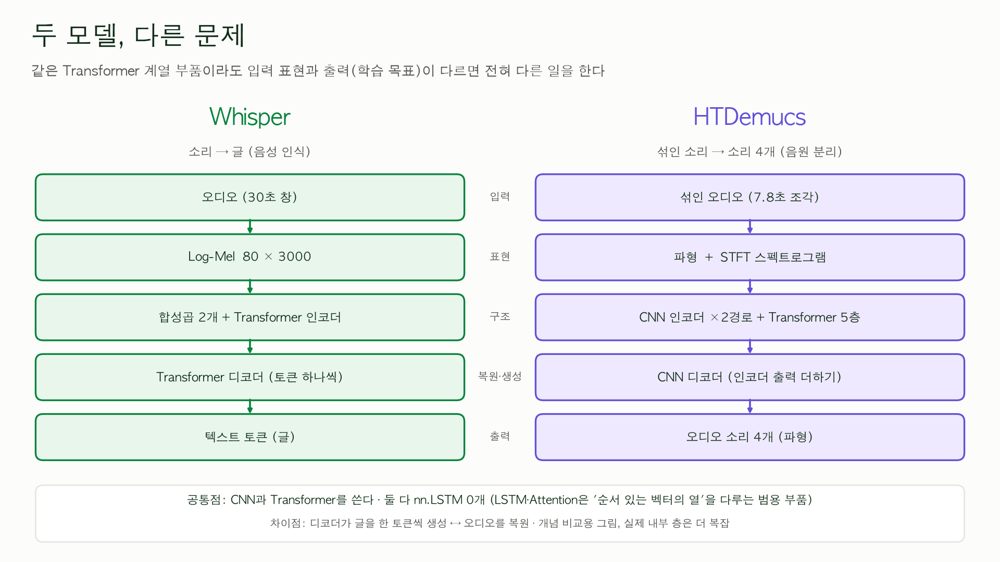

# 🎤 song-lingo 최종 발표 대본 (2026-11-12, 16~17분) — 초안 v2

> 작성일 2026-11-10, **같은 날 ChatGPT 피드백(`docs/발표_대본_20261112_초안 feedback_chatgpt.md`)을 반영해 v2로 고침**(반영 내역은 부록 맨 끝). **지금 서버에서 돌아가는 앱**(내 문장·내 노래·기록, F0 분석, 결과 화면 개편까지)과 구조 탐구 노트북(`experiments/model anatomy/`)을 근거로 쓴 초안입니다. `experiments/skeleton/발표_대본_초안_스켈레톤.md`는 11-01 서비스 스켈레톤 시점의 3분 대본이라 **새로 작성**했고, 형식(장 = `##` 한 개, **화면**과 **대본**)만 따랐습니다.
> 전체 그림은 `docs/module_structures_and_data_flow.md`(호출 관계·데이터 흐름), 나의 근본적 목표는 `docs/personal_goals.md`(여섯 가지 목표)를 기준으로 했습니다.
> **발표 시간은 15분 정도이고 넘어도 된다고 하셨습니다.** 13개 장(11-12에 장 번호를 1~13으로 통일)의 큰 틀은 유지하고, **모델 속(8·9장)에 시간을 더 줬습니다**(각 3분 안팎). 시간 배분은 글자 수로 잡은 **[추정]** 이고, 소리 내어 읽어 본 뒤 고칩니다.
> 표시: **[확인]** 내가 실행·측정하거나 소스·논문에서 확인한 것, **[추정]** 해석, **[미확인]** 아직 확인하지 못한 것, **[결정 필요]** 사용자가 정해야 하는 것(맨 아래 정리).
> **발표 원칙**(11-04·11-06 면담): 세부 UI보다 **내 실험(Demucs·Whisper)과 시행착오를 있는 그대로**. **실험으로 확인한 것과 해석을 구분**해서 말하고, 이해한 것과 아직 이해하지 못한 것을 나눕니다.
> **8·9장은 세 가지를 설명합니다**: ① 입력 데이터가 어떤 형태인가 ② 신경망의 각 부분이 어떤 계산을 하는가 ③ 그 계산이 왜 필요한가.

| 장   | 제목                                                                                          | 시간      | 누적  |
| ---- | --------------------------------------------------------------------------------------------- | --------- | ----- |
| 1    | 🎵 한 줄 소개                                                                                  | 0:30      | 0:30  |
| 2    | ❓ 왜 만들었나 — 나의 목표                                                                     | 1:15      | 1:45  |
| 3    | 🗺️ 전체 그림: 소리가 사용자에게 돌아오기까지 (언어 알아보기 규칙·모델 비교 0:30 포함)           | 2:00      | 3:45  |
| 4    | 📺 시연                                                                                        | 3:15      | 7:00  |
| 5    | 🔬 사용자의 따라읽기 음성 분석 방법                                                            | 1:15      | 8:15  |
| 6    | 🧮 채점의 핵심 — 편집 거리를 표로 채운다                                                       | 0:40      | 8:55  |
| 7    | 🧪 Azure API를 활용한 발음 평가 및 피드백 구현                                                 | 1:30      | 10:25 |
| 8    | 🧠 모델 속 1 — Whisper: 소리가 글이 되기까지                                                   | 3:00      | 13:25 |
| 9    | 🧠 모델 속 2 — Demucs: 섞인 소리가 넷이 되기까지 (소개 0:20 포함)                              | 3:20      | 16:45 |
| 10   | 🔁 두 모델을 나란히                                                                            | 0:30      | 17:15 |
| 11   | 🚧 시행착오와 한계 (노래 구간 인식 실험 1:00 포함)                                             | 2:15      | 19:30 |
| 12   | 🎓 목표에 비춰 본 나의 성장 (AI가 쓴 코드 이해하기 1:00 포함)                                  | 1:45      | 21:15 |
| 13   | 🔜 다음 단계와 마무리                                                                          | 0:30      | 21:45 |
| 부록 | 체크리스트 · 백업 계획 · 예상 질문 · 근거표 · 용어 · 이해 수준과 학습 계획 · 피드백 반영 내역 | 읽지 않음 | —     |

> 합계 **21분 45초**(장 번호를 1~13으로 통일, 3장에 언어 알아보기 비교 0:30 추가. 11-11에 Azure 장 1:30·편집 거리 장 0:40·노래 인식 실험 1:00·코드 이해 1:00·언어 알아보기 0:15 등을 더함, 시간은 글자 수로 잡은 **[추정]**. 11-10 면담에서 **15분을 넘어도 되고 질의응답은 별도**라고 하심). 줄이고 싶으면 4장의 "내 노래" 보조 시연(0:30)과 12장, 7장의 ④ 표를 3행으로 줄입니다.

---

## 1. 🎵 song lingo: 듣고, 따라읽고/받아적고, 확인한다

**화면**
- 외국어 노래 속 문장을 **듣고 → 따라읽거나 받아적고 → 평가 확인**하는 학습 도우미
- **소리가 데이터가 되고, 모델을 지나, 사용자에게 돌아오는 길을 직접 만들고 열어 본 프로젝트**

**대본**
> 안녕하세요. 
> 제가 금번 프로젝트 기간 중 song lingo는 외국어 노래 속 문장을 듣고, 따라읽거나 받아적고, 그에 대한 평가를 받을 수 있는 학습 도우미 웹앱입니다. 
> 오늘은 먼저, 서버에서 돌아가는 프로그램을 보여드리고, 구현 과정에서 경험한, 프로그램 안에서 쓰인 AI 음성 처리 모델 두 개의 구조와 실험 이야기를 공유하고자 합니다.

---

## 2. ❓ 왜 만들었나 — 나의 목표

**화면**
- 문제: 외국어 노래를 듣다가 **무슨 언어인지, 무슨 뜻인지 + 어떻게 발음하고 표기하는지** 궁금하다!
- **내가 이 프로젝트로 얻고 싶은 것 (한 문장)**
  > 실제로 쓸 수 있는 외국어 학습 도구를 만들면서, **음성 데이터가 수집되고 처리되고 분석되어 사용자에게 전달되는 전체 과정을 이해하고 직접 다룰 수 있는 개발자**로 성장한다
- 여섯 가지 목표 (12장에서 다시 점검)
  | 01 쓰는 도구           | 02 음성·음향 처리 내재화  | 03 AI 실험 능력      |
  | ---------------------- | ------------------------- | -------------------- |
  | **04 소프트웨어 설계** | **05 기술 → 사용자 경험** | **06 과학적 호기심** |

**대본**
> 외국어 노래를 듣다 보면 이 노래가 무슨 언어인지, 무슨 뜻인지, 어떻게 발음하고 표기하는지 알기 어렵습니다. 그래서 제가 실제로 듣는 노래를 학습 자료로 바꾸는 도구를 만들고 싶었습니다. 
> 다만, 이 프로그램은 노래방은 아닙니다. 사용자는 노래를 불러서 평가 받는 것이 아니라, 외국어 노래 문장의 표준 발음을 따라읽거나 받아쓴 것에 대해 피드백을 받습니다.
> 이 프로젝트에서 제가 목표한 것은, 수업에서 배운 음성 데이터 처리, 인공지능 원리를 적용한 프로그래밍 경험을 하는 동시에, 제가 실제로 쓸 수 있는 학습 도구를 만드는 것이었습니다. (이 기준으로 마지막에 제가 무엇을 얻었는지 점검하겠습니다.)

---

## 3. 🗺️ 전체 그림: 소리가 사용자에게 돌아오기까지

**화면** (`docs/module_structures_and_data_flow.md` 1절의 지도를 발표용으로 줄인 것)
```
 노래 문장 ──▶ 🔊 기준 음성(TTS) ──────────────┐
 (내 문장·내 노래)                              ▼
 내 목소리 ──▶ 🎙️ 녹음 ──▶ 상태 점검 ──▶ 👂 Whisper(STT) ──▶ 인식한 문장
                                                │
        ┌───────────────────────────────────────┤
        ▼                    ▼                   ▼
   📏 오류율 WER/CER    🎯 틀린 구간 표시     🎵 목소리 높낮이 F0
   (정답과 비교)        (단어별 시간)         (참고 TTS와 겹쳐 보기)
        └──────────── 화면에 결과 ◀──────────────┘
            (선택) 🧪 Azure 발음 평가 · 🎚️ Demucs 보컬만 듣기

 저장: 로그인 사용자의 점수·문장·인식한 글·가사·뜻 → PostgreSQL
       ※ 녹음과 올린 음원은 저장하지 않음
```
- 4개 층: **화면**(Streamlit) → **흐름**(practice·web_practice 등) → **처리**(audio·stt·tts·scoring·pitch·separate …) → **저장**(account·auth·storage)
- **언어 알아보기(탐지)** — 입력 직후, **STT·TTS보다 먼저** 한 번 [확인: `app/views/song.py` 1·372·416줄, `app/views/lyrics.py` 1줄]
  - **텍스트(내 문장)**: **AI 모델이 아니라 직접 만든 파이썬 규칙** — 글자의 문자 체계(한글·가나·키릴·라틴)를 세어 **줄마다** 제안, 라틴 문자는 언어별로 자주 쓰는 낱말·특징 글자 점수로 영어·프랑스어 등을 구분 → 모델 호출·과금 없음, 한자만 있는 줄은 일본어·중국어를 구분하지 못해 직접 선택 (`languages.suggest_line_language`)
  - **소리(내 노래)**: 구간을 자른 뒤 Whisper의 **언어 감지**가 앞 30초를 훑어 언어별 확률을 계산, 지원 언어 안에서 순위 → 글로 받아 적지 않음 (`stt.detect_language`)
  - 둘 다 **제안 → 사용자 확인**(네/아니오/모르겠어요) 뒤에 그 언어가 STT·TTS·채점에 쓰인다. 언어 코드는 `en`(영어)·`ja`(일본어)·`fr`(프랑스어)·`es`(스페인어)·`zh`(중국어) 등 **총 11개**(한국어 포함)(Azure 로캘은 `en-US`·`ja-JP`처럼 쓴다)
- **무엇이 어디서 돌고, 밖으로 무엇이 나가나** (정확히 구분)

  | 단계                | 기술                                        | 어디서      | 밖으로 나가는 것                           | 수업      |
  | ------------------- | ------------------------------------------- | ----------- | ------------------------------------------ | --------- |
  | 기준 음성           | OpenAI TTS                                  | OpenAI      | 문장 글(버튼을 누를 때, 같은 문장은 캐시)  | 013       |
  | 한글 뜻·표현 설명   | OpenAI 채팅 모델                            | OpenAI      | 문장 글과 언어(버튼을 누를 때)             | —         |
  | 인식                | faster-whisper (문장 `tiny`, 노래 `medium`) | 내 서버 CPU | 없음                                       | 7강       |
  | 채점                | WER/CER, 편집 거리 **직접 구현**            | 내 서버     | 없음                                       | 보충 학습 |
  | 소리 그림·틀린 구간 | STFT·Log-Mel·FFT, 단어별 시간               | 내 서버     | 없음                                       | 01~04     |
  | 목소리 높낮이       | pYIN(F0)                                    | 내 서버     | 없음                                       | 01·03     |
  | 보컬 분리(선택)     | Demucs `htdemucs`                           | 내 서버     | 없음                                       | —         |
  | 발음 평가(선택)     | Azure Speech                                | Azure       | **녹음·기준 문장·언어** (버튼을 누를 때만) | —         |
  | 저장·배포           | PostgreSQL, Oracle Cloud VM, HTTPS, 로그인  | 내 서버     | —                                          | —         |

**대본**
> 프로그램의 전체 구조를 도식화한 것입니다. 
> 외국어 노래 문장이 소리 또는 텍스트 형태의 데이터로 들어오면, TTS 모델을 통해 기준 음성을 만듭니다. 소리 데이터는 STT 모델인 Whisper를 거쳐서 TTS 모델에 입력시킵니다. 인식된 텍스트에 대해서는 OpenAI API 호출을 통해 한국어 뜻, 관련 표현 등의 설명을 제공합니다.
> 이 모든 단계에 앞서 언어를 먼저 확인합니다. 소스 코드에 따르면 텍스트로 입력한 문장은 AI 모델이 아니라 제가 직접 만든 규칙으로 판단합니다. 글자의 종류, 즉 한글, 가나, 키릴, 라틴 문자의 비율로 줄마다 언어를 제안하고, 라틴 문자는 언어마다 자주 쓰는 낱말과 특징 글자의 점수로 영어와 프랑스어 등을 구분합니다. 한자만 있는 줄은 일본어인지 중국어인지 구분하지 못해 직접 고르게 합니다. 소리로 넣은 곡은 구간을 자른 직후, 글로 받아 적기 전에 Whisper의 언어 감지 기능이 앞 30초를 훑어 언어별 확률을 계산합니다. 내 노래 화면의 소스에 따르면 이 '언어 알아보기'를 하기 전에는 '가사 인식하기' 버튼이 눌리지 않도록 되어 있습니다. 감지 결과는 제안일 뿐이라 사용자가 네, 아니오, 모르겠어요로 확인하고, 그 언어가 인식과 기준 음성, 채점에 쓰입니다. 선택할 수 있는 언어는 en(영어), ja(일본어), fr(프랑스어), es(스페인어), zh(중국어) 등 한국어를 포함해 총 열한 개입니다.
> 사용자는 기준 음성을 듣고 따라읽기, 또는 받아쓰기 연습을 합니다.
> 외국어 문장을 읽는 목소리를 녹음하면 음성 데이터 상태를 점검한 뒤 Whisper가 텍스트로 바꿉니다. 
> 프로그램은 텍스트를 정답과 비교해 오류율을 계산합니다.
> 따라읽기 녹음에 대해서는 틀린 구간 표시를 포함한 파형 분석, 목소리 높낮이 분석, Azure API를 활용한 발음 평가 및 피드백 등을 확인할 수 있습니다.
> 로그인한 사용자가 원하는 경우 연습 및 평가 기록을 서버 데이터베이스에 저장할 수 있습니다. 사용자가 업로드한 음원과 녹음은 데이터베이스에 저장하지 않습니다.

**(보조) 언어 알아보기 — 텍스트는 규칙, 소리는 모델** (약 0:30)

**화면** — 장표 한 장, 두 칸 비교입니다. 근거는 검토 문서 16.14-보충과 `languages.py`·`stt.py`·`app/views/song.py` 소스입니다 [확인].

| 구분                  | 텍스트 (내 문장)                                                                                      | 소리 (내 노래)                                                                                  |
| --------------------- | ----------------------------------------------------------------------------------------------------- | ----------------------------------------------------------------------------------------------- |
| 누가 판단하나         | **직접 만든 파이썬 규칙**(AI 모델 아님) — `languages.suggest_line_language`                           | **Whisper 모델**의 언어 감지 — `stt.detect_language`                                           |
| 무엇을 보나           | 글자 종류(가나·한글·한자·키릴·라틴)를 세고, 라틴 문자 줄은 자주 쓰는 낱말·특징 글자 점수로 영어·프랑스어 등을 구분 | 구간 앞 30초의 **소리**. 글로 받아 적지 않고 언어별 확률만 계산(앱이 지원하는 11개 안에서 다시 순위)      |
| 언제·비용             | 즉시, 모델 호출·과금 없음                                                                             | **STT보다 먼저**, 처음 한 번은 모델을 읽느라 몇십 초                                            |
| 한계                  | 짧은 줄은 틀릴 수 있음. 한자만 있으면 일본어·중국어를 구분하지 못해 직접 선택(**중국어는 자동 제안 안 됨**) | 반주가 섞인 소리·섞인 언어 가사에서 흔들릴 수 있음 **[추정]**                                   |
| 공통                  | **제안일 뿐** — 사용자가 네/아니오/모르겠어요로 확인하고, 그 언어가 STT·TTS·채점·Azure 로캘에 쓰인다 |                                                                                                 |

**대본**
> 언어 알아보기는 입력에 따라 방식이 다릅니다. 텍스트는 AI 모델이 아니라 제가 직접 만든 규칙으로 판단합니다. 소스 코드에 따르면 글자의 종류를 세고, 라틴 문자는 언어마다 자주 쓰는 낱말과 특징 글자의 점수로 구분하며, 한자만 있는 줄은 일본어와 중국어를 구분하지 못해 직접 고르게 합니다. 반면 소리는 Whisper 모델의 언어 감지 기능을 씁니다. 가사를 받아 적기 전에, 구간 앞 30초를 한 번 듣고 언어별 확률을 계산해서, 앱이 지원하는 열한 개 언어 안에서 순위를 매깁니다. 두 방식 모두 제안일 뿐이어서 사용자가 확인한 언어가 인식과 기준 음성, 채점에 쓰입니다.

---

## 4. 📺 시연 (실제 서버 화면)

**화면** — 시연 순서 (각 단계에 대본이 붙습니다. **화면은 라이브, 막히면 7부록의 캡처로 대체**)

| 단계 | 할 일                                                                   | 시간 | 보여 주는 것                             |
| ---- | ----------------------------------------------------------------------- | ---- | ---------------------------------------- |
| ①    | 로그인 → **내 문장** → 직접 쓴 문장 입력 → **언어 알아보기**            | 0:30 | 줄마다 언어를 제안하고 사용자가 확인한다 |
| ②    | **표준 발음 만들기**(캐시) → 듣기                                       | 0:20 | OpenAI TTS, 같은 문장은 캐시             |
| ③    | **따라읽기 → 채점하기**                                                | 0:40 | 마이크 녹음 → 채점 중(몇 초)             |
| ④    | **결과를 위에서 아래로 읽기**                                           | 1:15 | 아래 표                                  |
| ⑤    | (보조) **내 노래**: 곡 1개의 구간 → 가사 인식 → 줄 연습 / **기록** 화면 | 0:30 | 같은 연습 패널, 기록 그래프              |

- **채점 중 슬라이드 "채점 버튼을 누르면 안에서 일어나는 일"**(③과 ④ 사이, 기다리는 동안 보여 주는 장표): ① 녹음(브라우저 마이크 → bytes) ② 상태 점검(음량·무음·클리핑, 안내만) ③ Whisper 인식 ④ 채점(편집 거리 → WER/CER, 바뀜·빠짐·더해짐) ⑤ 단어별 시간(내 녹음·표준 발음을 각각 다시 인식, 틀린 구간과 F0가 **한 번만 구해 공유**) ⑥ F0(pYIN → 상대 음높이 → 단어 칸에 겹침)과 소리 모양 그림. 인식은 채점용 1번 + 단어 시간용 2번으로 **세 번** 돌아서 몇 초 더 걸린다. 근거: `docs/module_structures_and_data_flow.md` 2절 순서도

- ④ 결과를 읽는 순서
  1. **문장 인식 일치도 · Whisper**: WER/CER, 바뀜·빠짐·더해짐. "발음 점수가 아니라 문장 인식 오류율"
  2. **단어 대조**: 틀린 부분은 보라 물결 밑줄 + 이름표
  3. **다시 듣기**: 표준 발음과 내 녹음
  4. **틀린 구간 표시**: 같은 번호 [k]가 두 소리의 대응 구간
  5. **목소리 높낮이 · F0**: 참고 TTS와 내 녹음의 **상대 음높이**를 단어 칸 위에 겹침
  6. **Azure 발음 평가**(버튼): 점수 카드, 단어별 점수 — *선택*
  7. **소리 모양 자세히 보기**(접힘): 파형·FFT·STFT·Log-Mel
- **시연 문장 후보**: 3번 문장 `We'll sing together until the morning comes.`(직접 쓴 문장). 재녹음해도 `we are seeing`으로 인식된 사례가 있어 **틀린 구간·F0 비교가 잘 보이는** 후보입니다 [확인: `sentences.csv`의 probe 열]. 매번 같은 결과가 나온다는 보장은 없음 **[미확인]**
- 상업 노래 가사는 화면·슬라이드에 올리지 않습니다. 내 노래는 곡 1개를 **로컬 재생**만(11-03 허용 범위)

**대본**
> 직접 써 보겠습니다. 로그인하고 내 문장에 문장을 넣으면 줄마다 언어를 제안하고 제가 확인합니다. 표준 발음을 만들면 기준 소리가 나오고, 같은 문장은 캐시되어 다시 비용이 들지 않습니다. 이제 따라읽고 채점합니다. 몇 초 걸립니다.
> 그동안 안에서 일어나는 일을 설명드리겠습니다. 먼저 녹음이 들어오면 음량과 무음, 클리핑을 점검합니다. 이것은 안내일 뿐이라 경고가 있어도 계속 진행합니다. 그다음 Whisper가 녹음을 글로 바꾸고, 그 글을 정답과 편집 거리로 비교해 오류율을 냅니다. 이어서 틀린 구간을 소리 위에 표시하려고 내 녹음과 기준 음성에서 단어별 시간을 다시 구합니다. 같은 단어 시간을 목소리 높낮이 비교도 함께 쓰기 때문에 한 번만 구합니다. 마지막으로 pYIN으로 두 목소리의 높낮이를 계산해 단어 칸 위에 겹쳐 그립니다. 그래서 몇 초가 걸립니다.
> 결과를 위에서부터 읽겠습니다. 맨 위는 인식 결과를 정답과 비교한 오류율입니다. 발음 점수가 아니라 글이 얼마나 같은가입니다. 아래 단어 대조에서 보라색 밑줄이 다르게 인식된 단어이고, 틀린 구간 그림에서는 같은 번호가 기준 음성과 제 녹음에서 같은 단어 덩어리를 가리킵니다. 그다음이 목소리 높낮이인데, 사람마다 목소리 높이가 달라서 각자의 중앙 높이를 0으로 맞춰 올라가고 내려가는 모양만 겹쳐 보여 줍니다. 기준 음성의 억양이 정답은 아니고, 단어 칸에서 두 선이 어떻게 다른지 관찰하는 용도입니다. 발음 평가는 외부 서비스라 버튼을 눌렀을 때만 보냅니다. 아래 소리 모양은 접어 두었습니다.
> (보조) 내 노래에서는 곡 하나의 구간을 골라 가사를 인식하고 줄 단위로 같은 연습을 합니다. 기록 화면에서는 같은 문장의 오류율 변화를 봅니다.

**시연 시나리오 (초안, 11-12) — 클릭 단위 진행표** — 위 "시연 순서"를 실제 버튼 이름으로 풀어 쓴 것입니다. 버튼 이름은 앱 소스(`app/views/lyrics.py`, `app/ui_practice.py`)에서 확인했고 [확인], 시간은 연습해 보고 고칩니다 **[추정]**.

*발표 20~30분 전 준비* (이미 4장 아래 체크리스트에도 있음)
- [ ] 서버 앱에 접속해 로그인(발표용 비밀번호), 브라우저 **마이크 권한**을 허용하고 소리 출력 확인
- [ ] 시연 문장으로 **채점을 한 번 해 둔다**(표준 발음 캐시, 모델 로딩, F0 워밍업 약 20초). 끝나면 **새 묶음으로 화면을 비워 둔다**
- [ ] 브라우저 탭 2개: ① 서버 앱(내 문장) ② 백업 캡처(결과 전체, Azure 점수 카드, F0 그림). 슬라이드 4장 "시연 순서"를 띄운 채 시작
- [ ] **안전 경로**: 입력 대신 **예시 묶음 '영어' → 예시 문장 불러오기**를 쓰면 한글 뜻과 표준 발음 캐시가 이미 있어 빠르고 과금이 없다. 시연 문장은 그 안의 3번 줄 `We'll sing together until the morning comes.`

| #  | 누적 | 클릭·화면                                                                                                             | 말할 것 (한 줄)                                                                 | 막히면                                                      |
| -- | ---- | --------------------------------------------------------------------------------------------------------------------- | ------------------------------------------------------------------------------- | ----------------------------------------------------------- |
| 1  | 0:00 | 슬라이드 4장 → 앱 탭으로 전환                                                                                         | "서버에서 돌아가는 앱으로 따라읽기 한 번을 해 보겠습니다."                     | 서버가 안 열리면 **로컬 실행**(백업 계획 표) 또는 캡처       |
| 2  | 0:10 | 로그인 → 사이드바 **내 문장**                                                                                         | "로그인한 사용자만 기록이 저장됩니다."                                          | 로그인이 안 되면 게스트로 진행(저장은 없음)                 |
| 3  | 0:20 | 입력칸에 문장 넣기(직접 입력) 또는 **예시 묶음 '영어' → 예시 문장 불러오기**                                          | "직접 쓴 예문입니다."                                                            | 입력이 느리면 예시 불러오기                                 |
| 4  | 0:30 | **언어 알아보기** 클릭 → "영어로 보여요 … 맞나요?" → **제안이 있는 줄은 모두 맞아요**                               | "AI 모델이 아니라 제가 만든 규칙이 글자 종류와 낱말로 제안합니다. 제안이라 제가 확인합니다." | 제안이 틀리면 '아니오'로 영어를 직접 고르며 "그래서 확인합니다"로 설명 |
| 4b | (선택 0:15) | 시간이 남으면 **예시 묶음 '일본어+영어 섞인 예'** 불러오기 → 줄마다 제안이 다르게 나오는 것만 보여 주고 영어로 돌아오기 | "한 줄 안에서 일본어와 영어가 섞여도 글자 비중으로 주 언어를 정합니다."        | 건너뛴다                                                    |
| 5  | 0:55 | **연습할 줄**에서 3번 줄 선택 → **한글 뜻**이 보이는 것 확인 → **표준 발음 만들기** → 재생                            | "기준 소리는 OpenAI TTS이고 같은 문장은 캐시되어 다시 비용이 들지 않습니다."    | 소리가 안 나면 슬라이드로 설명하고 다음 단계로              |
| 6  | 1:15 | 탭 **🎤 따라읽기** → `st.audio_input`의 "눌러서 녹음 시작" → 문장을 읽고 → "다시 눌러서 끝내기" → **채점하기**        | "이제 읽고 채점합니다. 몇 초 걸립니다."                                         | 마이크가 안 되면 **미리 녹음한 파일/결과 캡처**              |
| 7  | 1:40 | 채점 중 **슬라이드 "채점 버튼을 누르면 안에서 일어나는 일"** 로 전환해 대본의 "그동안 설명"을 말한다 (약 0:40)        | (위 대본 둘째 문단)                                                             | 결과가 안 나오면 설명을 길게 하고, 끝까지 안 나오면 캡처    |
| 8  | 2:20 | 앱으로 돌아와 **결과를 위에서 아래로** 읽는다: ① 오류율 카드 ② 단어 대조(보라 밑줄) ③ 다시 듣기 ④ 틀린 구간 ⑤ F0    | (위 대본 셋째 문단)                                                             | F0가 느리면 워밍업을 기다리거나 캡처(오류율·단어 대조는 정상) |
| 9  | 3:15 | **Azure로 평가하기** 클릭 → 점수 카드와 단어별 점수 확인 (7장 Azure 장으로 이어 간다)                                 | "외부 서비스라 이 버튼을 눌렀을 때만 녹음이 전송됩니다."                         | 안 되면 "선택 기능이라 외부 연결이 필요하다"고 말하고 넘어감 |
| 10 | 3:30 | (보조, 선택 0:30) **내 노래**: 곡 1개의 구간 → 언어 알아보기 → 가사 인식 → 줄 연습 / **기록** 메뉴                    | "같은 연습 패널을 곡의 줄에서도 씁니다."                                        | 시간이 없으면 생략                                          |

**시나리오 메모 [결정 필요]**
1. 문장은 **직접 입력**할지(자연스럽지만 타이핑 시간) **예시 불러오기**로 할지(안전하고 빠름) — 추천: 3번 줄은 예시 불러오기로, "직접 쓴 문장입니다"만 말로 설명
2. **4b**(일본어+영어 섞인 예)와 **10**(내 노래)을 할지: 둘 다 선택 항목이고, 시간이 부족하면 빼도 시연의 핵심(1~9)은 약 3:30에 끝남
3. 시연 도중 **녹음 실패**에 대비해 미리 녹음한 파일 한 개를 데스크톱에 두고(커밋 금지, 개인 목소리), 결과 캡처 4장(오류율·틀린 구간·F0·Azure)을 같은 폴더에 둔다

---

## 5. 🔬 사용자의 따라읽기 음성 분석 방법

**화면** — 결과 화면에 나오는 분석 네 가지와 **각각의 한계**를 한 표에 적습니다 (11-11: 파형 분석 추가, 한계 칸 추가).

| 분석                                              | 답하는 질문                                                                                        | 점수인가?                                 | 한계                                                                                                                                                |
| ------------------------------------------------- | -------------------------------------------------------------------------------------------------- | ----------------------------------------- | --------------------------------------------------------------------------------------------------------------------------------------------------- |
| **문장 인식 오류율** (Whisper → WER/CER)          | 인식된 문장이 기준 문장과 **얼마나 다른가**                                                        | 오류율(낮을수록 좋음), **발음 점수 아님** | 문맥으로 **틀린 발음도 정답에 가깝게 적을 수 있고**, 쉼·속도·억양은 못 잡는다                                                                       |
| **파형 분석** (틀린 구간 표시, 스펙트로그램 포함) | **어느 단어 덩어리**가 다르게 인식됐고, 내 소리의 **파형·주파수 모양**이 기준 음성과 어떻게 다른가 | **점수 없음**, 눈으로 보는 관찰           | 단어 구간은 Whisper의 **단어별 시간(모델 내부 정보로 추정한 대략의 구간)** 이라 정확한 정렬이 아니다. 그림만으로 발음이 맞고 틀림을 판정하지 않는다 |
| **F0 (목소리 높낮이)**                            | 내 목소리의 **음높이가 시간에 따라 어떻게 변하나**                                                 | **점수 없음**, 관찰용                     | TTS의 억양이 **유일한 정답이 아니다**. 무성음·쉼에서는 값이 없고, 잡음에서는 옥타브 오류가 생기며, 상대 음높이만 비교한다                           |
| **Azure 발음 평가** (7장)                     | 기준 문장에 비추어 **발음·유창성·운율**을 어떻게 평가하나                                          | 외부 서비스의 점수(선택)                  | 내 시험은 **한 사람·한 문장·1회씩**. 운율·음절·음소는 영어 중심(일본어·프랑스어도 기본 점수는 나옴). 버튼을 누를 때만 녹음이 외부로 나간다       |

- 핵심: **"발음 점수를 하나 더 만든 것"이 아니라, 하나의 소리를 서로 다른 층위로 분석하고 각각의 한계를 밝힌 것**
- 파형 분석의 "스펙트로그램"은 결과 아래 **"소리 모양 자세히 보기"**(파형·FFT·STFT·Log-Mel)에 있고, 수업 3·4강에서 배운 그림과 같은 것입니다 [확인: 4장 시연 순서 ⑦]
- Whisper는 문맥을 보고 **틀린 발음도 정답에 가깝게 적을 수 있어서** 오류율이 낮아도 발음이 완벽하다는 뜻이 아니다
- F0는 TTS의 억양이 **유일한 정답이 아니고**, 문장 끝을 항상 올려야 하는 것도 아니다

**대본**
> 따라읽기 녹음에는 네 가지 분석이 붙습니다. 첫째 오류율은 인식한 글이 정답과 얼마나 다른지, 둘째 파형 분석은 어느 단어 구간이 달랐는지를 소리 위에 표시하고 파형과 스펙트로그램으로 소리 모양을 보여 줍니다. 셋째 F0는 목소리의 높낮이가 시간에 따라 어떻게 변했는지, 넷째 Azure는 발음과 유창성을 어떻게 평가하는지를 묻습니다. 네 가지는 서로 대체할 수 없고, 점수는 오류율과 Azure에만 있습니다. 그래서 저는 점수를 하나 더 만들기보다, 각 분석이 무엇을 알려 주고 무엇은 알려 주지 못하는지를 화면에 적어 두었습니다. 예를 들어 오류율은 Whisper가 문맥을 보고 단어를 고르기 때문에 발음이 조금 틀려도 맞게 적을 수 있고, 파형 분석의 단어 구간은 모델이 추정한 대략의 구간입니다. 이 중 Azure 발음 평가는 조금 뒤 일곱 번째 장에서 자세히 보겠습니다.

## 6. 🧮 채점의 핵심 — 편집 거리를 표로 채운다 (약 0:40)

**화면** — 장표 한 장 (표 + 점화식 + 코드 발췌). 예시는 직접 쓴 문장이고 표의 값은 `scoring.edit_matrix`가 만든 값 그대로입니다 [확인].
- **제목**: 채점의 핵심: 편집 거리를 표로 한 칸씩 채운다 (동적 계획법)
- **표** (정답 `we sing together until` × 인식 `we seeing together`, **굵은 칸 = 되짚은 길**)

  | 정답 \ 인식 | ∅     | we    | seeing | together |
  | ------------ | ----- | ----- | ------ | -------- |
  | ∅            | **0** | 1     | 2      | 3        |
  | we           | 1     | **0** | 1      | 2        |
  | sing         | 2     | 1     | **1**  | 2        |
  | together     | 3     | 2     | 2      | **1**    |
  | until        | 4     | 3     | 3      | **2**    |

- **되짚은 길**: `we = we` 일치 → `sing → seeing` **바뀜(S)** → `together = together` 일치 → `until → (없음)` **빠짐(D)**
- **점화식**: `d[i][j]` = 아래 세 값 중 가장 작은 것 — 위 칸 + 1(**삭제**: 정답 단어를 지움) · 왼쪽 칸 + 1(**삽입**: 인식에만 있는 단어) · 대각선 칸 + (같으면 0, 다르면 1)(**일치·바뀜**)
- **결과**: 오른쪽 아래 칸 = 최소 수정 횟수 = 2 → **WER = (S + D + I) ÷ N = (1 + 1 + 0) ÷ 4 = 0.50**
- **코드 발췌** (`scoring.edit_matrix`, 내 코드):
  ```python
  cost = 0 if ref[i-1] == hyp[j-1] else 1     # 같으면 0, 다르면 1
  d[i][j] = min(d[i-1][j] + 1,                # 삭제
                d[i][j-1] + 1,                # 삽입
                d[i-1][j-1] + cost)           # 일치 또는 바뀜
  ```
- **이해한 방법**: 점화식 → 표를 한 칸씩 넘기는 도구(`experiments/WER, CER/DP_편집거리_이해하기.html`) [확인: 검토 문서 13장]. **동률일 때 비슷한 단어끼리 짝짓는 규칙**은 이 프로젝트에서 덧붙인 부분(수업에 없음)

**대본**
> 오류율이 어떻게 나오는지 한 장으로 보겠습니다. 정답과 인식 결과를 표로 놓고, 한 칸을 채울 때 삭제, 삽입, 일치나 바뀜 중 가장 적게 드는 값을 고릅니다. 이렇게 앞부분의 답을 이용해 뒷부분을 채우는 방법이 동적 계획법입니다. 오른쪽 아래 칸이 최소 수정 횟수이고, 이 값을 정답 단어 수로 나눈 것이 오류율입니다. 이 방법은 수업에서 배운 것이 아니라서, 점화식을 따로 공부하고 표를 한 칸씩 넘겨 보는 도구를 만들어 이해했습니다.

---

## 7. 🧪 Azure API를 활용한 발음 평가 및 피드백 구현 (1:30)

> 근거: 검토 문서 14.7(7·8절). 강사님 11-05 DM — **"발음 자체를 평가하고 부족한 부분을 피드백하는 방향이 맞다"**, **"같은 문장을 정상적으로 읽은 경우와 단어를 생략하거나 끊어 읽은 경우를 비교해 차이가 평가 결과에 반영되는지 확인"**, 발표는 **"Azure API를 활용한 발음 평가 및 피드백 구현"** 으로 정리. 아래 숫자는 사용자가 앱에서 직접 읽은 **화면 캡처 4장의 값**이고, **조건마다 1회씩**입니다 [확인: 숫자, 해석은 **[추정]**].

**화면** — 장표 1장, 다섯 칸

| 칸            | 장표에 쓸 내용                                                                                                                                                                                                                                                             |
| ------------- | -------------------------------------------------------------------------------------------------------------------------------------------------------------------------------------------------------------------------------------------------------------------------- |
| ① 도입 배경   | 처음 기획한 오류율(WER/CER)은 **인식된 글의 일치도**라서 한계가 있다. ⓐ 문맥으로 고쳐 적혀 **오류율 0인데 Azure는 `explore`를 68점**으로 봤다(내 녹음 1건) ⓑ 끊어 읽어도 오류율은 0.250으로 낮다 → 언어 학습에는 "**어디를 어떻게 고칠지**" 피드백이 필요 **[추정: 동기]** |
| ② 서비스 개요 | **Azure AI Speech 발음 평가**. 항목: **정확도 · 유창성 · 완성도 · 운율 · 종합**, 단어별 점수와 오류 종류(**발음 · 빠짐 · 더해짐**), 음소 펼침. **평가 기준은 TTS가 아니라 Azure의 원어민 발음 모델**                                                                       |
| ③ 사용 방법   | 따라읽기 채점 후 **"Azure로 평가하기" 버튼**(누를 때만) → **녹음·기준 문장 글·언어**만 전송(TTS 소리는 보내지 않음, 녹음은 서버에 저장 안 함) → 점수 카드 + 단어별 점수. 로그인·저장을 켜면 **점수와 단어별 결과**가 기록에 저장(녹음 제외)                                |
| ④ 결과 예시   | 같은 문장을 네 가지로 읽은 비교표(아래)                                                                                                                                                                                                                                    |
| ⑤ 한계        | 한 사람·한 문장·**1회**. 정상 읽기도 `we'll` 51·`together` 43으로 이미 낮아 **완벽한 기준선이 아님**. "틀린 발음" 시험은 기준선이 낮은 단어를 골라 깔끔하지 않았음. 운율·음절·음소는 영어 중심이고, 일본어·프랑스어는 기본 점수가 나오는 것까지만 확인                                                |

**④ 결과 예시 표** (문장: `We'll sing together until the morning comes.`, 직접 쓴 문장) [확인: 11-05 화면 캡처 4장]

| 읽기 조건   | 정확도 | 유창성 | 완성도 | 운율 | **종합** | Azure가 표시한 단어                                          | 오류율(WER) |
| ----------- | ------ | ------ | ------ | ---- | -------- | ------------------------------------------------------------ | ----------- |
| ① 정상      | 81     | 90     | 71     | 81   | **79**   | `we'll` 51 · `together` 43(발음), 나머지 91~97               | (캡처 없음) |
| ② 단어 생략 | 32     | 77     | **14** | 69   | **41**   | `together`·`the`·`comes` **빠짐**                            | 0.750       |
| ③ 끊어 읽기 | 45     | **49** | 14     | 66   | **38**   | `We'll` **빠짐**, `the` **더해짐**                           | **0.250**   |
| ④ 틀린 발음 | 56     | 88     | 43     | 74   | **61**   | `We'll` **빠짐**, `sing` 47 · `together` 44 · `the` 55(발음) | 0.375       |

- 읽은 것 [확인 + 추정]: ⓐ 정상보다 **세 경우 모두 종합이 내려갔다**(79 → 41·38·61): 강사님 질문의 답은 "**차이가 평가에 반영된다**" ⓑ **끊어 읽기에서 유창성이 90 → 49로 가장 크게** 내려갔는데 **오류율은 0.250**으로 낮았다(Whisper는 끊어 읽어도 단어를 알아듣는다) → **쉼·속도는 오류율이 못 잡고 Azure(유창성)가 잡는다** ⓒ 단어 생략은 **`빠짐` 표시와 완성도 71 → 14**로 반응했다
- 완성도·정확도 등의 정의는 Microsoft 문서를 읽고 정리한 것이고 [일반 지식], **완성도의 계산식은 문서에 없어 이 표본으로 확인하지 못했다** **[미확인]**

**대본**
> 강사님께서 발음 자체를 평가하고 부족한 부분을 피드백하는 방향이 맞다고 하셔서 Azure의 발음 평가 API를 붙였습니다. 처음 기획한 오류율은 Whisper가 글로 바꾼 결과를 정답과 비교하기 때문에, 문맥으로 고쳐 적힌 단어나 쉼과 속도는 잡지 못합니다. 실제로 제 녹음에서 오류율은 0이었는데 Azure는 explore라는 단어를 68점으로 봤습니다.
> 사용법은 따라읽기를 채점한 뒤 'Azure로 평가하기' 버튼을 누르는 것입니다. 녹음과 기준 문장, 언어만 Azure로 전송되고, 정확도·유창성·완성도·운율과 종합 점수, 그리고 단어별 점수와 빠짐·더해짐 같은 오류 종류가 돌아옵니다. 평가 기준은 TTS가 아니라 Azure의 원어민 발음 모델이고, 녹음은 서버에 저장하지 않습니다.
> 강사님이 제안하신 대로 같은 문장을 정상으로, 단어를 빼고, 끊어서, 틀리게 읽어 봤습니다. 정상 읽기의 종합 79가 단어를 빼면 41, 끊어 읽으면 38, 틀리게 읽으면 61로 내려가서, 차이가 점수에 반영됐습니다. 특히 끊어 읽기는 유창성이 90에서 49로 가장 크게 떨어졌는데 오류율은 0.25로 낮았습니다. 쉼은 오류율이 못 잡고 Azure가 잡았다고 해석합니다. 다만 한 사람이 한 문장을 한 번씩 읽은 결과라 일반화하지 않고, 정상 읽기에서도 두 단어가 이미 낮았다는 점을 함께 말씀드립니다.

---

## 8. 🧠 모델 속 1 — Whisper: 소리가 글이 되기까지

> 이 장과 9장은 **이해하려고 직접 열어 본 이야기**입니다. 근거는 `experiments/model anatomy/whisper_anatomy_claude_code.ipynb`(이슈 #79). 설명은 **입력 → 계산 → 왜 필요한가** 순서로 합니다.

**화면** — 장표 이미지: `docs/slides/slide_6_whisper.png`(1920×1080, 아래 그림). 입력 예시는 직접 쓴 문장의 TTS 소리로 **Whisper와 같은 설정의 Log-Mel**을 계산했고 0으로 채운 부분을 회색으로 구분했습니다.


텍스트 버전(장표에 글로 쓸 때):
```
① 입력  소리(몇 초든) ─▶ Log-Mel (80 × 3000) : 30초 창에 맞추고 모자라면 0으로 채움   ← 수업 4강의 STFT·Mel 그대로
② 계산  인코더: 합성곱 2개(시간 3000 → 1500) + Transformer 셀프 어텐션 층들  → 위치 1500개 (= 30초 ÷ 20 ms)
        디코더: 지금까지 쓴 토큰 + 인코더 출력(교차 어텐션)을 보고 **다음 토큰의 확률** → 하나 고름 → 붙이고 반복 (자기회귀)
③ 왜    인코더가 소리를 "요약"해야 디코더가 글을 쓸 때 소리를 다시 참조할 수 있다. 디코더는 이전 토큰을 쓰는 언어 모델처럼 동작한다
   ─▶ 글(토큰)
```
- **수업 6강과의 같은 점·다른 점** [확인: 수업 노트북 `lesson06_practice.ipynb`와 이 노트북]: 같은 점은 **인코더 → 디코더**, 디코더가 **BOS부터 한 토큰씩** 만들고 앞 출력을 다음 입력으로 쓰는 **자유 생성**. 다른 점은 ① 6강 인코더는 LSTM이 소리를 **고정 길이 상태 h·c(32개 숫자) 하나**로 요약, Whisper 인코더는 **1,500개 위치를 그대로** 디코더가 **교차 어텐션**으로 참조 ② 6강 입력은 Log-Mel **40개·hop 8 ms**, Whisper는 **80개·hop 10 ms**(창 25 ms) ③ 6강 토큰은 **어절**(사전 35개), Whisper는 **글 조각**(51,865개) ④ 6강은 **3개 음성으로 학습한 구조 실습**
- 확인한 숫자 **[확인: 모델 파일 `model.bin`을 직접 읽음]**
  - 층 수 `tiny` 4 → `base` 6 → `small` 12 → `medium` 24, 차원 384 → 1024 (인코더·디코더 층 수는 같음)
  - **LSTM·GRU 변수 0개** → 수업 009의 RNN 계열은 없고 **Transformer만**(입력 앞의 합성곱 2개는 CNN)
  - `tiny`는 파라미터의 **절반 이상이 단어 사전**(토큰 51,865개 × 384)
  - 입력은 항상 **(80, 3000)**: 인코더 입력 크기는 음성이 짧아도 **줄어들지 않는다**. 다만 **전체 처리 시간**은 디코더가 만드는 토큰 수, 디코딩 설정, 하드웨어에도 영향을 받는다 (※ "비용은 30초 창 개수"로 단정하지 않음)
- **내가 겪은 현상: 확인한 것과 해석을 나눈다**

  | 현상                   | **확인**한 것                                                                                                                                | **해석**(추정)                                                                                                                                                        |
  | ---------------------- | -------------------------------------------------------------------------------------------------------------------------------------------- | --------------------------------------------------------------------------------------------------------------------------------------------------------------------- |
  | 무음에서 글이 생김     | 무음 입력에서도 **토큰이 생성**됨. 다만 `no_speech_prob`가 높고 `avg_logprob`가 매우 낮아 faster-whisper의 규칙이 걸러 냄 [확인: 노트북 8절] | 소리 정보가 부족할 때 **언어 패턴에 기대 그럴듯한 말**을 쓸 수 있음. 디코더가 이전 토큰으로 다음 토큰을 만든다는 것은 확인, 이 현상의 **원인이라고 증명한 것은 아님** |
  | 같은 말 반복           | **`temperature=0.0`(폴백 끔) 설정**의 노래 구간 인식에서 반복이 관찰됨 [확인: 11-03 비교]                                                    | 폴백이 반복을 끊어 주는 장치라는 점과 맞지만, 단일 원인으로 단정하지 않음                                                                                             |
  | 노래에서 가사가 지워짐 | 원곡에 **VAD를 켜면** 가사가 통째로 사라짐 [확인: 6곡, 검토 문서 13.5]                                                                       | 반주가 섞인 소리를 말소리로 잘 못 잡은 것으로 보임 [추정]                                                                                                             |
- **못 본 것 [미확인]**: 층 안쪽 가중치 값, 어텐션 패턴(변환된 모델이라 층 객체에 접근 불가)

**대본**
> 첫 번째 모델은 Whisper입니다. 세 가지 순서로 설명하겠습니다. 입력, 계산, 그리고 왜 그런지입니다.
> 입력은 소리의 길이와 상관없이 30초 창에 맞춘 80 곱하기 3000 크기의 Log-Mel입니다. 수업 4강에서 배운 STFT와 Mel이 그대로 입력입니다. 짧은 소리는 모자란 부분을 0으로 채우기 때문에, 인코더의 입력 크기는 소리가 짧아도 줄어들지 않습니다. 다만 전체 처리 시간은 디코더가 만드는 토큰 수에도 영향을 받습니다.
> 계산은 두 단계입니다. 인코더가 합성곱 두 개와 Transformer 층으로 소리를 읽어 위치 1,500개의 표현으로 만듭니다. 디코더는 지금까지 쓴 글과 그 표현을 교차 어텐션으로 보고 다음 토큰의 확률을 계산해 하나를 고르고, 그것을 붙여서 다시 계산합니다. 이렇게 글을 한 토큰씩 씁니다. 수업 6강에서 만든 LSTM 인코더·디코더와 같은 틀이지만, 6강은 소리 전체를 상태 하나로 요약해 디코더에 넘겼고, Whisper는 1,500개 위치를 그대로 두고 디코더가 필요할 때마다 다시 참조한다는 점이 다릅니다. 모델 파일을 직접 열어 세어 보니 LSTM은 하나도 없고 Transformer만 쓰였고, 층은 tiny 4개에서 medium 24개까지 늘어납니다.
> 왜 이런 구조가 필요한가를 제가 앱에서 겪은 현상으로 설명해 보겠습니다. 확인한 것과 해석을 나누겠습니다. 무음을 넣어도 토큰이 생성되는 것은 실험으로 확인했습니다. 소리 정보가 부족하면 언어 패턴에 기대어 그럴듯한 말을 쓸 수 있다는 건 해석이고, 이 구조 하나 때문이라고 증명한 것은 아닙니다. 온도를 0으로 고정한 노래 구간에서는 같은 말이 반복됐고, 소리 없는 구간을 거르는 옵션을 켜자 가사가 통째로 사라졌습니다. 그래서 노래에는 큰 모델을 쓰고 그 옵션을 끈 설정으로 정리했습니다. 다만 층 안쪽 가중치와 어텐션이 무엇을 보는지는 열어 보지 못했습니다.

---

## 9. 🧠 모델 속 2 — Demucs: 섞인 소리가 넷이 되기까지

> 근거: `experiments/model anatomy/demucs/demucs_structure_analysis.ipynb`(이슈 #35), 논문 두 편(Hybrid Demucs, HT Demucs). **이 노트북이 한 일**: ① **사전학습된 HTDemucs의 추론**(혼합 소리를 넣어 4개를 얻음) ② 설치된 **학습 코드를 읽음**(정답 stem·손실·역전파·옵티마이저가 어떻게 쓰이는지) ③ **작은 장난감 모델**을 직접 학습(Demucs가 아님). **Demucs를 직접 학습시킨 것은 아닙니다.**

**화면 (먼저, 약 0:20)** — 장표 "Demucs는 무엇인가"(새로 추가). 구조를 보기 전에 **무엇을 하는 모델인지**를 먼저 말합니다.
- **Meta AI가 공개한 오픈소스 음원 분리 모델**(저장소 `facebookresearch/demucs`, 이 프로젝트는 `demucs` 4.1.0) [확인: 설치된 패키지]
- 곡 하나를 넣으면 **소리 4개**: drums · bass · **other**(기타가 아니라 **나머지 반주 전체**) · vocals [확인: 노트북 1-2절]
- 계보 [논문]: v1(파형 U-Net + BiLSTM) → Hybrid(+ 스펙트로그램) → **HT**(+ 가운데 Transformer) = 우리 모델 `htdemucs`
- 우리 앱에서는 **선택 기능**: 노래에서 **"보컬만 듣기"**, 분리한 보컬이 **가사 인식에 도움이 되는지 비교** [확인: 검토 문서 15.4]
- 처음 보는 분을 위한 한 줄: 한 번에 **7.8초 조각**씩 처리한다 [확인: 노트북 3절]. ("10초 맥락을 기억한다"는 설명은 이 모델에는 맞지 않음)

**화면** — 장표 이미지: `docs/slides/slide_7_demucs.png`(1920×1080, 아래 그림). 노트북 맨 앞의 **"한 장 그림"**(기록한 숫자로 그린 전체 흐름)을 장표로 옮긴 것으로 **두 입력 경로와 텐서 모양이 단계마다 보입니다**.


텍스트 버전(장표에 글로 쓸 때):
```
① 입력  섞인 소리 (2, 343,980) = 스테레오 × 7.8초 × 44,100 Hz       ← 정답 stem은 모델에 주지 않는다
  ├─ 파형 가지        : CNN 4층 (stride 4)      (2,343,980) → (48,85,995) → (96,21,499) → (192,5,375) → (384,1,344)
  └─ 스펙트로그램 가지 : STFT → 복소수를 실수로 풀어 4채널 → CNN 4층 → (384, 8, 336) = 토큰 2,688개
② 계산  가운데 Transformer 5층 (가지 안은 self, 가지 사이는 cross 어텐션: 2,688 ↔ 1,344)
        디코더 4층: 인코더 같은 단계의 출력을 "더하기"로 합쳐 원래 크기로 복원
③ 출력  (4, 2, 343,980) = 드럼·베이스·그 밖의 반주(other)·보컬 × 스테레오 × 표본
```
- **기억할 네 문장**(이것만 말할 수 있으면 발표의 기본 요건): ① 파형과 스펙트로그램 **두 표현**을 쓴다 ② 각 경로의 **CNN이 압축**해 특징 벡터를 만든다 ③ **Transformer가** 같은 경로 안과 서로 다른 경로 사이의 정보를 **결합**한다 ④ **디코더가** 오디오 신호로 **복원**한다
- 확인한 숫자 **[확인: 이 노트북 실행]**
  - 파라미터 4,198만 개 중 **75%가 Transformer**. ※ 이것은 **학습되는 숫자의 개수 비중**이고, 연산량이나 성능 기여도가 75%라는 뜻이 **아님**
  - 같은 합성 입력에서 **고정 대역통과 필터 SDR 약 3~4 dB** 대 **Demucs 21.6 dB**. ※ **정답을 아는 쉬운 합성 입력 한정** 결과(실제 노래 성능이 아님)
  - 한 번에 **7.8초 조각**: 어텐션 점수 표가 토큰 수의 제곱(약 720만 칸)이라 긴 소리를 한 번에 못 넣음
- 계보 [논문]: Demucs v1(파형 U-Net + BiLSTM) → Hybrid(파형 + 스펙트로그램, 지역 어텐션) → **HT**(가운데를 Transformer로). 설치된 `htdemucs`에는 `nn.LSTM` **0개**
- **LSTM·Attention은 자연어 전용이 아니다** (노트북 2-2·7-4·8-4절에서 **직접 확인**)
  - 같은 `nn.LSTM` 층에 **단어 임베딩 5개**와 **음향 특징 5프레임**을 번갈아 넣어도 똑같이 `(1,5,16) → (1,5,8)` — 층은 입력이 단어인지 소리인지 모른다 [확인]
  - 소리에서는 **CNN이 "벡터의 열"을 만든다**(`(1,384,1344)` → 토큰 1,344개 × 384차원). 수업 6강의 음성 모델도 소리 프레임을 LSTM이 읽었다 [확인: 수업 노트북]
- **우리 앱에서는**: 분리가 **항상 STT를 좋게 하지 않았다** — 8구간 `tiny` 비교에서 분리 보컬 micro WER 0.606 대 원곡 0.506, `medium`은 원곡 0.177 대 보컬 0.257 **[확인: 검토 문서 13.5·15.4]**
- **못 본 것 [미확인]**: 어텐션 가중치(무엇을 참고하는지), 파형 가지·스펙트로그램 가지가 학습으로 각각 무엇을 맡는지

**대본**
> 두 번째 모델은 Demucs(디먹스)입니다. Meta AI 연구팀이 공개한 오픈소스 음원 분리 모델로, 노래 하나를 넣으면 보컬, 드럼, 베이스, 그리고 나머지 반주, 이렇게 소리 네 개로 나눠 줍니다. 처음에는 파형을 직접 다루는 모델이었고, 이후 스펙트로그램을 함께 보게 되었고, 최신 계열인 HT Demucs에서는 가운데에 Transformer가 들어갔습니다. 제 앱에서는 노래에서 보컬만 따로 듣게 하고, 분리한 보컬이 가사 인식에 도움이 되는지 비교하는 선택 기능으로 썼습니다.
>
> 이 모델에 대해 제가 한 일의 범위를 먼저 말씀드리면, 이미 학습된 모델로 추론을 해 봤고, 학습 코드를 읽었고, 같은 원리의 아주 작은 모델을 직접 학습해 봤습니다. Demucs 자체를 학습시킨 것은 아닙니다.
> 입력부터 보겠습니다. 스테레오 7.8초짜리 섞인 소리 하나, 2 곱하기 343,980 크기가 들어옵니다. 모델은 같은 소리를 두 가지 모양으로 나란히 봅니다. 파형 그대로 한 경로, STFT를 거친 스펙트로그램으로 한 경로입니다. 각 경로는 합성곱 네 층으로 길이를 4분의 1씩 줄이고 채널을 늘리며 압축합니다. 파형은 343,980이 1,344칸으로 줄고, 스펙트로그램은 토큰 2,688개가 됩니다.
> 가운데에서는 Transformer가 같은 경로 안에서, 그리고 두 경로 사이에서 서로를 참조해 정보를 결합합니다. 압축하지 않으면 토큰이 34만 개라 어텐션 계산이 불가능하기 때문에 합성곱이 먼저 압축하는 겁니다. 마지막으로 디코더가 인코더의 중간 결과를 더해 가며 원래 크기로 복원해 소리 네 개를 냅니다. 파라미터 4,198만 개 중 75퍼센트가 Transformer에 있지만, 이것은 숫자의 개수 비중이지 연산량이나 중요도는 아닙니다.
> 저는 LSTM과 Attention을 자연어 모델로 배웠기 때문에 왜 소리에 쓰이는지가 궁금했습니다. 같은 LSTM 층에 단어 임베딩과 음향 특징을 번갈아 넣어 봤더니 똑같이 계산됐고, 소리에서는 합성곱이 그 벡터의 열을 만들어 줍니다. 수업 6강의 음성 모델도 같은 구조였습니다.
> 같은 합성 입력에서 고정 필터는 3~4 dB, Demucs는 21.6 dB였는데, 정답을 아는 쉬운 입력이라 실제 노래 성능은 아닙니다. 실제 노래에서는 분리가 오히려 인식을 나쁘게 만든 구간도 있어서 선택 기능으로 두었습니다. 어텐션이 무엇을 보는지는 아직 열어 보지 못했습니다.

## 10. 🔁 두 모델을 나란히 (0:30)

**화면** — 장표 이미지: `docs/slides/slide_7-2_compare.png`(1920×1080, 아래 그림)



표 버전(장표에 글로 쓸 때):

|           | 👂 Whisper                                             | 🎚️ HTDemucs                                                    |
| --------- | ----------------------------------------------------- | ------------------------------------------------------------- |
| 하는 일   | **소리 → 글**(텍스트 토큰)                            | **섞인 소리 → 소리 4개**(오디오 신호)                         |
| 입력 표현 | Log-Mel (80 × 3000)                                   | 파형 **+** STFT 스펙트로그램                                  |
| 구조      | 합성곱 2개 + **Transformer** 인코더–디코더            | **CNN** 인코더·디코더 + 가운데 **Transformer**                |
| 출력      | 토큰 확률 → 한 개씩 선택                              | 4개 소리의 파형 복원                                          |
| 공통점    | 둘 다 **CNN과 어텐션**을 쓴다. **쓰는 자리가 다르다** |                                                               |
| 차이점    | **Transformer 디코더**가 글을 한 토큰씩 생성          | **CNN 디코더**가 오디오를 복원(Transformer 디코더는 **없음**) |

- 개념 비교용 그림입니다. 실제 내부 계층은 각 모델의 구현에서 더 복잡합니다.

**대본**
> 두 모델을 나란히 놓아 보겠습니다. 둘 다 딥러닝이지만 푸는 문제가 다릅니다. Whisper는 소리를 글의 토큰으로 바꾸고, Demucs는 섞인 소리를 소리 네 개로 나눕니다. 둘 다 CNN과 어텐션을 쓰지만 자리가 다릅니다. Whisper는 입력 앞에 합성곱 두 개를 두고 Transformer 인코더와 디코더가 글을 한 토큰씩 만들고, Demucs는 CNN 인코더와 디코더가 몸통이고 그 가운데에만 Transformer가 들어가 있어서 Transformer 디코더는 없습니다. 출력이 글이냐 소리냐에 따라 부품을 놓는 자리가 달라진다는 것을 직접 열어 보며 확인했습니다.

---

## 11. 🚧 시행착오와 한계

**화면**
- **시행착오** (실험 설정과 관찰 결과로 말한다)
  - 노래 인식 실험(아래 장표): **가설이 두 번 바뀜** — 설정 A(폴백 끔)에서 "분리가 VAD를 쓸 수 있게 한다"고 해석 → 설정 B(기본 설정)에서 **VAD를 켜자 원곡 가사가 통째로 사라져** 철회 → 설정 C에서 `medium` + 원곡 + VAD 끔 + 기본 설정으로 정리 **[확인: 노래_구간_비교_실험_절차.md]** (원인을 하나로 단정하지 않음)
  - 분리가 좋을 거라는 가설 → 구간별로 갈림 → "선택 기능"으로 **[확인]**
  - 서버 배포: `av` 최신판이 `faster-whisper`와 호환되지 않음 → **버전 고정, 앱 전용 환경 분리** **[확인: 검토 문서 16.3]**
  - 의존성: 새 버전 `numba` 휠이 이 Mac(Intel)에 없어 설치 실패 → 휠이 있는 버전으로 고정 **[확인]**
  - 처음에 시간 측정을 한 번만 보고 "짧을수록 빠르다"로 읽을 뻔함 → 번갈아 8번 재서 **흔들림**임을 확인 **[확인]**
- **한계**
  - 내 목소리 **한 명, 조용한 방**의 결과이고 다른 화자·잡음은 **[미확인]**
  - 모델 탐구는 **합성 입력과 모양·설정까지**(가중치·어텐션은 못 봄), Demucs는 **추론·코드 읽기·장난감 학습**까지
  - 오류율은 **발음 점수가 아님**. F0는 관찰용이고 TTS 억양이 정답이 아님
  - 서버에서 채점 한 번에 걸리는 시간은 로컬 약 8~10초, **서버 값은 측정 중 [미확인]**
  - 중국어 성조·일본어 악센트처럼 **언어별 억양 평가는 하지 않음**
  - **언어별 지원 수준**: 선택 목록은 11개(영어·일본어·한국어·프랑스어·스페인어·독일어·중국어·이탈리아어·포르투갈어·러시아어·스웨덴어)이고, 일본어·중국어는 글자 단위(CER)로 채점한다. Azure는 일본어·프랑스어도 **기본 점수는 확인**했고 운율·음소는 영어 중심이다. **영어 외 언어를 끝까지 시험한 범위는 일부**이고 나머지는 **[미확인]**

**대본**
> 시행착오와 한계를 말씀드리겠습니다. 노래에서는 소리 없는 구간을 거르는 옵션을 켜자 가사가 통째로 사라졌고, 온도를 0으로 고정하자 같은 말이 반복되는 것이 관찰됐습니다. 그래서 큰 모델과 원곡, 그리고 그 옵션을 끈 설정으로 정리했습니다. 보컬을 분리하면 좋아질 거라는 가설도 구간마다 갈려서 선택 기능으로 남겼습니다. 서버에 올릴 때는 라이브러리 버전이 맞지 않아 버전을 고정하고 환경을 나눴습니다.
> 한계도 분명합니다. 결과는 제 목소리 한 명, 조용한 방에서 얻은 것이고, 모델은 모양과 설정까지만 열어 봤습니다. 오류율은 발음 점수가 아니고, 높낮이의 기준 음성이 정답도 아닙니다. 언어는 열한 개를 고를 수 있지만, 영어 말고는 끝까지 시험해 본 범위가 제한적입니다. 서버에서 채점이 몇 초 걸리는지는 지금도 재고 있습니다.

**(보조) 노래 구간 인식 실험 — 가설이 두 번 바뀐 과정** (약 1:00)

**화면** — 장표 한 장 (세 칸 + 막대 그래프 3개). 같은 8구간(c01~c08, 정답 231단어, 영어)을 정답과 비교한 값(micro WER, 낮을수록 좋음)이고 곡 번호와 숫자만 씁니다 [확인: `experiments/song vocals/노래_구간_비교_실험_절차.md`].
- **제목**: 노래 구간 인식 실험: 가설이 두 번 바뀌었다
- **부제(용어)**: **VAD** = 말소리가 없는 구간을 지우고 인식하는 전처리 · **폴백** = 인식이 나쁘면 온도를 올려 같은 소리를 다시 인식하는 기본 동작(설정 A는 `temperature=0.0`으로 **끔**, 설정 B가 **기본 설정**) [확인: 작업 일지 5장]

  | 칸                              | 조건                                           | 결과                                                                                         | 해석·결정                                            |
  | ------------------------------- | ---------------------------------------------- | -------------------------------------------------------------------------------------------- | ---------------------------------------------------- |
  | ① 설정 A — 폴백 끔              | tiny·base·small × VAD 끔/켬 × 원곡/보컬, 1회   | 반복 루프가 많아 WER이 1을 넘는 조건 다수(예: c05 base 보컬은 정답 32단어에 인식 222단어)    | 당시 해석: "분리가 VAD를 쓸 수 있게 한다"            |
  | ② 설정 B — 기본 설정(폴백 켬)   | tiny·base × VAD × 소리, **3회 반복**           | 루프 거의 사라짐(삽입 40개 이상 3/64건 → 1/96건). **VAD 켬 + 원곡은 8구간 중 5구간이 통째로 빔** | A의 해석 **철회**, 최고는 base + VAD 끔 + 보컬(0.382) |
  | ③ 설정 C — 모델 크기 확대       | small·medium 추가, 기본 설정, VAD 끔           | medium은 원곡(0.177)이 보컬(0.257)보다 낫고 base는 반대                                      | **medium + 원곡 + VAD 끔 + 기본 설정**으로 결정      |

- **그래프 ① 폴백 끔 → 켬 (VAD 끔)**: tiny 원곡 1.03 → 0.56 · tiny 보컬 0.98 → 0.59 · base 원곡 0.58 → 0.51 · base 보컬 1.22 → 0.38
- **그래프 ② VAD 끔/켬 (base, 설정 B, 3회 평균)**: VAD 끔 — 원곡 0.51, 보컬 0.38 / VAD 켬 — 원곡 0.74(**5/8구간이 빔**), 보컬 0.50
- **그래프 ③ 모델 크기 (VAD 끔, 기본 설정)**: base — 원곡 0.51, 보컬 0.38 / medium — 원곡 0.18, 보컬 0.26
- **한계** [확인]: 한 곡 분량의 8구간, 영어, 내 서버 CPU 조건의 결과이고 일반화하지 않는다. "VAD가 반주를 말소리로 보지 않는 것으로 **보인다**"는 **[추정]**

**대본**
> 노래 구간 인식은 실험하면서 제 가설이 두 번 바뀌었습니다. 처음에는 인식이 나쁘면 다시 시도하는 기본 동작, 폴백을 끈 상태로 실험했는데, 같은 말이 수백 번 반복되는 현상이 많았습니다. 이때 최고 조합이 보컬을 분리하고 소리 없는 구간을 거르는 옵션, VAD를 켠 것이라서, 분리가 그 옵션을 쓸 수 있게 해 준다고 해석했습니다. 그런데 기본 설정으로 세 번씩 다시 돌려 보니 반복은 거의 사라졌고, 원곡에 VAD를 켜면 여덟 구간 중 다섯 구간의 가사가 통째로 사라졌습니다. 그래서 앞의 해석을 철회했습니다. 마지막으로 모델을 키워 보니 큰 모델에서는 원곡이 분리한 보컬보다 나았고, 그래서 큰 모델, 원곡, VAD 끔으로 정했습니다. 한 곡 분량의 영어 구간에서 나온 결과라 일반화하지는 않습니다.

---

## 12. 🎓 목표에 비춰 본 나의 성장

**화면** (`docs/personal_goals.md`의 여섯 목표 대비 — **증거**와 **아직 부족한 것**)

| 목표                  | 이 프로젝트에서의 증거                                                 | 아직 부족한 것                                        |
| --------------------- | ---------------------------------------------------------------------- | ----------------------------------------------------- |
| 01 쓰는 도구          | 서버 배포·로그인·내 문장/내 노래·기록, 11개 언어 중 언어 제안·확인     | 실제 사용 후기·검수(#15)                              |
| 02 음성·음향 처리     | 16 kHz 변환, STFT·Log-Mel·FFT 그림, **pYIN F0**, 단어 시간 정렬        | 직접 구현한 부분의 폭(F0 단어축 변환은 연습으로 남김) |
| 03 AI 실험            | 모델 크기·VAD·온도 비교, 원곡 대 보컬, WER/CER의 한계                  | 실제 환경·다른 화자 실험                              |
| 04 소프트웨어 설계    | 모듈 책임 분리, **단위 테스트 524개**(※ 아래), 호출 관계 문서, DB·배포 | `songlingo/` 패키지 정리(#24, 발표 뒤)                |
| 05 기술 → 사용자 경험 | 점수와 관찰 분리, 결과 화면 순서, "어떻게 동작하나요?" 상자            | 사용자 테스트                                         |
| 06 과학적 호기심·창작 | Whisper·Demucs·F0를 열어 보는 탐구 노트북                              | **창작(시각 표현)은 시작 전**                         |

- ※ 단위 테스트 524개: `voice-ai` 환경의 `unittest discover` 11-10 실행에서 **524개 실행·통과, DB·앱 환경이 필요한 65개는 건너뜀**. 앱 화면 시험(Streamlit AppTest) 27개는 앱 환경에서 **따로** 통과 [확인]. 시험이 모든 기능을 덮는다는 뜻은 아님
- **AI와 함께 만든 방식 — 빼지 않고 말한다** (ChatGPT 피드백도 유지 권장): 코드의 상당 부분은 Claude Code와 함께 작성했습니다. 대신 **설계 결정·실험 설계·검증**은 제가 했고, 이해하려고 **호출 관계 문서·구조 탐구 노트북·"수업과의 관계" 주석 기준**을 만들었습니다. 이해하지 못한 부분은 따로 표시했습니다 **[결정 필요: 표현 확정]**

**대본**
> 처음에 말씀드린 목표로 돌아가 점검해 보겠습니다. 쓸 수 있는 도구는 서버에 올려 로그인과 저장까지 되는 앱이 되었습니다. 음성 처리는 수업에서 배운 STFT와 Log-Mel을 앱에 적용하고, 새로 pYIN으로 목소리 높낮이까지 다뤘습니다. 실험은 모델 크기와 설정, 분리 여부를 비교하며 한계를 확인했고, 설계는 모듈로 나누고 테스트를 붙였습니다. 반면 사용자 테스트와 창작 쪽 표현은 아직 시작하지 못했습니다.
> 솔직히 말씀드리면 코드의 상당 부분은 Claude Code와 함께 썼습니다. 대신 무엇을 만들지, 어떻게 실험할지, 결과를 믿을 수 있는지는 제가 정했고, 코드를 이해하려고 호출 관계 문서와 구조 탐구 노트북을 직접 만들어 따라갔습니다. 아직 이해하지 못한 부분도 구분해서 표시해 두었습니다.

**AI가 쓴 코드를 이해하려는 노력: 시도 → 한계 → 앞으로** (약 1:00)

**화면** — 장표 한 장: 위쪽은 "수업에서 배운 것 → 내 코드에 들어간 자리"(수업 주제, 코드 발췌와 한 줄 주석, 같음/응용), 아래쪽은 시도·한계·앞으로 표입니다. 발췌는 `audio.py`·`visualisation.py`·`stt.py`에서 줄여 옮겼고 근거는 검토 문서 16.12의 대응표입니다 [확인].
- **02 리샘플링** → `audio.to_16k_mono` — *수업과 같음*
  ```python
  g = gcd(sr, orig_sr)                          # 44100→16000이면 (160, 441)
  x = resample_poly(x, sr // g, orig_sr // g)   # 16 kHz 모노로 맞춤
  ```
- **03·lesson04 STFT** → `visualisation.stft_power` — *수업과 같음(인자를 한 줄씩 대조)*
  ```python
  hz, t, spec = stft(sound, fs=sr, window="hann", nperseg=512, noverlap=512-128)
  power = abs(spec) ** 2                        # 창 512, 이동 128, 파워 = |X|²
  ```
- **lesson04 Log-Mel** → `visualisation.logmel` — *수업과 같음 + 두 소리를 같은 색 범위로 비교*
  ```python
  mel_power, _ = apply_mel_filters(hz, power, sr, 40)   # Mel 필터 40개로 묶기
  log_mel = to_db(mel_power)                            # 로그(dB)로 바꿈
  ```
- **07 Whisper 최소 예제** → `stt.load_model` — *수업과 같음 + 모델 크기·VAD·온도 옵션*
  ```python
  WhisperModel(size, device="cpu", compute_type="int8")   # 7강과 같은 설정
  segments, _ = model.transcribe(audio, beam_size=1)      # 후보 하나만 탐색
  ```
- **05 WAV와 정답 연결** → `sentences.csv` ↔ 녹음 — *같은 발상 [추정]* (5강 manifest의 id·file·reference): `sentences.csv`의 id=1 ↔ `data/recordings/s01_take1.wav`, 녹음 파일 번호로 정답 문장을 찾아 인식 결과와 비교

| 단계       | 내용                                                                                                                                                                                                                                                                                         |
| ---------- | -------------------------------------------------------------------------------------------------------------------------------------------------------------------------------------------------------------------------------------------------------------------------------------------- |
| **시도**   | ① **주석 기준**을 정해 달라고 했다(이슈 #25): 파일 맨 위에 역할·흐름·**수업과의 관계**(`[수업과 같음]`·`[수업에 없음]`), 함수마다 입력·출력, 인라인은 "왜" ② **수업 코드와 대응표**로 대조(위) ③ **호출 관계 문서**와 **구조 탐구 노트북**을 만들어 따라가기 ④ 모르는 알고리즘은 따로 공부(편집 거리 표 도구) |
| **한계**   | 주석을 많이 달았지만 **끝까지 읽어 내지는 못한 곳이 많다** [사용자 설명]. 코드를 닫고 내 말로 설명할 수 있는 곳과 아닌 곳이 섞여 있고, 알고리즘 중 직접 구현해 본 것은 일부(F0 단어축 변환은 연습으로 남김). 모델 쪽은 가중치·어텐션을 열어 보지 못했다 **[미확인]**                                |
| **앞으로** | 핵심 함수(채점 `scoring`, 줄 나누기 `song_lines`, 언어 제안 `languages`)부터 **코드를 닫고 설명해 보기**, 직접 구현해 볼 부분을 정해 연습, 패키지 구조 정리(#24)                                                                                                                              |

**대본**
> 코드를 이해하려고 한 일도 말씀드립니다. 주석을 파일 맨 위에 역할과 수업과의 관계, 함수마다 입력과 출력, 인라인에는 왜 그렇게 했는지를 달아 달라고 정했습니다. 그리고 수업에서 배운 코드와 대응표를 만들어 비교했습니다. 리샘플링, STFT, Log-Mel, Whisper 호출은 수업 코드를 그대로 따랐고, 모델 크기나 옵션 같은 응용만 덧붙였습니다. 다만 솔직히 주석을 끝까지 읽어 내지 못한 곳이 많습니다. 앞으로는 채점, 줄 나누기, 언어 제안부터 코드를 닫고 제 말로 설명해 보는 연습을 하려고 합니다.

---

## 13. 🔜 다음 단계와 마무리

**화면**
- 다음: 서버 속도 측정·사용자 테스트 · `songlingo/` 패키지 정리 · TTS 목소리 선택 · 줄 단위 보컬 · **언어별 억양**(단어·음절 정렬 후 중국어 성조 등)
- 더 알고 싶은 것: **어텐션이 무엇을 보는가**, 각 가지가 무엇을 배웠는가
- **한 줄 메시지**: **"듣고, 따라읽고, 확인한다 — 그리고 그 안에서 소리가 어떻게 데이터가 되고 모델을 지나 돌아오는지 직접 열어 본 프로젝트."**

**대본**
> 앞으로는 서버에서 속도를 재고 실제 사용자 테스트를 하고 싶습니다. 코드는 패키지 구조로 정리하고, 언어마다 다른 억양을 단어와 음절 단위로 비교하는 것도 해 보고 싶습니다. 모델 쪽에서는 어텐션이 실제로 무엇을 보는지 열어 보는 것이 가장 알고 싶은 질문입니다. 듣고, 따라읽고, 확인하는 도구를 만들면서, 소리가 데이터가 되어 모델을 지나 돌아오는 길을 직접 열어 본 프로젝트였습니다. 감사합니다.

---

## 📎 부록

### 🎬 시연 체크리스트 (발표 전)
- [ ] **서버 재시작은 발표 직전에 하지 않는다**(재시작 직후 F0 워밍업 약 20초). 재시작했다면 화면을 한 번 열어 두고 20초 기다린 뒤 시작
- [ ] 발표 전에 시연 문장으로 **채점을 한 번 해 두기**(표준 발음 캐시, 모델 로딩 끝)
- [ ] 서버에서 **채점 버튼 후 결과까지 걸리는 시간**을 재서 이 문서 4장 대본의 "몇 초"를 맞춘다 **[미확인]**
- [ ] 마이크 권한(브라우저)·소리 출력 확인, 발표용 임시 비밀번호로 교체
- [ ] (내 노래를 시연한다면) 서버에 Whisper `medium`·Demucs 가중치가 **이미 내려받아져 있는지** 확인하고 미리 한 번 돌려 두기 — 처음 한 번은 모델 내려받기로 **약 18분** 걸린 적이 있음 [확인: 검토 문서 16.15]
- [ ] 시연 문장은 **직접 쓴 문장**, 상업 노래 가사·음원은 화면과 슬라이드에 없음. 캡처에 다른 사람 이름·얼굴 없음
- [ ] **개인정보 문장 점검**: 3장·예상 질문의 "녹음·음원은 저장하지 않고, 로그인 사용자의 점수·문장·인식한 글·가사·뜻은 저장한다"가 **실제 서버의 저장 동작과 일치하는지** 발표 직전에 한 번 더 확인 (저장 설정 `학습 기록을 서버에 저장` 스위치 포함)
- [ ] 9장 화면에 "**합성 입력 한정**"(SDR)과 "**파라미터 개수 비중**"(75%) 문구가 보이는지, Demucs가 **추론·코드 읽기·장난감 학습**이라는 점이 화면에 있는지 확인
- [ ] 최종 점검(#21): 개인 음성·키·상업 가사가 저장소에 없는지, `git status`

### 🧯 백업 계획 (일이 안 될 때)
| 상황                  | 대응                                                                                                                                                                                             |
| --------------------- | ------------------------------------------------------------------------------------------------------------------------------------------------------------------------------------------------ |
| 서버·인터넷 장애      | **내 Mac에서 로컬 실행** (`SONGLINGO_SEPARATE_PYTHON=/opt/anaconda3/envs/voice-ai/bin/python ~/venvs/song-lingo-app/bin/python -m streamlit run app/streamlit_app.py`) 또는 준비한 **화면 캡처** |
| 마이크가 안 됨        | **미리 녹음한 파일**(`data/recordings/`, **개인 목소리라 커밋 금지**)로 보여 주기, 결과 캡처                                                                                                     |
| Azure가 안 됨         | 그 단계는 건너뛰고 "선택 기능이라 외부 연결이 필요하다"고 설명                                                                                                                                   |
| F0가 느림             | 워밍업 대기, 그래도 느리면 캡처로 설명(F0 실패해도 오류율·단어 대조는 정상)                                                                                                                      |
| 채점이 너무 오래 걸림 | 대본의 "그동안 설명" 부분을 길게 쓰고, 결과가 안 나오면 캡처                                                                                                                                     |

### 🌐 온라인 발표 대비 (11-12 저녁은 온라인이 될 가능성이 큼) — 회의 도구(Zoom·Meet·Teams)는 **[미확인]**
| 항목           | 점검                                                                                                                                                                                             |
| -------------- | ------------------------------------------------------------------------------------------------------------------------------------------------------------------------------------------------ |
| 화면 공유 범위 | 슬라이드(PPT)와 앱(브라우저)을 **창 단위로 오가며 공유**하는 연습. 앱 창만 공유하면 다른 창의 알림·탭이 안 보임                                                                                  |
| 소리 공유      | TTS 표준 발음을 청중이 들으려면 **"컴퓨터 소리 공유"(Zoom) / 탭 오디오(Meet)** 를 켜야 함. 미리 켜고 한 번 재생해 확인                                                                           |
| 마이크 충돌    | 시연의 **따라읽기 녹음**(브라우저 마이크)과 회의 앱이 같은 마이크를 쓰므로 충돌·에코 가능 → **이어폰 사용**, 회의 앱과 브라우저의 마이크 권한을 사전 시험. 안 되면 미리 녹음한 파일·캡처로 대체 |
| 지연           | 채점 한 번 약 8~10초(서버 **[미확인]**) + 네트워크 지연 → 대본의 "그동안 설명" 구간을 활용하고, **발표 시작 전 서버 워밍업**(재시작 금지, 화면을 열어 두고 채점 한 번)                           |
| 화면 속 글자   | 청중은 공유 화면을 **작게** 볼 수 있음. 8·9장 구조 그림(PNG)은 글자가 작은 편이라 **확대해 설명**하거나 글자를 키워 다시 그릴지 **[결정 필요]**                                                  |
| 발표자 노트    | 슬라이드쇼 공유 중에는 노트가 청중에게 안 보이지만, 발표자 보기와 공유 화면 설정을 **미리 연습**(노트는 다른 기기·인쇄본이 안전)                                                                 |
| 노출 주의      | 비밀번호(초대 코드) 입력 장면, 북마크·알림·다른 탭이 공유 화면에 나오지 않게 정리                                                                                                                |
| 영상 백업      | 라이브가 막힐 때를 위한 **화면 녹화 영상**(결과 화면까지 한 번 찍어 두기)                                                                                                                        |
| 질문           | 질문은 채팅으로 받을지 말로 받을지 미리 안내                                                                                                                                                     |

### 🧩 시연에서 누르는 버튼: "어떻게 동작하나요?" 한 장 요약 (질문 대비용, 발표 자료 아님)
> 앱 화면의 "어떻게 동작하나요?" 상자(`app/explain.py`) 중 **시연 순서(4장 시나리오)에서 누르는 것만** 한 줄씩 줄였습니다. "이 버튼 누르면 안에서 뭐가 일어나요?"라는 질문에 바로 답하려는 **내 치트시트**이고, 장표·발표자 노트가 아닙니다. 원문이 더 자세하니 막히면 앱의 상자를 열어 봅니다. 모두 앱 소스·설명 글 기준입니다 [확인].

| 시연 단계                 | 누르는 것                          | 안에서 일어나는 일 (한 줄)                                                                                                | 쓰는 것                                            | 질문이 오면                                                                                  |
| ------------------------- | ---------------------------------- | ------------------------------------------------------------------------------------------------------------------------- | -------------------------------------------------- | ------------------------------------------------------------------------------------------- |
| 4 언어 알아보기(내 문장)  | **언어 알아보기**                  | 글자 종류(가나·한글·한자·키릴·라틴)를 세고, 라틴 문자 줄은 자주 쓰는 낱말·특징 글자 점수로 영어·프랑스어 등을 구분      | `languages.suggest_line_language` — **파이썬 규칙** | "AI인가요?" → **아니요, 규칙입니다.** 모델 호출·과금 없음. 한자만 있으면 일본어·중국어를 구분 못 해 직접 선택. **제안일 뿐** |
| 5 한글 뜻                 | **한글 뜻 보기**(예시 문장은 이미 있음) | 문장 글과 언어를 OpenAI 채팅 모델로 보내 뜻을 받음. **버튼을 누를 때만**                                                  | `meaning.py`, `gpt-4o-mini`, 캐시(글+언어 해시)    | "틀릴 수 있나요?" → 네, AI라 참고용. 예시 문장 뜻은 직접 쓴 것                              |
| 5 표준 발음               | **표준 발음 만들기**               | 줄의 기준 소리를 OpenAI TTS로 만들고 `data/tts_cache/`에 저장. 같은 문장은 캐시에서 바로                                  | `tts.py`, `gpt-4o-mini-tts`(voice alloy)           | "비용은?" → 버튼 누를 때만, 같은 문장은 한 번만                                              |
| 6~7 채점                  | **채점하기**                       | ① 상태 점검(음량·무음·클리핑, 안내만) ② Whisper가 녹음을 글로 ③ 편집 거리로 오류율 ④ 같은 녹음으로 단어 시간·F0·소리 모양까지 | `quality`·`stt`(tiny, CPU int8)·`scoring`·`practice` | "발음 점수인가요?" → **아니요, 문장 인식 일치도.** "N초 걸림"은 Whisper 계산 시간이지 녹음 길이가 아님 |
| 8 틀린 구간               | (채점 결과에 자동)                 | 내 녹음과 TTS를 각각 한 번 더 인식해 단어별 시간을 얻고, 틀린 덩어리를 시간 구간으로 바꿈. F0가 같은 단어 시간을 공유        | `stt.recognize_words`, `align.py`                  | "정확한 정렬인가요?" → 아니요, Whisper의 **추정값**이라 조금 어긋날 수 있음                  |
| 8 목소리 높낮이 F0        | (채점 결과에 자동)                 | pYIN으로 20 ms마다 기본주파수(65~500 Hz) 추정, 각자 중앙값을 0으로 둔 반음 단위로 바꿔 단어 칸에 겹침                      | `pitch.py`, `librosa.pyin`                         | "점수인가요?" → 아니요, **관찰용**. TTS 억양이 정답도 아님. 유성음에서만 값이 있고 **저장하지 않음** |
| 9 Azure                   | **Azure로 평가하기**               | **녹음·기준 문장 글·로캘만** Azure Speech로 보냄(TTS 소리는 안 보냄). 정확도·유창성·완성도·운율·단어별 점수를 받음          | `azure_pronunciation.assess`                       | "개인정보는?" → 버튼 누를 때만 전송, 녹음은 서버에 저장 안 함, 로그인+저장 켬이면 **점수만** 저장 |
| 저장·기록                 | 사이드바 저장 스위치, **기록** 메뉴 | 로그인하고 스위치가 켜져 있을 때만 점수·문장·인식한 글·가사·뜻·Azure 결과를 DB에 저장. **녹음·올린 음원·보컬 결과·F0 그림은 저장 안 함** | `storage.py`, `persist.py`                         | "내 목소리가 서버에 남나요?" → 아니요(세션이 끝나면 임시 폴더도 삭제)                        |
| 4b·10 내 노래 언어 알아보기 | **언어 알아보기**(내 노래)         | 구간 **앞 30초의 소리**를 Whisper가 듣고 언어별 확률을 계산(글로 받아 적지 않음), 지원 11개 안에서 순위 → **STT보다 먼저**   | `stt.detect_language`(medium)                      | "텍스트와 뭐가 다른가요?" → 텍스트는 규칙, **소리는 모델**                                   |
| 10 내 노래 가사 인식      | **가사 인식하기**                  | Whisper `medium`(원곡, VAD 끔, 폴백 켬)으로 구간별 글을 만들고, 길면 쉼에서 자르고 짧으면 합쳐 연습용 한 줄로 나눔(규칙)  | `stt.recognize_segments`, `song_lines.py`          | "왜 medium·원곡·VAD 끔?" → 8구간 실험에서 가장 나았음(11장). 처음 인식한 글은 고쳐도 보존    |

### ❓ 예상 질문과 준비한 답
| 질문                                                  | 답                                                                                                                                                                                                                                                                                                                                                                                                               |
| ----------------------------------------------------- | ---------------------------------------------------------------------------------------------------------------------------------------------------------------------------------------------------------------------------------------------------------------------------------------------------------------------------------------------------------------------------------------------------------------- |
| 발음을 평가하는 건가요?                               | 아닙니다. Whisper는 문맥을 보고 단어를 정해서 발음이 흐려도 맞게 적을 수 있어, 그래서 **"문장 인식 일치도"** 라고 부르고 발음 평가는 Azure로 따로 보여 줍니다 **[확인]**.                                                                                                                                                                                                                                        |
| 왜 `tiny`인가요? 노래는 왜 `medium`인가요?            | 문장 연습은 CPU·수업 설정(`tiny`, int8)으로 빠르게 했고, 노래는 11-03 비교에서 `medium`이 원곡에서 가장 좋았습니다(micro WER 0.177 대 0.257). **모델 크기 하나만 바꾼 통제 실험은 아니어서 크기 때문이라고 인과를 단정하지 않습니다.** 이 노트북에서 재현하지 않았습니다 **[확인: 11-03 비교 / 미확인: 재현·인과]**.                                                                                             |
| Whisper가 무음에서 글을 만드는 이유는?                | **확인**한 것은 무음 입력에서도 토큰이 생성된다는 것과 디코더가 이전 토큰으로 다음 토큰을 만든다는 것입니다. 소리 정보가 부족할 때 언어 패턴에 기대 그럴듯한 말을 쓰는 것으로 **해석**하지만, 그 원인을 증명한 것은 아닙니다.                                                                                                                                                                                    |
| Whisper는 짧은 소리도 30초만큼 걸리나요?              | 입력은 30초 단위 고정 길이라 **인코더 입력 크기**는 줄지 않지만, **전체 처리 시간**은 디코더가 만드는 토큰 수·디코딩 설정·하드웨어에도 달라집니다. 우리 측정(CPU `tiny`)은 한 대의 값입니다 **[확인: 이 컴퓨터]**.                                                                                                                                                                                               |
| Demucs를 직접 학습시켰나요?                           | 아닙니다. **사전학습된 HTDemucs로 추론**하고, 설치된 **학습 코드를 읽고**, 같은 원리의 **작은 장난감 모델을 학습**했습니다. 장난감 학습은 Demucs가 아니라 손실과 가중치 변화의 원리를 보려는 것입니다 **[확인]**.                                                                                                                                                                                                |
| 파라미터의 75%가 Transformer면 그게 성능의 75%인가요? | 아닙니다. 파라미터는 **학습되는 숫자의 개수**일 뿐이고 연산량이나 성능 기여도를 직접 나타내지 않습니다. 구조를 센 숫자로만 말합니다.                                                                                                                                                                                                                                                                             |
| SDR 21.6 dB면 실제로 잘 분리되나요?                   | 아닙니다. **정답을 아는 쉬운 합성 입력**에서의 값입니다. 실제 노래에서는 분리가 인식을 오히려 나쁘게 만든 구간도 있었습니다(0.606 대 0.506) **[확인]**.                                                                                                                                                                                                                                                          |
| LSTM·Attention은 자연어 모델 아닌가요?                | 순서 있는 벡터의 열을 다루는 범용 부품이고, 소리에서는 CNN이 그 열을 만듭니다. 같은 LSTM 층에 단어 임베딩과 음향 특징을 넣어 똑같이 계산되는 것을 확인했고, 수업 6강 음성 모델이 소리 프레임을 LSTM이 읽는 구조였습니다 **[확인]**.                                                                                                                                                                              |
| 기준 음성(TTS) 억양이 정답인가요?                     | 아닙니다. 합성 목소리의 비교 기준일 뿐이고, 문장 끝을 항상 올려야 하지도 않습니다. 그래서 점수가 없고 상대 음높이로 모양만 비교합니다.                                                                                                                                                                                                                                                                           |
| F0는 무엇을 알려 주나요?                              | 성대 진동의 기본 반복 주파수로, 목소리의 높낮이가 시간에 따라 어떻게 변했는지입니다. 무성음(`s` 등)에는 값이 없어 선이 끊깁니다. 자음이 정확한지는 알려 주지 않습니다.                                                                                                                                                                                                                                           |
| Demucs 쓰면 인식이 좋아지나요?                        | 항상 그렇지 않았습니다. 8구간 `tiny`에서 분리본이 오히려 나빴고(0.606 대 0.506), `medium`에서도 원곡이 더 좋았습니다. 그래서 선택 기능입니다 **[확인]**.                                                                                                                                                                                                                                                         |
| 어텐션이 무엇을 보는지는요?                           | 아직 열어 보지 못했습니다. 가중치를 꺼내 보는 것이 다음 질문입니다 **[미확인]**.                                                                                                                                                                                                                                                                                                                                 |
| 개인정보(녹음·문장)는 어떻게 되나요?                  | **녹음과 올린 음원은 서버에 저장하지 않고** 세션이 끝나면 지웁니다. 다만 **로그인하고 저장을 켠 사용자의 연습 점수·문장·인식한 글, 내 노래의 가사·구간 정보, 한글 뜻은 서버 DB에 저장**되고 스위치로 끄거나 계정과 함께 전부 지울 수 있습니다. 외부로는 기준 음성·뜻을 만들 때 문장 글, Azure는 버튼을 눌렀을 때 녹음·기준 문장·언어를 보냅니다. 비밀번호는 해시로 저장합니다 **[확인: 앱의 "저장" 설명 상자]**. |
| 노래 저작권은요?                                      | 상업 가사·음원은 저장소·문서에 올리지 않고, 사용자가 올린 곡은 세션 동안만 처리합니다. 시연은 곡 1개를 로컬에서 재생합니다.                                                                                                                                                                                                                                                                                      |
| 코드를 AI가 썼는데 본인이 이해하나요?                 | 설계·실험·검증은 제가 했고, 이해하려고 호출 관계 문서, 구조 탐구 노트북, "수업과의 관계" 주석을 만들었습니다. **다만 모델 내부(어텐션·가중치)는 아직 이해하지 못한 부분이 있고 그것을 구분해 표시했습니다** **[결정 필요: 표현]**.                                                                                                                                                                               |
| 단위 테스트 524개는 무엇인가요?                       | `voice-ai` 환경의 `unittest discover` 11-10 실행에서 524개를 실행해 통과했고, DB·앱 환경이 필요한 65개는 건너뛰었습니다. 앱 화면 시험(AppTest) 27개는 앱 환경에서 따로 통과했습니다. 모든 기능을 덮는다는 뜻은 아닙니다 **[확인]**.                                                                                                                                                                              |
| 비용은?                                               | 기준 음성은 한 번만 만들어 캐시하고, 인식·분석은 내 서버에서 합니다. 뜻·표현 설명과 Azure는 버튼을 눌렀을 때만 외부를 부릅니다.                                                                                                                                                                                                                                                                                  |
| 다국어는?                                             | 11개 언어(영·일·한·프·스·독·중·이·포·러·스웨덴)를 제안·확인으로 지원하고, 일본어·중국어는 글자(CER) 중심입니다. 영어 외의 억양 비교는 **[미확인]**입니다.                                                                                                                                                                                                                                                        |
| 가장 어려웠던 점은?                                   | 노래에서 인식이 흔들리는 이유를 찾는 것(VAD·온도 폴백)과, 결과를 일반화하지 않는 것이었습니다 **[결정 필요: 본인 경험으로 교체]**.                                                                                                                                                                                                                                                                               |

### 🧾 숫자와 근거표
| 숫자·주장                                                                                                        | 근거                                                                      |
| ---------------------------------------------------------------------------------------------------------------- | ------------------------------------------------------------------------- |
| Whisper 층 4→24, 차원 384→1024, LSTM 0개, `tiny` 절반이 단어 사전, 입력 (80, 3000)                               | `whisper_anatomy_claude_code.ipynb` 4·5·9절 [확인: 모델 파일을 직접 읽음] |
| Demucs 4,198만 개 중 75% Transformer, 입력 (2,343,980) → (4,2,343,980), 토큰 2,688·1,344, SDR 21.63 대 약 3~4 dB | `demucs_structure_analysis.ipynb` 4·7·8·10절 [확인: 합성 입력 한정]       |
| `medium` 원곡 micro WER 0.177 대 보컬 0.257                                                                      | 검토 문서 13.5·15.2 [확인: 11-03]                                         |
| 8구간 `tiny` 분리 0.606 대 원곡 0.506, 20초 분리 CPU 약 65초                                                     | 검토 문서 15.4 [확인]                                                     |
| F0 내 녹음 30건 모두 분석 성공, 중앙 219~328 Hz, 로컬 채점 약 8~10초                                             | 검토 문서 16.18 8·11절 [확인: 참고 baseline, 한 명]                       |
| 단위 테스트 524개 실행·통과(65개 건너뜀), 앱 AppTest 27개 별도 통과                                              | `unittest discover`(`voice-ai`)·앱 환경 AppTest [확인: 11-10]             |
| 서버: Oracle Cloud VM(Ubuntu, aarch64, Python 3.12), F0 첫 호출 20.1초·두 번째 0.0초                             | 검토 문서 16.15, 서버 실행 결과 [확인: 사용자]                            |

### 📚 용어 정리 (읽지 않음)

> 용어 사전의 **원본은 `docs/작업_일지.md` 5장(용어·방법 메모)** 입니다. 아래는 발표 직전에 훑어보는 요약이고, 새 용어는 일지 5장에 먼저 추가합니다.
| 용어                                 | 한 줄                                                                           |
| ------------------------------------ | ------------------------------------------------------------------------------- |
| STT / TTS                            | 소리 → 글 / 글 → 소리                                                           |
| WER / CER                            | 단어 / 글자 오류율 = (바뀜+빠짐+더해짐) ÷ 정답 길이. 1을 넘을 수 있음           |
| Log-Mel                              | STFT를 사람 귀의 눈금(Mel)으로 묶고 로그를 취한 것. Whisper의 입력 모양         |
| VAD                                  | 말소리가 있는 구간만 고르는 장치                                                |
| 온도 폴백                            | 확률이 낮으면 다시 디코딩하는 Whisper의 기본 동작                               |
| F0 / pYIN                            | 기본주파수(목소리의 음높이) / 그것을 추정하는 알고리즘(무성음은 값 없음)        |
| semitone                             | 음높이 차이의 단위, 12 = 두 배                                                  |
| SDR                                  | 분리 품질 점수(dB), 클수록 정답 소리에 가까움                                   |
| CNN / LSTM / Attention / Transformer | 국소 패턴 압축 / 순서대로 상태 전달 / 어디를 참고할지 계산 / 어텐션을 쌓은 구조 |
| self / cross attention               | 같은 열 안에서 / 다른 열을 참조하는 어텐션                                      |

### 🧭 이해 수준 3단계와 11-10 저녁 학습 계획 (ChatGPT 피드백에서)

**목표는 완벽한 이해가 아니라 "발표 가능한 이해"입니다.** 모르는 용어가 나오면 검색으로 번지지 말고, 발표에서 설명할 것과 나중에 더 공부할 것을 나눕니다.

| 수준                                  | 내용                                                     | 이번 발표                   |
| ------------------------------------- | -------------------------------------------------------- | --------------------------- |
| **Level 1 발표 가능한 이해**          | 구조도 없이 모델의 **입력 → 처리 → 출력** 흐름을 설명    | **필수**                    |
| Level 2 기술 질문에 답할 수 있는 이해 | 텐서 shape, CNN, Attention, Decoder, 학습과 추론의 관계  | 권장(가능한 만큼)           |
| Level 3 모델 내부 연구                | 어텐션 가중치 패턴, 각 head의 역할, 학습된 가중치의 의미 | 장기 학습(이번엔 하지 않음) |

**Level 1 자기 점검** (노트북을 닫고 소리 내어)
- **Whisper**: 소리 → Log-Mel(80×3000) → 인코더 → 디코더(토큰 하나씩) → 글. 왜 30초 고정인가, 짧은 소리는 어떻게 되나, 환각·반복·VAD는 **확인과 해석**을 나눠 말할 수 있나
- **Demucs**: `(2, 343,980)` → 두 경로(파형·스펙트로그램) → CNN 압축 → Transformer 결합(self/cross) → 디코더 복원 → `(4, 2, 343,980)`. 위 "기억할 네 문장"을 말할 수 있나. 사전학습 모델 **추론**과 모델 **학습**을 구분해 말할 수 있나

**11-10 저녁 학습 계획** (약 3시간 가정, 발표 대본을 먼저 고정하고 거꾸로 공부)

| 순서             | 시간 | 할 일                                                                                                                                                           |
| ---------------- | ---- | --------------------------------------------------------------------------------------------------------------------------------------------------------------- |
| 1 발표 구조 고정 | 20분 | 10개 장 유지 확정, 두 모델의 **핵심 메시지 한 문장씩**, 모델마다 **발표 그림 1~2개** 고르기                                                                     |
| 2 Demucs         | 70분 | 2-2절(LSTM과 입력 벡터) → 7-3·7-4절(CNN의 텐서 압축) → 8-3·8-4절(Transformer·Cross-Attention) → 11-2절(학습과 추론). 목표: `(2,343,980)` → `(4,2,343,980)` 설명 |
| 3 Whisper        | 50분 | 5절(Log-Mel) → 6절(인코더) → 7절(디코더·자기회귀) → 8절(환각·반복·VAD). 목표: 파형 → 텍스트 토큰 설명                                                           |
| 4 두 모델 비교   | 20분 | 입력·출력 비교, 공통점(CNN·Transformer)과 차이점(글 생성 대 소리 복원) — 10장 표                                                                               |
| 5 리허설         | 20분 | 노트북을 닫고 8장과 9장을 각각 2~3분 설명, 막힌 곳만 노트북에서 확인                                                                                            |

> 원칙: **모르는 것을 모두 해결하려 하지 않는다.** 어텐션 가중치 시각화는 이번 발표에 필요하지 않습니다.

### 🖼️ 장표 그림 검토 (ChatGPT가 보여 준 그림 3장 → 직접 만든 그림으로 대체)

검토한 파일: `experiments/model anatomy/Screenshot 2026-11-10 at 02.02.57.png`, `experiments/model anatomy/whisper_chatgpt.jpeg`, `experiments/model anatomy/demucs/demucs_chatgpt.jpeg`.

| 그림                                          | 무엇인가                                                                                                                                                                                                                                          | 판단                      | 이유                                                                                                                                                                                                                                                                                                     |
| --------------------------------------------- | ------------------------------------------------------------------------------------------------------------------------------------------------------------------------------------------------------------------------------------------------- | ------------------------- | -------------------------------------------------------------------------------------------------------------------------------------------------------------------------------------------------------------------------------------------------------------------------------------------------------- |
| 스크린샷 "Two AI Models, Two Different Tasks" | ChatGPT 화면의 **모의 비교 카드**: 아래 두 외부 그림 + 단순 흐름 글자(Audio → Log-Mel → Transformer → Text Tokens / Mixed Audio → Waveform + STFT → Transformer → Audio Stems × 4)                                                                | **쓰지 않음**             | 흐름 글자는 방향이 맞지만 **CNN이 빠진 과도한 단순화**(Whisper의 합성곱 2개, HTDemucs의 CNN 인코더·디코더)이고, 위의 두 그림이 해당 모델의 구조가 아님. ChatGPT 화면 캡처라 장표로도 부적절                                                                                                              |
| `whisper_chatgpt.jpeg`                        | **파형 + Log-Mel 스펙트로그램의 입력 예시**(어떤 음성인지·출처·사용 허락 **[미확인]**)                                                                                                                                                            | **쓰지 않음**             | Whisper의 **구조**가 아니라 입력 예시일 뿐이고, 우리 데이터가 아님 → 직접 쓴 문장의 TTS 소리로 같은 종류의 그림(Whisper 설정 Log-Mel, 80×3000, 0 채움)을 새로 만듦                                                                                                                                       |
| `demucs_chatgpt.jpeg`                         | 그림 안에 **"Danna-Sep"** 이라고 적힌 앙상블 그림(입력 혼합 → U-Net·X-UMX·Demucs → 소리 4개). ChatGPT 답의 링크 제목은 "Frontiers \| Music Demixing Challenge 2021"이라 MDX 대회 논문의 그림으로 보임 **[추정: 링크 제목과 그림 속 글자로 판단]** | **쓰지 않음 (오해 위험)** | **HTDemucs의 구조가 아니라**, 서로 다른 세 모델(스펙트로그램 기반 U-Net·X-UMX, 파형 기반 Demucs)을 합친 **Danna-Sep 앙상블**이다. 여기서 "Demucs"는 한 상자일 뿐이어서 이 그림을 7장에 쓰면 HTDemucs가 파형만 쓰는 모델로 오해된다(HTDemucs는 두 경로 + Transformer). 사용 허락(라이선스)도 **[미확인]** |

- 그림들이 **발표 메시지에는 도움이 되는 방향**(입력 표현이 다르고 출력이 다르다)이었지만, 정확성·출처 때문에 **이 저장소의 노트북에서 확인한 숫자(층 수·모양·토큰 수)로 새로 그렸습니다.** 세 장표: `docs/slides/slide_6_whisper.png`, `slide_7_demucs.png`, `slide_7-2_compare.png`(1920×1080). 수정은 `scripts/make_slide_figures.py`를 고치고 `/opt/anaconda3/envs/voice-ai/bin/python scripts/make_slide_figures.py`로 다시 만듭니다.
- 장표에는 **개념도**임을 적었고(실제 내부 층은 더 복잡), Demucs 그림에는 "개수 비중 ≠ 연산량·기여도", "직접 학습한 것이 아님", "못 본 것"을 함께 넣었습니다.
- ChatGPT 그림 파일 3개는 **저장소에 커밋하지 않기를 권합니다**(외부 그림이라 출처·허락 미확인).

### 🧰 발표 준비 우선순위 (11-12까지)
| 순위 | 작업                     | 완료 기준                         |
| ---- | ------------------------ | --------------------------------- |
| 1    | 발표 대본 큰 틀 고정     | 10개 장의 순서와 핵심 메시지 확정 |
| 2    | Demucs 핵심 구조 학습    | CNN → Transformer → Decoder 설명  |
| 3    | Whisper 핵심 구조 학습   | Log-Mel → Encoder → Decoder 설명  |
| 4    | anatomy 발표용 그림 제작 | 모델별 1~2개 그림                 |
| 5    | 기술적 표현 검증         | 수치·실험 조건·한계 점검          |
| 6    | 서비스 시연 리허설       | 마이크·서버·백업 확인             |
| 7    | 전체 발표 리허설         | 16~17분 이내, 질문 대응           |

### 🧾 ChatGPT 피드백 반영 내역 (v1 → v2)

> 아래 표의 장 번호는 **v1·v2 초안 기준**(11-12에 장 번호를 1~13으로 통일하기 전)이라 지금 번호와 다릅니다.
| 피드백                                          | 반영                                                                                                                                                                           |
| ----------------------------------------------- | ------------------------------------------------------------------------------------------------------------------------------------------------------------------------------ |
| 10개 장 큰 틀 유지, 6·7장 시간 확대             | 큰 틀 유지, 6장 3:00 · 7장 3:30(두 모델 나란히 포함), 합계 16:15                                                                                                               |
| 3장 "계산은 모두 내 서버" 부정확                | **밖으로 나가는 것** 열을 추가(TTS·뜻: 문장 글, Azure: 녹음·기준 문장·언어), 저장 문구를 "로그인 사용자의 점수·문장·인식한 글·가사·뜻은 저장, 녹음·음원은 저장 안 함"으로 정정 |
| 6장 "3초든 25초든 비용은 30초 창 개수"          | **인코더 입력 크기**와 **전체 처리 시간**을 구분                                                                                                                               |
| 6장 환각·반복 원인 단정                         | **확인 / 해석** 표로 분리, 반복은 "온도 0.0 설정에서 관찰"로 표현                                                                                                              |
| 6장 모델 크기와 인과                            | 예상 질문에서 "크기 때문이라고 단정하지 않음" 명시                                                                                                                             |
| 7장 두 입력 경로와 텐서 변환 시각화             | 노트북 "한 장 그림"을 화면으로 쓰고 단계마다 shape 표시                                                                                                                        |
| 7장 75% 해석 주의                               | "학습되는 숫자의 개수 비중, 연산량·성능 기여도 아님"                                                                                                                           |
| 7장 SDR 조건 명시                               | "정답을 아는 쉬운 합성 입력 한정"을 화면과 대본에 명시                                                                                                                         |
| Demucs 노트북의 성격                            | "추론 + 학습 코드 읽기 + 장난감 학습, 직접 학습 아님" 명시                                                                                                                     |
| 두 모델 비교 그림 추가                          | **7-2장**(0:30) 추가                                                                                                                                                           |
| 8장 온도 0.0 표현                               | 실험 설정과 관찰 결과로 표현                                                                                                                                                   |
| 9장 테스트 524개                                | 실행 범위(65개 건너뜀, AppTest 별도)를 각주·질문에 추가                                                                                                                        |
| 9장 AI 협업 문장은 빼지 않기                    | 유지                                                                                                                                                                           |
| 이해 수준 3단계·저녁 학습 계획·준비 우선순위    | 이 부록에 추가                                                                                                                                                                 |
| 피드백의 점수(발표자의 원리 설명 숙련도 2/5 등) | **정성적 진단**이라 대본에는 넣지 않음. 6·7장 리허설로 보완                                                                                                                    |

### 📝 [결정 필요] 사용자가 정할 것
1. **시간**: 지금 약 21분 15초(장 추가 후; 15분을 넘어도 된다고 하심). 더 줄일지, 8·9장에 더 쓸지
2. **AI와 함께 만든 방식** 문장은 유지로 정리(피드백 의견). 표현이 사실과 맞는지만 확인
3. **6번 목표**(창작)를 "시작 전"이라고 말할지, 빼고 다섯 가지로 말할지
4. **시연 문장**(3번 문장으로 할지)과 **내 노래 보조 시연**(곡 1개 로컬 재생)을 할지
5. **anatomy 발표 그림**: 모델마다 1~2개(Whisper: 구조 + 현상 표, Demucs: 한 장 그림 + 두 모델 비교) 확정
6. 예상 질문 "가장 어려웠던 점"을 **본인의 경험**으로 바꾸기
7. **7장(Azure) 장표**: 표(④) 위주로 만들지 캡처를 쓸지, 표를 3행(정상·끊어 읽기·단어 생략)으로 줄일지. 4장 시연의 Azure 단계(⑥)와 겹치니 시연에서는 버튼만 누르고 해석은 7장에서 할지
